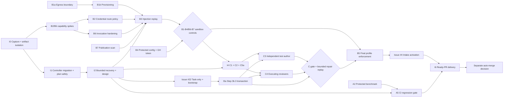

# Autonomous SSDLC: three non-postponable workstreams

Status: implementation plan, consolidated on 11 November 2026 against `df31917`. The former section 8 review is integrated below; section 8 now records traceability and completion criteria. Unless explicitly checked below, deliverables are planned. I0 is implemented for review under issue #23; integration and the issue #22 migration remain separate.

## 1. Objective, scope, and implementation policy

The operational target is one authorization of scope and limits, followed by a ready pull request without avoidable human intervention. Merge remains human for Tier M and L. Correct security refusals, product decisions, authentication failures and exhausted authorized limits remain legitimate stops; they are measured separately and never hidden from the intervention count.

| Workstream | Delivery | First priority |
| --- | --- | --- |
| A. Stop discipline and recovery | Durable candidate handoff, isolated artifacts, native plan/controller transitions, bounded design and repair, protected replay benchmark | Recover work without repeated developer dispatch or operator edits to runtime state |
| B. Containment | Restricted network and credentials, isolated dependency provisioning, hardened role invocation, publication checks | Establish an enforceable boundary before unattended GitHub intake |
| C. Independent correctness oracle | Protected acceptance tests, classified fail-before evidence, independent test author, executing reviewers | Reject real defects without creating repair loops from invalid tests or unsupported findings |

Implementation starts with the small stabilization increment in section 6. The entire plan must not be passed to one development invocation. Split each increment into scoped tickets with explicit target files, dependencies, limits and acceptance cases; an increment is a milestone, not a required single run. Aggregate internal tasks into a milestone PR when appropriate. Keep controller code modular; `orchestrator.py` coordinates transactions rather than accumulating every handler.

This plan complements `PLAN_TASK_ROUTING_AND_SUBGOALS.md`. Issue #22 retains its task-only, bootstrap and Step 3b.3 corrective-bounce scope. Issue #14 owns full provider accounting, issue #9 parallelism, issue #4 the GitHub adapter, and issue #3 authenticity. The runtime stabilization below precedes further issue #22 development; it does not replace that feature or declare its preserved candidate verified.

### 1.1 Autonomous profile and staged rollout

The final autonomous profile requires task mode, Docker isolation, candidate-proof convergence, the accepted B controls and the C oracle. Version 1 supports Python projects with an explicit quality-contract adapter. Its interface collects test identifiers and statuses, classifies failure witnesses, declares scratch/cache needs and supplies bounded mutation operators. Other languages require their own tested adapter; an unsupported target is refused before dispatch.

Existing legacy runs remain inspectable; they receive no new execution path or silent conversion. Task-only activation and historical-run refusal belong to issue #22. Stabilization may exercise the existing explicitly selected task mode before that activation is merged.

Before the full profile exists, development uses an explicitly authorized supervised bootstrap profile with its implemented controls and residual risks recorded. It must never advertise full autonomy or enable unattended intake. Each increment records which capabilities it adds. This avoids requiring the completed system in order to build its first increment.

No live run adopts this document's defaults, a new controller, changed inputs or larger limits implicitly. Real-model replay is disabled unless the operator has authorized its invocation, duration and applicable spend caps. Offline semantic-engine replay requires no provider access.

## 2. Evidence and limits of the current diagnosis

References below identify the starting revision or archived run; runtime archives are private evidence, not a publication allowlist. Public derivatives must pass B7.

| Observation | Source | Consequence |
| --- | --- | --- |
| The developer result and producer are not durably saved before secondary guards; a guard failure can leave a completed invocation recorded as `RUNNING` | `ssdlc_tasks.py`, `TaskScheduler.run`, result handling around lines 1338–1358 at `df31917` | Capture before secondary validation; resume verification without redispatch |
| Issue #22 T01 returned with source edits, then stopped on ten new root bytecode files; no trusted task checkpoint was completed | `.ssdlc/runs/issue22/diagnosis/preserved-T01/manifest.json`, original state and developer log retained privately | Use this case as the first recovery replay, not as proof of successful implementation |
| A child process clearing its environment bypasses parent Python cache settings; running a disposable copy leaves the authoritative source clean | `.ssdlc/runs/issue22/diagnosis/cache-reproducer/result.json` | Environment variables alone are insufficient isolation |
| Issue #22 required operator plan revisions for fixture scope and preservation of dependency order | `.ssdlc/runs/issue22/target/.ssdlc/ISSUE22-TASK-ONLY/02-design/revisions/plan-4` and `plan-5` | Native impact analysis and versioned plan amendments are required |
| Design can rewrite a growing ADR while retaining unresolved obligations; existing stagnation detection requires the same ADR hash and blocker IDs | `ssdlc_design.py`, `DesignSession`; issue #22 design history | Measure semantic progress and bound context, rounds and diagnosis |
| Issue #20 needed five operator recoveries and passed gates before two integration defects were fixed | PR #21 `delivery-provenance.json`; pre-fix `e1ebe76` and corrected `05cba13` | Add recovery replay and seeded-defect cases |
| Issue #20 reported 3h53m elapsed, about 73 minutes of model time and a 52-minute budget hold | PR #21 `timing-report.json` | Separate execution, waiting and operator time; do not sum overlapping durations |
| Role containers have unrestricted network access; developer execution receives credentials and a writable worktree | `orchestrator.py`, `_wrap_in_role_container`, `run_claude` | Add B controls before unattended issue intake |
| The developer authors implementation and tests; review/QA model calls do not themselves execute reproductions | `ssdlc_tasks.py`, developer prompt; `orchestrator.py`, `run_phase_review` and `run_phase_qa` | Add independent tests and isolated execution |

A textual count of `raise` statements is not a count of terminal interventions: exceptions may be caught, retried or used for validation. A3 inventories reachable failure paths and their handlers before making quantitative claims. Archived completion counts are reported only with a reproducible sample manifest.

Ignored-file membership checks and hash-chain validation are separate mechanisms. An unkeyed hash can detect unauthorized change when its reference is protected; it does not authenticate a history against an actor able to rewrite both data and reference. This plan preserves existing integrity checks until A1 supplies a specific, tested replacement. Stale Git locks and package-registry abuse are risks to test, not claimed incidents without an exact evidence reference.

## 3. Workstream A: durable recovery and measured autonomy

| Step | Deliverable | Acceptance |
| --- | --- | --- |
| A1. Threat model | Actor/capability matrix in `docs/threat-model.md`; trusted host/controller, untrusted issue and repository content, developer, test author, reviewers, external writers; per-check keep/reconcile/remove decision | Every changed integrity boundary names the actor, protected reference and residual risk; repository-to-agent and developer-to-reviewer flows are explicit |
| A2. Replay foundation | Pinned repositories, protected graders and semantic role/contract mocks under `tests/replay/`; on-demand live mode | Reproducible fixture manifest and per-case outcomes, interventions, stops, acceptance, time and invocations; engine completion and ready-PR delivery are distinct |
| A3. Stop registry | Map reachable stops to the existing ordered recovery matrix and its eight classes in `ssdlc_supervisor.py` | No new unregistered stop; legacy inventory debt can only shrink; each handler specifies preconditions, persistent allowance and exhausted outcome |
| A4. Recovery handlers | Seven contracts in section 3.1, implemented incrementally | Seeded crash, cache, timeout, limit, lock and transport cases reach the specified outcome without state edits or duplicate dispatch |
| A5. CI regression gate | Deterministic replay in `.github/workflows/test.yml`, using the metrics in section 3.3 | No new false blocks or escaped seeded defects; no increase in avoidable interventions on the pinned baseline; security cases cannot be removed or reclassified by the candidate |
| A6a. Plan impact and amendment | Fixture/API impact report and native reviewed plan revision | Scope changes preserve prior evidence, counters and required dependency order; crash/replay is idempotent |
| A6b. Design convergence | Bounded delta-based design, semantic progress report and diagnosis | Rewriting prose or renaming findings does not reset progress detection or allowance; stalled cases terminate with actionable evidence |
| A6c. Controller migration | Explicit compatibility-checked transition for a suspended run | Old and new controller identities remain recorded; old proof is not relabelled; failed migration leaves the original recoverable |

The registry reuses `transient_environment_provider`, `authentication`, `integrity`, `limits`, `code_defect`, `uncertain_outcome`, `operator_decision` and `unsupported_transition`. Preserve the existing matrix precedence; new reason codes refine these classes without creating a competing taxonomy.

### 3.1 Seven recovery contracts

1. **A4.1 Candidate capture and dispatch.** Persist dispatch intent and invocation identity before calling a provider. After return, or confirmed termination, establish writer quiescence and persist an immutable `candidate-captured` receipt before secondary guards. Bind task, attempt, base, controller, plan, quality contract, environment identity, termination/exit status, output digest or explicit absence, and source payload digest. Capture includes new files and deletions. `captured` means preserved, not authorized or verified. Unsafe/out-of-scope paths are recorded and blocked without following symlinks or importing them into trusted source. A partial capture remains explicitly incomplete. A crash between return and capture must reconcile the original invocation and workspace; uncertainty forbids another dispatch. Resume reuses a complete receipt and does not repeat the model call.
2. **A4.2 Preflight validation.** Validate launcher, cwd, runner and baseline regression checks before accepting an executable plan. Execute repository code only in isolated verification workers. Future acceptance files receive structural validation at planning and executable validation when authored; their intentional red state is excluded from the baseline preflight. Missing baseline dependencies or a broken harness are environment failures, not acceptance witnesses.
3. **A4.3 Artifact isolation.** Separate the disposable developer workspace from the authoritative candidate and from fresh verification workers. The controller transfers only approved source changes through a confined manifest, then seals the candidate. Tests, installers, build hooks and reproduction scripts execute in workers without host credentials, Docker socket or controller-state write access. Scratch/cache writes stay disposable even if a subprocess clears its environment. Python cache variables are defense in depth. Classify generated artifacts by the trusted adapter/scratch policy, never merely by `.gitignore`. Unknown files, protected changes, symlink escapes and out-of-scope source remain blocking; do not fix this with blanket ignored-file exemptions or blind deletion. Recheck source and environment bindings after verification.
4. **A4.4 Timeout recovery.** This is a new path, not `_recover_protocol_candidate`. Fence the old generation and confirm all role processes/writers are terminated before snapshotting. If quiescence cannot be established, retain `uncertain_outcome`. A confined, stable candidate may be verified without a completion marker, with `termination: timeout` and `unconfirmed_completion` retained. All ordinary source, scope, integrity and configured gate requirements still apply. Passing task checks yields a checkpoint, never immediate PR readiness. Failing code checks preserve the partial candidate for normal bounded repair; a harness failure routes to environment diagnosis. The timed-out dispatch consumes its original attempt; verification does not consume another development attempt, and a later repair dispatch consumes the next one.
5. **A4.5 Limits and accounting.** Freeze per-run invocation, wall-time and per-role/phase limits at authorization; persist reservation before dispatch and reconcile results exactly once. Subscription CLI dollar estimates are recorded as estimates, separately from metered API spend. Unknown costs remain unknown. No provider switch, resume, migration or repair resets limits. Derive a versioned limit profile from A2 samples with explicit headroom for added roles; a missing required cap refuses autonomous launch. Until a profile is accepted, supervised development uses explicit operator-authorized values. Full usage/billing reporting stays in issue #14.
6. **A4.6 Lock handling.** Keep stable `flock` files; kernel lock release is not permission to unlink them. A Git index lock is different and does not inherently identify its owner. Automatic cleanup requires a host-owned creation/ownership receipt, process identity including birth time, fencing and proof no associated Git writer remains. Missing ownership proof or ambiguous ownership requires a registered stop. Never infer safe deletion from age or a PID lookup alone.
7. **A4.7 Transport retry.** Use bounded backoff with jitter for retryable 429/503/504 and transport failures. Retry only when non-dispatch is proven, or the route/operation has tested replay safety; a nominally read-only role can still consume provider usage. An uncertain developer dispatch is never repeated. Transport retries, logical attempts and provider accounting are distinct, persistent and bounded by the total authorized limits.

Candidate lifecycle: `dispatch-reserved -> running -> candidate-captured -> verifying -> commit-intent -> checkpointed`. Secondary refusals retain the receipt and reason. Crash reconciliation is idempotent at every boundary, including partial payload/receipt publication and commit-intent. The implementation must use atomic publication and the existing journal/locking model, with explicit schema versions; these names describe the contract, not existing states.

### 3.2 Native plan, design and controller transitions

**A6a: fixture impact and plan revision.** Before plan approval, inspect changed public interfaces and existing test/fixture references; archive a host-generated impact report plus reviewer assessment. Static analysis is a hint, not a complete dependency proof. Plans separately declare implementation paths, acceptance tests, baseline test changes/retirements, shared test configuration and rationale. A request outside approved scope suspends dispatch and creates a versioned amendment bound to the prior plan and current candidate. Reuse native plan validation and independent review. Preserve historical plans, journal prefix, counters and checkpoints; verify DAG validity and preservation of required ordering when tasks merge or split. Invalidate affected tasks and descendants explicitly, then revalidate in topological order. Pure scope correction within the authorized goal may proceed under the frozen amendment policy; changed requirements, protected paths or larger limits require operator authorization. Never silently broaden `target_files`.

**A6b: design progress.** Keep the approved requirements catalogue and stable obligation references. Each round supplies a bounded ADR delta, open findings, attempted resolutions and evidence, with access to archived full context rather than repeatedly growing inline prompts. Progress means supported resolution or material new evidence against an obligation; changing hashes, wording or finding IDs alone is not progress. Two consecutive rounds without such progress trigger one bounded diagnosis/prototype step, within the frozen design and ticket invocation limits. Reuse an existing diagnosis allowance where applicable; otherwise reserve a separate named allowance at authorization, never allocate an implicit extra call. A prototype executes in a disposable worker and grants no implementation authority. If the next authorized round still makes no progress, or no allowance remains, stop with the unresolved cases and recommended split/amendment. Uncertainty or missing environment prerequisites do not trigger blind rewrites. The initial five-round design limit is retained unless explicitly changed; no automatic sixth round.

**A6c: controller migration.** A run continues on its pinned controller by default. Migration requires a stopped/fenced run and an explicit authorization naming old/new controller digests, schema compatibility and candidate/input identities. Publish an intent, preserve the original journal/evidence, validate the converted projection, record invalidated proofs and commit a new generation atomically. Resume performs no model dispatch until this transaction is complete. All limits and consumed attempts carry forward. Changed controller/environment bindings require fresh checks and affected gates; historical approvals remain historical. Crash recovery finishes or rejects the same migration idempotently. Unsupported transitions produce a registered refusal or a linked fresh run with imported source treated as unverified; neither path fabricates a prior checkpoint. Session-context resume is a later optimization, not a prerequisite for file-based candidate recovery.

For an older run stopped before the capture receipt existed, support an explicitly authorized import of the preserved snapshot. Bind the original run/task/attempt, base, plan, controller and available logs to a new import receipt; retain unknown producer metadata as unknown. Do not invent an earlier completion event or trust self-reported checks. Keep the original attempt charged, perform fresh verification, and record that adoption occurred under the new controller. Missing attribution cannot authorize redispatch; ambiguous source identity requires an operator decision. This is the compatibility case required for issue #22 T01.

### 3.3 Benchmark authority and metrics

The host owns graders, expected outcomes, fixture commits and baseline policy outside candidate write access. Candidate-authored assertions or reclassification do not set their own pass criteria. Start with issue #20, the issue #22 capture/cache case, a Tier S ticket and one seeded case per new handler; record fixtures and exact source revisions rather than relying on archive counts.

Record separately: engine completion, verified checkpoint, ready PR, correct rejection, expected policy stop, false block, escaped defect, total human interventions, avoidable interventions, invocations, first-pass task acceptance, model duration, verification duration, operator wait and elapsed wall time. A correct rejection that still needs a person increases total interventions; it is not reclassified away. An expected policy stop is an outcome specified by the protected scenario, not a blanket name for code rejection. For a repairable-defect scenario, success requires repair and fresh gates within limits.

A5 gates avoidable interventions and correctness on fixed comparable cases. New justified security refusals may raise total stops while passing the security scenario's explicit expectation; report the change and preserve positive controls. Baseline changes require separate reviewed justification and before/after results; adding a role must not silently grant a larger benchmark budget. Time and invocation regressions are reported against explicit tolerances in the accepted baseline, not universal guessed thresholds.

Live replays run only on demand within their authorized caps. Deterministic replay runs on each PR. Report escape rates with numerator, denominator and corpus version. Before the C gate, include at least ten independently verified behavioral defect cases spanning multiple failure types, including both issue #20 integration defects; a `fix` commit or a generated mutant is only a source of candidates until a protected test demonstrates the defect. Zero escapes on this finite corpus is required and is not a guarantee of general correctness.

## 4. Workstream B: containment and publication

The trusted host orchestrates isolated workers; it never executes untrusted test code or dependency hooks directly. The boundary protects against untrusted repository/issue content and role execution within the sandbox. A privileged host compromise or external writer able to replace both records and their trusted references is outside the guarantee and must be stated in A1.

| Step | Deliverable | Acceptance |
| --- | --- | --- |
| B1a. Egress boundary | Internal role network; only a controlled proxy/gateway can reach approved provider operations. No direct DNS, alternate proxy, unrestricted CONNECT, IP-literal or redirect bypass. Verification workers have no network by default; declared exceptions require approved destinations and operations | Negative bypass tests and positive provider/streaming controls pass; undeclared verification network is refused |
| B1b. Dependency provisioning | Host orchestrates a dedicated, credential-free provisioning container with registry-only egress and no worktree write access; hash-verified locks produce a read-only environment layer | Unpinned installation and hash mismatch fail closed; role workers cannot reach registries or mutate the provisioned layer |
| B2. Host credentials | For supported API routes, a host-side gateway overwrites authorization for approved upstream operations; workers receive only placeholders. Subscription routes follow the spike below | Valid authentication, streaming and renewal work without keys in worker output/logs; attacker-supplied authorization cannot select an attacker account |
| B3. Injection replay | Goal/repository/dependency injections, malicious settings/hooks, reviewer-addressed comments and publication canaries | No successful unauthorized request, unpinned installation or canary publication; legitimate traffic still succeeds and the known defect is still rejected |
| B4. Delivery and protected configuration | Host-only repository-scoped GitHub token; CI, manifests, locks and role-control files are protected. Plan and post-execution guards enforce the boundary | Unauthorized changes stop as `operator_decision`; no role receives `GITHUB_TOKEN`, `GH_TOKEN`, host credential directories or publication authority |
| B5. Profile enforcement | Check the selected profile and actual runtime on every unattended start/resume; refuse local, legacy, unsupported adapter, missing lockfile or missing required isolation | Each unsupported case is refused before dispatch with a registered reason; historical runs remain inspectable |
| B6. Role invocation hardening | Trusted isolated runtime configuration, explicit role tool allowlists, no project MCP servers/hooks or automatic instruction loading, no provider-side web tools | Malicious project hook never runs; seeded defective candidate receives the same correct verdict with and without reviewer-addressed instructions |
| B7. Publication boundary | Host scans the exact immutable outgoing snapshot: pushed commits and messages, PR body, comments, evidence and logs; release assets and archives are inspected before upload | A canary in any outgoing surface blocks publication and retains local state; clean content publishes idempotently without switching to an unscanned payload |

### 4.1 Provisioning prerequisites

Create a hash-verified lockfile for this repository in an operator-authorized bootstrap ticket. Pin agent CLIs, uv and other runner tools to exact versions and verified artifacts in both `Dockerfile` and `--update-tools`; remove ignored installer failures and disable in-container self-update. Locks cover transitive dependencies. Lockfile changes require explicit approval and provenance; hashes verify selected artifacts, not their safety.

Key provisioned layers by lockfile hash, platform, base image, toolchain and provisioning policy, not lockfile alone. Build/install hooks remain untrusted and isolated. A target needing undeclared downloads, a missing lock or unavailable provisioned artifacts is refused before development in the autonomous profile. Supervised bootstrap may create these prerequisites under its explicit authorization.

### 4.2 Credential and CLI spikes, with binding outcomes

Run B2 and B6 capability spikes alongside initial stabilization without consuming another run's provider allowance. Record tested CLI versions, route, effective config loading, hooks/MCP behavior, tool restrictions, authentication, refresh and streaming. Treat proposed Claude flags such as `--setting-sources`, `--strict-mcp-config` and `--tools` as capabilities to test, not portable guarantees; verify equivalent behavior for every enabled engine. Verify subscription compatibility before considering `--bare`. Fail closed for an engine/version whose effective restrictions cannot be established.

A forward CONNECT proxy alone cannot inject authorization into opaque TLS. The spike must establish a supported host-side auth gateway/adapter and effective upstream operation restrictions. Do not claim credential isolation from a hostname allowlist. Test redirects, alternate authorization mechanisms, account selection and provider-side tools as well as direct network paths.

If a subscription CLI requires readable credentials, an explicitly authorized profile may use minimal read-only mounts, with B1a and B7 active and `credential_exposure` recorded. Read-only credentials are still readable and usable; allowed provider endpoints and model input remain residual channels. Exact-value scans do not detect every encoding or transformed secret. If the threat policy forbids this exposure, exclude that route from the autonomous profile. API routes that meet the stronger boundary remain usable. Residual-risk acceptance is a versioned operator policy, not a model decision or an implied approval from this plan.

### 4.3 Instruction and publication controls

Protect existing runtime paths plus `.claude`, `CLAUDE.md`, `AGENTS.md`, `.mcp.json` and equivalent engine configuration at all relevant ancestor/nested locations. Reject unauthorized task manifests and resulting diffs affecting them. Disable automatic repository settings/instruction discovery; only quality-contract-approved standards enter gate/test-author context as attributed untrusted content. Quoting is defense in depth, not an injection-proof boundary. Tool allowlists do not replace network/filesystem controls, especially where shell execution is available.

B7 checks gitleaks rules, live credentials by value in host memory without logging them, and benchmark canaries. Scan the entire outgoing commit range, not just its tip. Bind a scan receipt to the exact published bytes/object identities and policy version; mutations require a new scan. Parse supported archives safely; unsupported or uninspectable content is refused. Do not silently redact source changes and publish a different unreviewed candidate. Secret-bearing raw transcripts and runtime state remain private. Publication/attachment authorization and evidence retention policy remain with issue #4; B7 supplies its mandatory prepublication control.

B3 includes at least: an outside-host/DNS request, an unpinned package request, a project hook writing a marker, an instruction file requesting approval, reviewer-addressed comments beside a seeded defect, attacker-supplied provider authorization, and a canary in source, commit message and final output. A denied tool action is recorded; it ends the ticket only when the recovery policy requires it. A benign denied request must not create an unconditional terminal stop.

## 5. Workstream C: an independent, executable oracle

The host validates records and schedules work; candidate tests and reproduction scripts execute only in fresh B-compatible sandbox workers. No acceptance or reproduction result has authority merely because a model claims it.

Before C3/Step 3b.3 is available, I4 uses protected acceptance fixtures authored and reviewed in its implementing tickets. It does not claim independent runtime test authorship or automatic dispute repair. An unresolved adequacy/dispute case produces a measured registered stop; later activation connects the same records to C3 and the corrective transaction.

| Step | Deliverable | Acceptance |
| --- | --- | --- |
| C1. Seeded-defect corpus | Protected demonstrated defects and known-good controls, with numerator/denominator reporting under A2 | Both issue #20 integration defects are rejected; controls pass; the section 3.3 corpus requirement is met before the C gate |
| C2. Dual-catalogue proof | Baseline Regression Suite plus New Acceptance Criteria Suite, frozen and versioned; classified witnesses and test inventory | Valid feature witness fails before and passes after; harness errors and undeclared weakening cannot satisfy the check |
| C3. Independent test author | Separate role/context before development; different model where available, requirements/public-interface context without developer output; protected acceptance checkpoint | Developer cannot edit frozen acceptance tests; disputes are bounded and amendments are reviewed and versioned |
| C4. Executing reviewers | Disposable reproduction workers, typed outcomes and evidence-bound findings | Real behavioral defects remain blocking; failed reproductions are diagnosed, and unsupported claims cannot trigger unbounded repair |
| C5a. Targeted adequacy | Bounded relevant mutation/sentinel probes for `missing_target` witnesses | Vacuous tests fail a demonstrated relevant probe; invalid/equivalent mutants or inconclusive execution never fabricate a pass or rejection |
| C5b. General mutation sampling | Optional broader quality-contract check | Advisory evidence only until a separately reviewed baseline justifies a blocking policy |

### 5.1 Test catalogue and fail-before semantics

Capture the baseline regression inventory on the start commit in a provisioned worker. Record identifiers, collection result, skips/xfails and configuration digest. Baseline tests stay green on the candidate. Deletion, rename, newly skipped/expected-failure status, assertion changes and shared runner/configuration changes require a declared, independently reviewed plan amendment with rationale and preserved obligation coverage. Merely declaring a path is insufficient approval to weaken coverage. New quarantine entries follow section 5.2.

Classify acceptance intent per approved obligation:

| Intent | Before/after requirement |
| --- | --- |
| Behavior change or bug fix | Relevant assertion fails on the start commit and passes on the candidate |
| New approved public interface | `missing_target` may witness the exact planned interface's absence; candidate must execute meaningful assertions and satisfy C5a |
| Coverage-only addition | May pass both versions; record coverage intent and adequacy evidence, never claim it demonstrates a behavior change |
| Pure refactor or fixture adaptation | Baseline behavior/coverage preserved; no blanket requirement that changed tests fail on the start commit; document any equivalence exception |

Only a pertinent `assertion` or validated `missing_target` is a fail-before witness. Syntax errors, unclassified test collection failures, missing third-party dependencies, incorrect invocation, timeout and unrelated import/attribute failures are `execution_error` or `inconclusive`. A collection failure caused specifically by the approved missing interface may qualify as `missing_target`; an import error alone is insufficient. Validate the intended public symbol against requirements/ADR and the dependency manifest before accepting missing-target evidence. Retain adapter-specific classification and logs. New acceptance tests do not enter the green baseline preflight until the implementation checkpoint satisfies them.

C5a uses a deterministic bounded set of probes against the relevant behavior, recorded in the quality contract. Report `killed`, `survived`, `invalid`, `equivalent_or_unknown` and `execution_error` separately. A syntactically broken mutant is invalid, not killed. Zero kills is a diagnosis trigger, not proof of vacuity: establish a relevant non-equivalent sentinel that a meaningful test should reject. If it survives, request test-author correction; if adequacy remains unprovable, record `inconclusive` and use the bounded dispute path. Do not auto-approve or reject solely from arbitrary mutant selection. Seed an `assert True` case plus equivalent-mutant and unavailable-runner controls.

### 5.2 Unstable tests

One rerun in a fresh equivalent worker is allowed to distinguish repeatability, within verification and ticket limits. Fail then pass is `unstable`, not automatically `transient_environment_provider` and not a passing gate. Diagnose whether baseline/environment or candidate introduced the instability. An accepted baseline quarantine requires a protected quality-contract entry, rationale, expiry/review condition and independent approval; the developer cannot add it. Quarantined tests remain reported and cannot supply fail-before proof. New candidate instability remains unresolved until fixed or explicitly adjudicated under policy.

An intermittent defect can have valid reproduction evidence from one observed occurrence. Report repeat counts and artifacts; do not require two failures to acknowledge it. A pass on rerun does not erase the observed failure. Reproduction frequency is evidence for diagnosis, not an automatic validity threshold.

### 5.3 Test-author independence and dispute

C3 uses existing public CLI/API entrypoints and approved new interface definitions, never guessed private methods. With a single provider, a different model in a fresh context may be used; record `reduced_independence`. If only the same model is available, record the same reduction and enforce fresh context and protected tests. Neither configuration is eligible for auto-merge without a separately accepted independence policy. Tier S uses existing public interfaces; introducing a new interface requires Tier M design.

Disputes retain the test, objection and obligation evidence. At most two test-author correction rounds are allowed, within the frozen global invocation/wall-time budget and the authorized amendment allowance. Correcting a test versions its protected checkpoint and invalidates affected proof. Test correction is not an implementation attempt. Development repair uses Step 3b.3 and consumes the next persistent development attempt; neither path resets the other or creates a second scheduler. If the dispute concerns requirements or exceeds bounds, stop with a registered decision request.

### 5.4 Reproduction and finding disposition

C4 records `reproduced`, `not_reproduced`, `execution_error` or `inconclusive`, binding candidate, environment, command, result and log digest. A behavioral blocker normally needs an observed, host-validated reproduction. A concrete static counterexample or a demonstrable missing security/standards obligation can also support a blocker; an obligation identifier alone cannot. Such evidence records exact location, violated requirement and reasoning for review.

`not_reproduced` does not automatically dismiss a finding; `execution_error` does not count as disproval. Diagnose once in a fresh worker, then request one independent adjudication if still needed, subject to a named persistent allowance and total limits. Retain valid intermittent/static evidence. Only an explicitly adjudicated unsupported or disproved claim is closed without code repair, with rationale. Remaining uncertainty becomes a registered stop, not approval. Adjudication may interpret evidence but cannot override host integrity or modify requirements.

Confirmed, attributable defects enter the Step 3b.3 transaction: authorize roots, invalidate affected tasks/dependents, repair and revalidate topologically, then repeat affected global gates. Ambiguous roots, scanner/harness failures or requirement changes route to diagnosis/amendment rather than guessed repair roots. C3 disputes and C4 reuse this transaction infrastructure with distinct typed actions and counters under the same frozen ticket limits. Immutable bounce previews remain non-authorizing.

## 6. Implementation increments, dependencies, and rollout

The following order is binding; unrelated work may run in parallel only after the listed prerequisites exist. Every increment carries its contract cases, offline regressions, schema compatibility note and evidence summary in the same PR. New runs use the latest merged controller, pinned at launch. Already-running controllers remain frozen.

| Increment | Scope and prerequisites | Exit criterion |
| --- | --- | --- |
| I0. Capture and isolation stabilization | Minimal A1 capability decisions, A2 issue #22 fixture, A3 mappings for new reasons, A4.1 and A4.3; develop with offline semantic engines in a separate branch | Completed developer work survives secondary failure/crash; fresh verification leaves source unchanged; no second developer call; malicious/protected/out-of-scope changes still stop |
| I1. Native continuation and plan safety | I0; A6c, then A6a and A4.2; A2 issue #20 and Tier S fixtures | Controller migration and plan amendments survive crash; original counters/history/order survive; preserved issue #22 T01 can enter fresh verification through an explicit authorized transition |
| I2. Bounded recovery and design | I1; A3 inventory, A4.4–A4.7, A6b and initial A5 gate | Timeout, retry, limits, locks and design-stagnation scenarios converge or produce the expected registered stop; no operator state edits |
| I3. Containment | B1a and B2/B6 spikes may start alongside I0; then B1b, B2, B4, B6, B7, B3 and B5 refusal tests, using A2/A3 | B sandbox controls and route-specific residual-risk decisions are accepted; outgoing scan and network controls pass; B5 final-profile activation waits for I5b |
| I4. Oracle foundation | I1/I2 plus I3 sandbox controls; C1, C2 and C5a | Classified witness, inventory, mutation and instability cases pass; correct rejections count honestly even before automatic repair exists |
| I5a. Corrective loop | I2; resume issue #22 task-only/bootstrap work and complete Step 3b.3; may proceed alongside I3/I4 | Seeded attributable defects enter a real authorized corrective transaction, preserve attempts and revalidate tasks/dependents/global gates |
| I5b. Independent roles | I3/I4 and I5a before C3/C4 activation | Seeded defects are repaired and freshly re-gated without operator action; test disputes/adjudication respect persistent limits |
| I6. Integrated delivery | A5, all B, C1–C4/C5a and corrective-loop acceptance; connect issue #4 | Authorized issue reaches a ready PR with fresh evidence and no avoidable intervention; duplicate/out-of-order GH events do not duplicate work |

I0 is a small direct implementation/bootstrap PR, not another attempt to execute the full autonomy plan. Do not resume paid issue #22 development merely because this document is updated. First merge/test stabilization, then migrate the suspended run through I1 with explicit controller/input authorization and its existing limits. Preserve the original unverified T01 source and evidence until reconciliation completes. If the source fails fresh checks, repair it through the authorized workflow; never import the old self-reported test results as trusted proof.

I3 implements B5 checks and tests profile refusals using fixtures; its final autonomous-profile positive control waits for I5b. I4 needs the accepted B sandbox controls, not activation of the final profile. This separates containment from final capability enforcement and avoids a circular prerequisite. Intake adapter development may proceed earlier using synthetic events; live unattended activation requires all B controls and B5's final profile, including the C oracle. The C gate requires the protected corpus minimum, zero seeded escapes, valid known-good controls and bounded corrective replay. Auto-merge remains disabled; passing these gates only enables a separate policy decision.

Issue #9 parallel execution remains after the corrective loop and integration contract. C5b remains optional advisory work. Step 6 of the existing roadmap adds its S/M/L, resume, advisory and concurrency scenarios to A2 rather than creating another benchmark. Existing roadmap work after the task-only/bounce milestone resumes once these runtime and workflow prerequisites are accepted.

### 6.1 I0 acceptance matrix

Run these cases without live providers, credentials or manual repair scripts; use deterministic engines that emit the expected role contracts.

| Case | Required outcome |
| --- | --- |
| Developer completes, then an ignored-file or secondary guard fails | Durable receipt and source payload remain; resume performs reconciliation/verification with exactly one developer dispatch |
| Child clears environment and generates root/nested caches | Disposable artifacts stay outside authoritative source; source hashes and protected inputs remain unchanged |
| Developer changes a protected path, escapes via symlink or adds out-of-scope source | Candidate is preserved safely and refused; no imported unauthorized path, blanket ignore or silent cleanup |
| Crash before dispatch, after dispatch, during capture, before/after receipt publication and during commit-intent | No torn accepted receipt, counter reset or duplicate dispatch; uncertain outcome stays explicit where reconciliation is impossible |
| Verification writes files or child processes continue writing | Writes remain disposable; authoritative snapshot stays stable; live writers prevent capture/adoption |
| New source files and deletions are part of the approved patch | Exact payload is transferred once and verified; cache isolation does not discard legitimate code |

The initial PR may add only this focused fixture subset. Later increments add their own cases before enabling their handler; passing I0 does not claim all A/B/C controls are implemented.

## 7. Contracts, risks, and implementation readiness

The following contracts are normative requirements for the implementing tickets. Each ticket materializes its affected contract as versioned schemas, transition tables and concrete expected outcomes before activating a handler. This is implementation work within that ticket, not another global approval phase.

| Contract | Required bindings and negative cases |
| --- | --- |
| Candidate/dispatch | Invocation, payload, controller, plan, contract and environment; partial capture, uncertain dispatch, quiescence, timeout and crash publication |
| Plan/controller revision | Prior/new identities, authorization, journal ancestry, DAG/order, invalidated proof, counters and atomic migration recovery |
| Containment/publication | Effective actor capabilities, gateway/provisioning policy, engine-version restrictions, credential exposure and exact outgoing content scan |
| Oracle | Test inventory/intent, protected checkpoints, classified witnesses, mutation adequacy, instability and reproduction/adjudication outcomes |
| Benchmark/delivery | Protected case expectations, total versus avoidable interventions, source/controller bindings, metric denominator and ready-PR criteria |

Ready PR means the current source commit/tree is clean and checkpointed; all required task/global review, QA, AppSec and quality-contract gates apply to that candidate with valid bindings; no unresolved blocker remains; evidence has passed the publication policy; and issue #4 has created/updated the correct PR idempotently. Before issue #4 is available, report verified engine completion separately from any operator-performed publication. An evidence pack contains selected canonical requirements/design/plan, gate/proof summaries, sanitized logs and provenance with hashes and omissions; raw provider transcripts, credentials and full private runtime state are excluded. Changed source, controller, contract or unproven environment identity invalidates reuse under the existing candidate-proof rules.

| Risk | Required treatment |
| --- | --- |
| Every stop is declared human-required | A5 compares protected expected outcomes and avoidable interventions; a registry alone is not improvement |
| Stronger controls add justified stops | Preserve positive controls and report total interventions; security expectations may change only through reviewed baseline changes |
| Subscription credentials remain readable or secrets are encoded | Explicit route-specific residual risk; restricted operations plus B7; no claim that scanning or proxy allowlists prevent every leak |
| Dependency artifacts or hooks are malicious | Hash verification plus isolated provisioning; lock authorization and artifact provenance; no host execution |
| Test or grader tampering, flaky tests, equivalent mutants | Protected references, typed evidence and bounded diagnosis; no automatic quarantine or pass-on-rerun |
| Incorrect test-author assumptions or inconclusive findings | Public-interface scope, independent adjudication and explicit amendment; no repair against invented private interfaces |
| Design/test/reviewer roles inflate cost | Delta context, per-role and total frozen limits, persistent counters, baseline reporting and no implicit re-baselining |
| Git lock ownership cannot be established | Preserve it and stop; age alone never authorizes removal |
| Changed controller makes historical proof incompatible | Explicit migration with fresh proof; original records stay immutable |

Implementation defaults are fixed here: Python v1, task-only final profile, human Tier M/L merge, no auto-merge activation, two test-author dispute rounds, one fresh reproduction rerun and one independent adjudication at most, and semantic stagnation diagnosis after two no-progress design rounds. All are subordinate to smaller existing authorized allowances. Test-author rounds and adjudication require named allowance entries at launch; missing allowance never grants an extra inference. Accepted baseline-derived time/invocation profiles and route capability reports are deliverables of A2/A4.5 and the B spikes, respectively. Until accepted, those routes/profiles remain disabled or explicitly supervised. No unresolved capability assumption blocks starting I0.

## 8. Integrated review traceability and completion checklist

Sections 1–7 are the implementation specification. This section records where the former review items landed; it contains no alternative pending rules. Historical P/R shorthand has been removed from the specification in favor of named deliverables.

| Former item | Integrated requirement |
| --- | --- |
| G1: bounce dependency | Sections 5.3–5.4 and I5a/I5b; Step 3b.3 precedes C3/C4; typed counters share frozen ticket limits; correct refusals still count honestly |
| G2: repository instructions and tools | A1, B4/B6, sections 4.2–4.3 and B3 malicious hook/reviewer-comment cases |
| G3: host publication and credential fallback | B2/B7, exact outgoing snapshot scans, gateway capability spike and explicit residual channels |
| G4: weak fail-before and baseline tampering | Sections 5.1–5.2; intent-specific witnesses, approved inventory/config changes and C5a relevant probes with inconclusive outcomes |
| G5: timeout candidate recovery | A4.4; distinct path without marker, fenced writers, persistent attempt and ordinary gate requirements |
| G6: profile, language and provisioning scope | Section 1.1, B1b/B5 and section 4.1; explicit bootstrap profile prevents circular prerequisites |
| M1: unstable tests | Section 5.2; instability is not environment attribution or automatic acceptance; one occurrence can demonstrate an intermittent defect |
| M2: defect corpus | C1 and section 3.3; verified history-derived cases, minimum ten, denominator and known-good controls |
| M3: limit values | A4.5 and section 7; accepted versioned profiles or explicit supervised caps, no live-run increase |
| M4: independence/Tier S | Section 5.3; fresh context, reduced-independence evidence and public-interface tiering |
| M5: undefined R labels | Removed historical labels from normative requirements; this map retains named review provenance |
| M6: unsupported evidence | Section 2 distinguishes observations, mechanisms and risks; removes unsupported terminal-count and lock-incident claims |
| M7: inconclusive findings | Section 5.4; bounded diagnosis/adjudication, concrete static evidence and explicit closure instead of automatic dismissal |
| M8: missing dependencies | Section 6 provides increment prerequisites and the dependency diagram; A2 feeds A5, all B gates intake and bounce gates C3/C4 |
| Follow-up: actual issue #22 blockers | I0/I1, A6a–A6c, cache-cleared-environment replay, preserved unverified source and explicit migration |

Completion is demonstrated, not inferred from merged schemas or individual unit tests:

- [x] I0 replay passes with zero live model calls and exactly-once developer dispatch in recoverable cases (issue #23; see `docs/candidate-capture.md` and its offline evidence).
- [ ] A4 and A6 fault cases preserve source, history, counters and explicit uncertainty across restart.
- [ ] A5 uses protected scenarios and reports total/avoidable interventions and justified refusals separately.
- [ ] Every enabled route passes B capability, bypass, positive-control and publication cases; residual exposure is authorized explicitly.
- [ ] C2/C5a distinguish real witnesses, test intent, harness failures, unstable tests and inconclusive mutation evidence.
- [ ] C3/C4 integrate with the real corrective transaction and persist all bounded allowances.
- [ ] The C corpus meets its minimum with zero seeded escapes and passing known-good controls.
- [ ] Issue #4 delivers a ready PR from the authorized profile without operator state repair; public evidence matches the actual candidate.
- [ ] Existing task-routing milestones remain tracked separately; this plan's completion does not imply advisory, parallel execution or auto-merge is shipped.
