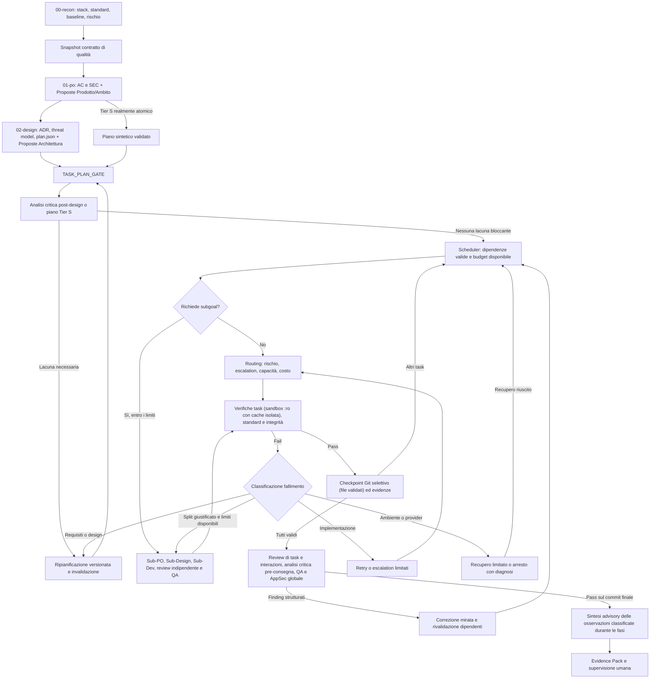

# Piano di implementazione: task verificabili, routing granulare, subgoal e advisory multilivello

## 1. Obiettivo e invarianti

Evolvere l'esecuzione monolitica di `03-dev` in [orchestrator.py](orchestrator.py) verso uno sviluppo autonomo per task, mantenendo standard qualitativi elevati e uniformità di codice, architettura e interfacce nel progetto destinatario.

Il risultato atteso comprende:

1. **Contratto di qualità condiviso e versionato**, ereditato da ogni task e subgoal, con controlli eseguibili e criteri di review.
2. **Piano strutturato** (`02-design/plan.json`), validato prima dello sviluppo, con dipendenze, contratti, requisiti e verifiche.
3. **Scheduler sequenziale su DAG**, riprendibile dopo interruzioni, con checkpoint Git e invalidazione delle evidenze quando cambiano gli input.
4. **Routing per capacità e rischio**, ottimizzato per costo dopo aver soddisfatto i vincoli di qualità, con escalation motivata dal tipo di fallimento.
5. **Subgoal con limiti e invarianti ereditati**, per sottoproblemi che richiedono specifica o design dedicati.
6. **Consegna legata al commit verificato**, con evidenze preservate e controlli globali di integrazione.
7. **Advisory multilivello continuo**, che cattura e categorizza proposte di miglioramento a livello di codice, architettura, prodotto e ambito emerse durante il ciclo di vita del ticket, senza generare scope creep nel diff corrente.

Invarianti obbligatori:

- La scomposizione non riduce tier, mitigazioni di sicurezza o gate obbligatori del ticket.
- Nessun task è completato solo perché il modello termina con exit code zero o produce un diff.
- Ogni requisito segue la catena `AC/SEC → task → verifica → risultato → commit verificato`.
- Task e subgoal ereditano gli stessi standard; un figlio non può ridefinire gli obiettivi del padre.
- Solo l'orchestratore modifica piano approvato, stato, ledger ed evidenze. Gli agenti di sviluppo modificano il codice nel worktree assegnato.
- Review e QA approvano una revisione identificata. Nuove modifiche invalidano le attestazioni interessate.
- Retry, ripianificazione e subgoal consumano un budget comune e non azzerano i contatori al riavvio.
- Un finding bloccante o una lacuna necessaria alla correttezza del ticket non possono essere riclassificati come advisory per ottenere il passaggio dei gate.
- Ogni proposta distingue osservazioni dimostrate e ipotesi, conserva la provenienza e richiede una decisione esplicita prima di diventare nuovo lavoro.

La prima versione usa **un solo esecutore per ticket e un solo worktree condiviso sequenzialmente**. Worktree separati per subgoal e parallelismo sono evoluzioni successive.

## 2. Flusso esecutivo target



Ogni arco di recupero è soggetto ai limiti globali. Un gate fallito, una verifica assente o un limite esaurito non possono essere trasformati in successo.

## 3. Contratto di qualità del progetto

### 3.1 Ricognizione e snapshot

Estendere `00-recon` e `_gather_repo_context` per identificare configurazioni e convenzioni effettive: istruzioni del repository, formatter, lint, type checking, test, confini architetturali, client API, logging, gestione degli errori, design token e componenti riutilizzabili.

Produrre `.ssdlc/<ticket>/00-recon/quality-contract.json`, con versione dello schema e revisione del contratto, contenente:

- Fonti e hash degli standard applicabili, relativi ambiti e precedenza esplicita in caso di conflitto.
- Comandi di controllo strutturati come argomenti, directory di lavoro, timeout e prerequisiti.
- Regole automatiche e regole che richiedono review semantica, identificate da ID stabili (`STD-*`).
- Confini di modulo, contratti pubblici e catalogo delle primitive da riutilizzare, riferiti al codice esistente.
- Baseline dei controlli sul commit iniziale, con difetti preesistenti distinti dalle regressioni.
- Eccezioni motivate, ambito, responsabile dell'approvazione e scadenza; un agente di sviluppo non può introdurre deroghe per far passare un gate.

Lo snapshot è incluso negli artefatti protetti. Una modifica degli standard richiede una nuova revisione e rivalidazione dei task interessati. Se mancano strumenti o configurazioni, il piano deve prevedere il loro bootstrap oppure registrare una limitazione che impedisce di dichiarare soddisfatto il relativo gate. I controlli falliti non si disabilitano automaticamente.

### 3.2 Standard generali e adattamenti di progetto

Separare i template generali dagli adattamenti specifici oggi presenti in `standards/` per yuna. Aggiornare `setup-ssdlc.sh` per installare solo standard applicabili, senza imporre percorsi, framework o componenti inesistenti nel progetto destinatario. Risolvere conflitti con le convenzioni del repository prima dell'esecuzione.

Sostituire le regole UI specifiche del progetto incorporate nei prompt con riferimenti al contratto. Lo stesso meccanismo deve coprire API, database, backend, documentazione e infrastruttura. Gli aggiornamenti del catalogo sono proposte validate rispetto al codice consegnato; non diventano automaticamente nuovi standard solo perché un agente ha creato un componente.

## 4. Schema e validazione di `02-design/plan.json`

### 4.1 Esempio del formato target

Esempio illustrativo: gli ID e i comandi devono esistere nel contratto e nel repository destinatario.

```json
{
  "schema_version": "1.0",
  "plan_revision": 1,
  "ticket_id": "TKT-001-auth",
  "execution_strategy": "sequential_dag",
  "base_commit": "0123456789abcdef0123456789abcdef01234567",
  "quality_contract_ref": "00-recon/quality-contract.json",
  "tasks": [
    {
      "task_id": "T1-token-contracts",
      "title": "Definire tipi e contratti degli errori di autenticazione",
      "description": "Riutilizzare le convenzioni API fissate nell'ADR.",
      "depends_on": [],
      "target_files": ["src/auth/models.py", "tests/unit/test_auth_models.py"],
      "ac_refs": ["AC-1"],
      "sec_refs": [],
      "standard_refs": ["STD-API-ERRORS", "STD-PYTHON-STYLE"],
      "profile": "BOILERPLATE",
      "complexity": "simple",
      "kind": "task",
      "contract_refs": ["adr.md#token-schema"],
      "verification": {
        "mode": "automated",
        "checks": [
          {
            "check_id": "CHECK-T1-MODELS",
            "argv": ["python3", "-m", "pytest", "tests/unit/test_auth_models.py"],
            "cwd": ".",
            "timeout_sec": 120,
            "ac_refs": ["AC-1"],
            "sec_refs": []
          }
        ],
        "quality_check_refs": ["CHECK-LINT", "CHECK-TYPES"]
      }
    }
  ]
}
```

### 4.2 Classificazione, granularità e gestione dello sconfinamento file

- `complexity`: `simple | standard | critical`. Il numero di file è un indicatore, non una misura sufficiente di difficoltà o rischio.
- `profile`: `BOILERPLATE | ALGORITHMIC | SECURITY | DATABASE_MIGRATION | FRONTEND_UI | FULLSTACK | REFACTOR | TESTS | DOCS`.
- `kind`: `task | subgoal`. Sostituisce la duplicazione tra `complexity=subgoal` e `promote_to_subgoal`; un subgoal dichiara anche `subgoal_reason`.
- Test, documentazione e UI non sono semplici per definizione. Contano comportamento, invarianti, incertezza e impatto.
- Ogni task deve avere un risultato verificabile e contratti di ingresso/uscita comprensibili ai task dipendenti.
- `contract_refs` identifica decisioni e interfacce usate o prodotte. L'incertezza architetturale sostanziale porta a design dedicato, non a task descritti solo come liste di file.
- `target_files` indica l'ambito previsto, inclusi i test. La gestione degli sconfinamenti distingue tra:
  1. **File accessori nello stesso modulo**: l'orchestratore può estendere il manifest locale senza consumare una revisione formale del piano solo dopo aver accertato che non cambino contratti pubblici, dipendenze, configurazione/efficacia dei controlli, confini architetturali o rischio. Il nome del file non basta: export in `__init__.py`/`index.ts`, fixture in `conftest.py` e snapshot possono avere effetti estesi e richiedono analisi semantica.
  2. **File assegnati o completati da altri task**: richiedono valutazione d'impatto sui task interessati e invalidazione delle relative evidenze e dei dipendenti transitivi, con rivalidazione topologica (§5.3). Un'estensione locale non può eludere questa regola.
  3. **Sconfinamento critico o cross-modulo**: nuovi domini del contratto, modifiche a DB/infra/dipendenze o variazioni di contratti pubblici e controlli richiedono arresto del tentativo, valutazione d'impatto e aggiornamento formale del piano (`plan_revision + 1`) prima di proseguire.
  4. **Percorsi protetti**: restano vietati all'agente di sviluppo. Il tentativo viene interrotto per integrità; una ripianificazione non autorizza retroattivamente la modifica. Le eventuali variazioni agli artefatti di controllo avvengono solo tramite il coordinatore e il relativo processo di approvazione.

Ogni estensione locale produce una revisione immutabile del manifest effettivo, con hash, file aggiunti, motivazione, analisi d'impatto e legame alla revisione del piano nel journal. Prompt, stage selettivo, verifiche e attestazioni usano quel manifest. Se cambiano manifest o assunzioni durante il tentativo, rivalidare i controlli interessati; non aggiornare silenziosamente gli input di un task già completato.

### 4.3 `TASK_PLAN_GATE`

Introdurre uno schema JSON eseguibile e `TaskPlanValidator`, con validazione di:

1. Tipi, campi obbligatori, enumerazioni, revisione e strategia supportate; task non vuoti e ID univoci e sicuri per nomi di directory/ref.
2. Dipendenze esistenti, assenza di auto-dipendenze e cicli, ordinamento topologico deterministico.
3. Copertura di tutti gli AC/SEC, esistenza dei riferimenti e validità dei riferimenti agli standard e ai contratti. Non assumere ID numerici contigui; supportare i namespace dei subgoal.
4. Percorsi relativi confinati nel worktree, inclusa la risoluzione dei symlink; esclusione dei percorsi protetti. Ammettere nuovi file previsti, rifiutando traversal e percorsi assoluti.
5. Strategia di verifica obbligatoria. `automated` richiede controlli eseguibili; `review_only` richiede motivazione, criteri ed evidenza di review indipendente, ed è ammesso solo per risultati che non richiedono prove eseguibili. I controlli globali restano obbligatori.
6. Compatibilità con contratto di qualità, rischio e limiti residui; coerenza dei requisiti ereditati per i figli.

Hash di piano, requisiti, ADR, threat model quando presente e contratto di qualità vengono registrati nello stato e verificati prima e dopo l'esecuzione. Anche la scomparsa di un artefatto obbligatorio è un fallimento di integrità.

### 4.4 Produzione e revisione del piano

`run_phase_pair_design` produce e sottopone a review congiunta ADR, threat model e piano, incluse scomposizione e strategia di verifica. Un controllo di schema non sostituisce la review semantica del piano.

Per il Tier S introdurre uno step esplicito di pianificazione leggera dopo `01-po`, anche quando il design completo è saltato. Un piano sintetico a singolo task è ammesso solo se l'obiettivo è realmente atomico e a basso rischio; se emergono vincoli critici, rivalutare tier e gate.

Le ripianificazioni producono revisioni archiviate con motivazione e mappa delle invalidazioni. Vietata la modifica silenziosa del piano da parte dello sviluppatore. Gli hash identificano la revisione approvata, senza impedire revisioni controllate.

## 5. Scheduler sequenziale, checkpoint e ripresa

### 5.1 Stato persistente

Estendere lo stato con versione dello schema e record per task. Stati minimi: `PENDING`, `RUNNING`, `VERIFYING`, `COMPLETED`, `INVALIDATED`, `FAILED`, `BLOCKED`.

Ogni record conserva: hash degli input e della definizione del task, revisione del piano e del manifest effettivo, snapshot delle dipendenze, commit iniziale/finale, tentativi persistenti, engine/modello/effort, classificazione degli errori, verifiche con exit code e log, risultati di review e riferimenti alle evidenze. La provenienza conserva tutti i modelli che hanno contribuito al contenuto mantenuto, incluse correzioni e tentativi precedenti riutilizzati.

Separare tentativi di implementazione, recuperi dell'ambiente/provider e revisioni del piano. I retry globali oggi gestiti da `run_pipeline` devono usare questi contatori, evitando cicli annidati che moltiplichino i tentativi.

Le scritture di stato usano file temporaneo e sostituzione atomica, con lock per ticket. Un journal delle transizioni consente di riconciliare Git, stato ed evidenze dopo un crash. Il lock deve avere una procedura di recupero dopo arresti anomali.

### 5.2 Esecuzione di un task

1. Verificare integrità degli input, dipendenze valide, budget e worktree pulito. Il worktree iniziale nasce dal `base_commit` registrato, non da un `HEAD` successivo del repository principale.
2. Registrare l'inizio del tentativo e il commit di partenza nel journal.
3. Costruire il contesto con requisiti pertinenti, ADR e invarianti, standard applicabili, contratti delle dipendenze, codice rilevante ed evidenze precedenti. `git status` da solo non descrive i risultati dei task già committati.
4. Eseguire il modello senza delegargli checkpoint, modifiche agli artefatti di controllo o approvazioni.
5. Verificare exit code, diff, manifest effettivo e integrità dei percorsi protetti; eseguire controlli locali e controlli comuni applicabili tramite `EngineRunner.run_sandboxed_cmd`. Durante la verifica il worktree resta in sola lettura (`:ro`); per evitare fallimenti dei runner (es. `pytest`, `mypy`, `ruff`, `jest`, `tsc`) che tentano di scrivere cache nel repository, l'orchestratore assegna directory scratch/cache isolate per ticket, task e tentativo su tmpfs o sotto `.ssdlc/.runtime/cache/`, montate separatamente dal sorgente. Configurare env e parametri supportati dai singoli runner (`TMPDIR`, `XDG_CACHE_HOME`, `PYTEST_ADDOPTS="-o cache_dir=..."`, `MYPY_CACHE_DIR`, `RUFF_CACHE_DIR`), preservando le opzioni esistenti e senza disabilitare verifiche.
6. Archiviare log, risultati e diff del tentativo anche in caso di errore. Un diff vuoto può essere valido solo se il comportamento è già presente e una verifica indipendente ne dimostra il soddisfacimento; non basta una dichiarazione dell'agente.
7. Se i controlli passano, eseguire lo stage esplicito dei soli file validati (`git add -- <target_files_validati>`, vietando `git add -A`), verificare che non residuino modifiche non autorizzate o file untracked spuri, creare un checkpoint con messaggio descrittivo (`feat(<ticket>/<task_id>): <title>`), verificare il tree risultante e registrare commit ed evidenze prima di marcare `COMPLETED`. Se hook o processi esterni hanno modificato il contenuto dopo la verifica, ripetere i controlli sul contenuto risultante.

I comandi di verifica hanno argomenti, cwd e timeout espliciti e non accedono ai segreti AI o allo stato di controllo. Se un controllo richiede file temporanei o servizi, il contratto definisce un ambiente dedicato e riproducibile; non si allentano i permessi per farlo passare. Terminati i controlli, il contenuto del sorgente deve corrispondere a quello attestato.

L'exit code non basta se il runner non ha eseguito le prove previste: registrare test raccolti/eseguiti e skip quando disponibili, rifiutando suite vuote o controlli obbligatori saltati. La review indipendente valuta anche modifiche a test e configurazioni, per impedire che rimozioni di asserzioni o nuove esclusioni nascondano regressioni.

Per il retry iniziale si archivia il tentativo fallito e si riparte dal suo checkpoint iniziale, passando diff e diagnostica al modello. I ripristini riguardano esclusivamente modifiche del tentativo nel worktree gestito dall'orchestratore; modifiche esterne inattese bloccano la ripresa e non vengono cancellate.

### 5.3 Ripresa e invalidazione

`--from-phase 03-dev` riconcilia stato, journal, commit e worktree prima di scegliere il prossimo task:

- Un task `COMPLETED` è riutilizzabile solo se input, dipendenze, commit ed evidenze sono coerenti. Un cambio di piano non invalida automaticamente i task la cui definizione e i cui input sono rimasti identici; la nuova revisione registra il motivo del riuso.
- Un crash tra commit e salvataggio dello stato recupera il checkpoint tramite journal e identificatori del task, senza duplicare il lavoro. Se manca una prova valida, il task viene rivalidato.
- Un task interrotto non è completato implicitamente. Conservare il tentativo e ripristinare la baseline controllata prima del retry.
- Se cambia un requisito, standard, contratto o output di un predecessore, invalidare le evidenze pertinenti e quelle dei dipendenti transitivi. Rivalidare in ordine topologico; modificare codice solo dove necessario.
- Se il branch di destinazione avanza, l'integrazione sulla nuova base richiede nuove verifiche. Le attestazioni del vecchio risultato non provano la validità del nuovo merge.

### 5.4 Bounce mirato e verifiche globali

Review, QA e AppSec producono finding strutturati con ID, gravità, file, AC/SEC/standard coinvolti e task attribuibili. Conservare un report leggibile oltre al formato macchina.

Il coordinatore associa i finding ai task, programma le correzioni e invalida le attestazioni interessate, incluse quelle dei dipendenti. Finding trasversali o non attribuibili richiedono analisi d'impatto o ripianificazione; non sono scartati per assenza di `task_id`.

Dopo le correzioni, rigenerare il diff cumulativo `git diff <base_commit>..HEAD` e rieseguire i gate globali sul commit finale: review del risultato integrato, suite di integrazione/regressione e AppSec quando prevista. I controlli locali non sostituiscono questi gate.

## 6. Routing, fallimenti e limiti

### 6.1 Precedenza deterministica del dispatcher

Introdurre `SquadDispatcher.dispatch_task(task, parent_tier, execution_history)` con risultato strutturato: engine, modello, effort richiesto/effettivo, motivazione e vincoli applicati. Il solo parametro `attempt` non basta a decidere un'escalation.

Applicare nell'ordine:

1. **Sicurezza e criticità**: `complexity=critical`, `profile=SECURITY`, mitigazioni SEC o rischio rilevato richiedono capacità adeguate, indipendentemente dal profilo UI/test/docs e dal numero di file. La valutazione può innalzare il rischio dichiarato dal planner.
2. **Escalation**: un fallimento di implementazione attribuibile alle capacità del modello attiva un modello più capace secondo la policy configurata.
3. **Capacità e disponibilità**: verificare engine, autenticazione, modello e livelli di effort supportati. Fallback solo verso candidati che rispettano i vincoli minimi; in assenza, registrare il blocco.
4. **Specializzazione**: scegliere, tra i candidati idonei, il percorso UI, algoritmico, database ecc.
5. **Costo**: usare `codex:gpt-6-luna` per task realmente semplici; `codex:gpt-6.1-sol` è il candidato predefinito per criticità/escalation, `claude:sonnet` per UI ordinaria compatibile con i vincoli. Nomi e policy restano configurabili.

Gli override selezionano candidati, senza aggirare rischio e gate. Nessuna regola del tipo `profile=TESTS → modello semplice`.

**Matrice di indipendenza per task e interazioni**: ogni ambito di review dichiara l'insieme dei modelli autori e almeno un reviewer esterno a quell'insieme. Nei ticket composti è possibile la cross-review di contributi separati (Claude valuta un task scritto solo da Codex e viceversa), con copertura esplicita nel report. La provenienza include correzioni, contenuti riutilizzati dai tentativi precedenti e modifiche a test/configurazioni, non solo l'ultimo modello invocato.

La matrice comprende anche contratti condivisi, file modificati da più task e comportamenti d'integrazione. Se Claude e Codex hanno contribuito ai due lati di un'interfaccia, la review della loro interazione richiede un terzo modello idoneo (es. un reviewer configurato su OpenRouter) o un reviewer umano indipendente. Due approvazioni incrociate dei singoli task non valgono come approvazione indipendente del comportamento integrato. In assenza di copertura indipendente il gate resta aperto; test automatici e sintesi advisory non sostituiscono questa review.

`resolve_reasoning_effort` rispetta sempre `SSDLC_MAX_REASONING_EFFORT` e le capacità del modello. L'escalation a `high` avviene solo quando consentita; registrare il cap applicato e non dichiarare un effort superiore a quello effettivo. Se il minimo richiesto non è disponibile, scegliere un candidato idoneo o fermare il task con diagnosi.

### 6.2 Classificazione dei fallimenti

| Classe | Risposta prevista |
| --- | --- |
| Implementazione o regressione | Retry mirato, eventuale escalation; split solo se motivato dall'analisi del sottoproblema. |
| Requisito ambiguo o contraddittorio | Ritorno al PO; chiarimento dagli input disponibili oppure richiesta esplicita se resta una decisione di prodotto. |
| Design o contratto errato/incompleto | Ritorno al design, nuova revisione e invalidazione dipendenti. |
| Ambiente, dipendenza o servizio indisponibile | Ripristino limitato dell'ambiente e nuova esecuzione; nessuna escalation di codice automatica. |
| Test instabile | Diagnosi e ripetizione limitata; il fallimento non si cancella disabilitando il controllo. |
| Quota o provider | Backoff limitato o fallback idoneo, entro il tempo residuo. |
| Integrità o modifica esterna inattesa | Interruzione, conservazione delle evidenze e diagnosi; nessun retry cieco. |
| Budget/limiti esauriti | Arresto esplicito con stato e risultati parziali riprendibili; nessun successo implicito. |

Classificazioni incerte richiedono diagnosi limitata; non autorizzano loop indefiniti. Due timeout o due errori del provider non giustificano uno split.

### 6.3 Budget comuni

Il ticket radice impone limiti persistenti su costo, durata totale, invocazioni, tentativi per task, revisioni del piano e numero complessivo di task/subgoal. I figli ereditano il residuo e non aprono un budget indipendente.

Controllare i limiti prima e dopo ogni invocazione, verifica e creazione di subgoal; applicare timeout coerenti con il tempo residuo. Registrare gli eventi una sola volta nel ledger radice e derivare da essi i riepiloghi dei figli, evitando doppio conteggio. Per le CLI a sottoscrizione, costo sconosciuto non equivale a costo misurato zero: durata e numero di invocazioni restano vincoli effettivi.

## 7. Subgoal: attivazione, ereditarietà e rollback

### 7.1 Quando promuovere un task

`should_run_as_subgoal` considera incertezza di design, confini di modulo, migrazioni, contratti autonomi e necessità di una verifica dedicata. La soglia di file è un segnale per rivalutare la granularità, non una promozione automatica: una modifica meccanica su molti file può restare un task.

Lo split a runtime richiede fallimenti di implementazione classificati, tentativi persistenti sul modello di escalation e una motivazione che spieghi perché la scomposizione può risolvere il problema. Prima di creare il figlio verificare profondità, conteggio, tempo, invocazioni e budget residui.

Alla profondità massima il task torna al design o viene arrestato con diagnosi se non risolvibile entro i limiti. Vietato rieseguire indefinitamente il trigger o creare figli equivalenti per aggirarlo. La profondità della radice è `0`; il default `MAX_SUBGOAL_DEPTH=1` ammette un solo livello di figli.

### 7.2 Struttura e invarianti ereditati

Directory `.ssdlc/<ticket>/subgoals/<task_id>/` con stato, requisiti, ADR, piano, log di sviluppo, review e QA. Il figlio eredita:

- Ticket radice, checkpoint iniziale, budget residuo, contratto di qualità e vincoli di sicurezza/architettura.
- AC/SEC del task padre, con mappa esplicita verso Sub-AC/Sub-SEC a namespace univoco e copertura completa.
- Contratti delle dipendenze e contesto dei moduli adiacenti necessario a evitare ottimizzazioni locali incompatibili.

Un Sub-ADR può dettagliare il contratto del padre. Se occorre cambiarlo, serve ripianificazione del padre e invalidazione dell'impatto; il figlio non può autoapprovare la variazione.

### 7.3 Esecuzione e integrazione della prima versione

Il padre resta sospeso mentre il figlio usa sequenzialmente lo stesso worktree. Il figlio ha isolamento di stato ed evidenze; l'isolamento del codice è dato da checkpoint e assenza di esecutori concorrenti, non da una directory separata.

1. Registrare checkpoint e journal di ingresso del subgoal.
2. Eseguire Sub-PO e Sub-Design con validazione dei requisiti ereditati e del sub-piano.
3. Eseguire i micro-task con lo stesso scheduler e gli stessi controlli di integrità/qualità.
4. Eseguire review indipendente, verifiche dei Sub-AC e controlli di sicurezza richiesti dal rischio ereditato.
5. Verificare il risultato contro AC/SEC, contratti e test di integrazione del padre. Solo dopo marcare il task padre `COMPLETED` e registrare il rollup delle evidenze.

In caso di fallimento conservare commit intermedi sotto ref di recupero e archiviare le evidenze, quindi ripristinare il checkpoint di ingresso nel solo worktree gestito, previa verifica dell'assenza di modifiche esterne. Lo stato dei figli distingue lavoro conservato da lavoro integrato; il padre resta incompleto. L'eventuale ripresa riconcilia anche questa distinzione.

Worktree separati sono una fase successiva e richiederanno test specifici per conflitti, integrazione sulla base corrente e rivalidazione dopo merge. Un branch temporaneo da solo non costituisce isolamento delle modifiche non committate.

## 8. Evidenze, consegna e compatibilità con la pipeline

Estendere `compile_evidence_pack` con:

- Versioni/hash di piano e contratto, baseline, commit finale e risultati dei gate su quella revisione.
- Tabella per task/subgoal: dipendenze, complessità, modelli autori/reviewer, escalation motivate, stato, commit ed evidenze di verifica.
- Matrice AC/SEC → task → controllo o review → risultato → revisione verificata; riferimenti agli standard, eccezioni e controlli non eseguiti.
- Storia di invalidazioni, ripianificazioni, recuperi, limiti consumati e costi misurati o non disponibili.
- Copertura indipendente delle interazioni, revisioni dei manifest effettivi e risultati dei due passaggi di analisi critica (§9.2).
- Snapshot advisory con provenienza, classificazione, evidenze, confidenza, decisioni ed eventuali limiti di elaborazione raggiunti.

L'integrazione dei checkpoint richiede questi aggiornamenti prima dell'attivazione del nuovo percorso:

1. `run_pipeline`: coordinare scheduler, bounce e contatori persistenti, mantenendo specialisti e gate AppSec del ticket complessivo.
2. `run_phase_review` / `run_phase_qa` / `run_phase_appsec`: consumare diff cumulativo e finding strutturati, legare ogni risultato al commit/input hash e distinguere baseline e regressioni. I controlli critici devono avere verifiche indipendenti, oltre ai test scritti dal modello autore.
3. `compile_evidence_pack` / `approve_and_merge`: richiedere worktree pulito e corrispondenza con il commit verificato. Evitare `git add -A` e commit di modifiche residue durante pubblicazione o approvazione senza nuova verifica.
4. `approve_and_merge`: preservare stato, log, diff ed evidenze prima e dopo il merge. Rimuovere l'eliminazione preventiva degli artefatti in `.ssdlc/<ticket>/`. Usare le regole locali di esclusione di Git solo per percorsi operativi non tracciati, esplicitamente gestiti da SSDLC; risolvere il percorso tramite Git anche nei worktree. Non escludere indiscriminatamente `.agents/`, che può contenere istruzioni condivise versionate. Le esclusioni non agiscono sui file già tracciati: per questi serve una migrazione esplicita che preservi contenuti ed evidenze, senza rimozioni automatiche dall'indice o promesse di evitare conflitti tramite ignore.
5. **Integrazione sulla destinazione aggiornata e consegna del commit verificato**: identificare separatamente il branch locale di destinazione e l'eventuale riferimento remoto, aggiornare i riferimenti remoti quando la sincronizzazione è attiva e registrare gli SHA osservati. In assenza di remoto usare la destinazione locale; se locale e remoto divergono, risolvere esplicitamente la base d'integrazione prima di procedere. Integrare nel worktree isolato il commit di destinazione identificato per SHA, gestire i conflitti e rieseguire i gate globali sul candidato risultante, registrandone commit e tree SHA. Prima dell'aggiornamento finale richiedere worktree di destinazione pulito, coordinamento a livello repository e ricontrollo dei riferimenti attesi. Aggiornare il branch locale solo con fast-forward verso lo SHA candidato verificato; un avanzamento concorrente della destinazione invalida il tentativo di consegna e richiede nuova riconciliazione e, se cambia il contenuto integrato, nuove verifiche. Per la pubblicazione remota usare un aggiornamento condizionale sul riferimento atteso, con controllo di ancestry e senza riscrivere storia; se il backend non lo supporta, mantenere la consegna tramite PR e controlli del server. Non forzare il push né considerare un semplice `--ff-only` una protezione completa dalla concorrenza remota. La garanzia riguarda il commit/tree consegnato; la corrispondenza con la produzione richiede una catena separata e verificata di build e deployment.
6. Se i gate sono falliti, il ticket non è pronto. Un eventuale override umano già previsto dalla CLI deve essere esplicito, motivato e registrato come deroga, senza presentare il risultato come verificato automaticamente.

Per ticket precedenti senza piano, definire una migrazione esplicita: conservare lo stato originale, ricostruire e validare gli input disponibili e rivalidare il lavoro esistente prima di dichiarare task completati. Un piano corrotto o incompatibile non attiva un fallback silenzioso all'esecuzione monolitica. La feature disabilitata mantiene il percorso precedente per i ticket che non sono già migrati.

## 9. Sistema di proposte di miglioramento multilivello (Advisory Engine)

### 9.1 Perimetro e classificazione obbligatoria

Le osservazioni possono emergere in tutte le fasi, inclusi subgoal, AppSec, documentazione e supervisione. Prima di generare proposte, il coordinatore classifica separatamente gravità, appartenenza al perimetro e solidità dell'evidenza:

| Tipo di osservazione | Destinazione e comportamento |
| --- | --- |
| Violazione di AC, SEC, standard obbligatorio o regressione introdotta dal ticket | Finding bloccante del gate competente, correzione e rivalidazione. Non può essere rinviata come advisory. |
| Caso necessario alla correttezza del comportamento richiesto, ma requisito assente/ambiguo o design incompleto | Ritorno a PO/design, chiarimento, nuova revisione e verifiche. L'assenza di un AC esplicito non rende facoltativa la correttezza. |
| Miglioramento facoltativo esterno al perimetro e non necessario a soddisfare i gate | Proposta advisory per backlog, senza modifica del diff o avvio automatico di lavoro. |
| Osservazione incerta o possibile vulnerabilità | Diagnosi limitata e classificazione motivata; non assumere che sia innocua per ottenere un PASS. Applicare il gate di rischio competente se non è possibile risolvere l'incertezza necessaria alla consegna. |

Un problema preesistente non è automaticamente advisory: valutare se impedisca il soddisfacimento dei requisiti o dei vincoli di sicurezza del ticket. Accessibilità, isolamento dei dati, gestione degli errori e casi limite non possono essere rinviati quando sono obbligatori per il risultato richiesto.

Ogni classificazione registra motivazione, riferimenti e responsabile. La gravità non determina da sola il perimetro; l'impatto `HIGH` non autorizza né modifica del codice né esportazione remota. Se una proposta già registrata si rivela bloccante, collegarla al finding o alla ripianificazione e rimuoverla dal backlog facoltativo tramite evento, senza cancellarne la storia. Vietato declassificare un finding per ottenere il passaggio dei gate.

### 9.2 Ricerca esplicita delle casistiche mancanti

Integrare due passaggi di analisi critica nelle review obbligatorie, anche se la raccolta advisory è disabilitata:

1. **Dopo il design o il piano leggero Tier S**: contestare assunzioni, completezza dei requisiti, confini del dominio e modalità di fallimento. Considerare, dove pertinenti, autorizzazioni, input anomali, concorrenza, retry, indisponibilità di servizi, migrazioni e compatibilità.
2. **Prima della consegna**: cercare comportamenti non dimostrati dai test, interazioni tra task, effetti sulle funzionalità adiacenti, recupero dagli errori e differenze tra ambiente di test e utilizzo previsto. Rivalutare le osservazioni dopo modifiche sostanziali, entro i limiti globali.

Il report identifica scenari esaminati, prove disponibili e lacune residue, poi applica la classificazione del §9.1. Ogni nuova osservazione riporta scenario concreto, impatto ipotizzato, evidenze e confidenza. Le ipotesi sono dichiarate come tali e indicano come verificarle: non presentare un sospetto collo di bottiglia come un problema misurato né prescrivere una migrazione tecnologica senza analisi.

Non sono previste quote minime di suggerimenti: zero proposte fondate è un risultato valido. I passaggi semantici necessari ai gate non possono essere saltati esaurendo il budget opzionale dell'advisory; se un controllo obbligatorio non viene completato, il gate resta aperto.

### 9.3 Quattro livelli di miglioramento

Ogni proposta ha un livello principale; collegamenti tra proposte rappresentano gli impatti trasversali senza duplicarle:

| Livello | Ambito | Esempio di proposta facoltativa |
| --- | --- | --- |
| `CODE` | Leggibilità, duplicazioni locali, micro-refactoring, test aggiuntivi non necessari ai gate correnti. | Unificare due parser equivalenti in un modulo adiacente, preservandone il contratto. |
| `ARCHITECTURE` | Confini di modulo, persistenza, resilienza, prestazioni e coerenza dei contratti. | Misurare la contesa della tabella sessioni sotto carico prima di valutare partizionamento o cache. |
| `PRODUCT` | Opportunità UX/DX, funzionalità e messaggi aggiuntivi oltre ai requisiti correnti. | Valutare notifiche proattive di sessione revocata su altri dispositivi, se non richieste dal ticket. |
| `SCOPE` | Confini del dominio, roadmap, funzionalità deprecate e opportunità per ticket o Epic separati. | Valutare un flusso SSO per CLI aziendale distinto dal client web richiesto. |

Il livello è una classificazione tematica, non una deroga al §9.1. Gli standard applicabili restano gli stessi per tutti i livelli.

### 9.4 Registro eventi e modello dati

Il registro canonico di ogni ticket è `.ssdlc/<ticket>/08-supervisor/advisory-events.jsonl`, append-only e scritto esclusivamente dall'orchestratore. Conserva eventi con ID univoco, sequenza, timestamp, attore, versione dello schema e motivazione: osservazione, classificazione, accettazione, rinvio, rifiuto, obsolescenza, promozione a finding, collegamento a ticket ed esportazione.

`advisory-proposals.json` è una proiezione ricostruibile del registro, aggiornata atomicamente e identificata da sequenza e hash degli eventi. Anche `.ssdlc/backlog/` e l'Evidence Pack sono proiezioni/indici, non fonti concorrenti modificabili direttamente. `state.json` conserva solo riferimenti e checkpoint del registro. Il registro del ticket di origine riceve anche le decisioni successive alla chiusura del ticket; le proiezioni del backlog vengono aggiornate di conseguenza. L'Evidence Pack consegnato conserva lo snapshot di allora; sintesi successive sono revisioni distinte.

Esempio illustrativo di proiezione; hash, commit e riferimenti alle prove sono da risolvere nel ticket effettivo:

```json
{
  "schema_version": "1.0",
  "project_id": "example-project",
  "ticket_id": "TKT-001-auth",
  "event_sequence": 1,
  "events_sha256": "aaaaaaaaaaaaaaaaaaaaaaaaaaaaaaaaaaaaaaaaaaaaaaaaaaaaaaaaaaaaaaaa",
  "proposals": [
    {
      "id": "example-project/TKT-001-auth/PROP-ARCH-001",
      "level": "ARCHITECTURE",
      "phase_origin": "02-design",
      "source_task_id": null,
      "source_commit": "0123456789abcdef0123456789abcdef01234567",
      "source_artifact_refs": ["02-design/adr.md#events-outside-current-scope"],
      "evidence_refs": ["02-design/advisory-evidence-001.md"],
      "title": "Valutare affidabilità degli eventi di audit esterni al ticket",
      "scenario": "Una futura estensione pubblica un evento su broker e scrive su database; una delle due operazioni può fallire.",
      "observation": "Il ticket corrente non introduce questo flusso; non sono disponibili misure o prove di perdita di eventi.",
      "evidence_kind": "HYPOTHESIS",
      "confidence": "LOW",
      "proposal": "Riprodurre i fallimenti di dual-write e confrontare le opzioni, incluso un eventuale outbox.",
      "scope_classification": "OPTIONAL_OUT_OF_SCOPE",
      "classification_reason": "Il flusso ipotizzato non è necessario agli AC/SEC o ai gate del ticket corrente.",
      "impact": "HIGH",
      "effort": "MEDIUM",
      "priority_reason": "Possibile perdita di audit nel flusso futuro; impatto da validare prima di implementare.",
      "actionable_goal": "Valutare la consistenza degli eventi di audit nel flusso futuro e proporre una soluzione verificata.",
      "success_criteria": ["Riprodurre la finestra di fallimento", "Documentare alternative e limiti con prove ripetibili"],
      "target_modules": ["src/auth/events.py"],
      "fingerprint": "audit-events-dual-write-window",
      "status": "PROPOSED",
      "linked_ticket_ids": [],
      "remote_issue_refs": []
    }
  ]
}
```

Lo schema richiede identificatore qualificato progetto/ticket/proposta, provenienza, scenario, motivazione del perimetro, prove, confidenza, priorità motivata e criterio di successo. `evidence_kind` distingue `OBSERVED` e `HYPOTHESIS`; `confidence` usa `LOW | MEDIUM | HIGH`. I riferimenti alle prove devono esistere e conservarne gli hash. Riferimenti o metriche inventati invalidano la proposta.

La deduplicazione usa provenienza e fingerprint normalizzato del problema, non soltanto il titolo o il livello. Un indice di progetto collega osservazioni equivalenti emerse in ticket diversi alla proposta canonica, preservando tutte le fonti. Casi simili ma con requisiti diversi non vengono uniti automaticamente. Gli ID restano stabili dopo ripresa, aggiornamenti e decisioni.

Gli stati derivati sono `PROPOSED`, `ACCEPTED`, `DEFERRED`, `REJECTED`, `OBSOLETE`, `PROMOTED_TO_FINDING`, `IMPLEMENTED`. Creazione ticket ed esportazione sono eventi e collegamenti separati: esportare non significa accettare o implementare. Le transizioni registrano attore e motivazione; `IMPLEMENTED` richiede riferimento a un risultato consegnato e verificato. Gestire append e ricostruzione con lock, recupero dell'ultima scrittura incompleta e deduplicazione per ID evento.

### 9.5 Decisioni, nuovi ticket ed esportazione

Le proposte confluiscono in una sezione dedicata dell'Evidence Pack con livello, scenario, solidità delle prove, priorità motivata, stato e collegamenti. Il supervisore può accettare, rinviare o rifiutare tramite comandi che scrivono eventi nel registro canonico, senza modificare manualmente copie dello stato.

- **Nuovo ticket**: il comando proposto `./ssdlc run --from-proposal example-project/TKT-001-auth/PROP-ARCH-001` richiede una proposta accettata e istanzia un nuovo ticket con provenienza e chiave di idempotenza persistenti. L'accettazione da sola non avvia esecuzioni. `actionable_goal` è un input iniziale da riesaminare con recon e PO sul codice corrente: non è una specifica già approvata e non eredita automaticamente tier o evidenze del ticket originale. Una ripresa restituisce il ticket già collegato; un ulteriore ticket richiede una decisione esplicita distinta.
- **Esportazione remota**: `--sync-remote` abilita il canale, ma non seleziona le proposte. La policy è esclusivamente l'esportazione di proposte accettate e selezionate esplicitamente dal supervisore, con la funzione advisory abilitata all'export. Nessuna selezione automatica basata su `impact=HIGH`. Usare i backend supportati; l'attuale integrazione GitLab richiede un'estensione dedicata per creare Issue, non basta il supporto al push del branch.
- **Idempotenza**: prima di creare ticket o Issue registrare intenzione e chiave di idempotenza; dopo la creazione salvare ID/URL nel registro. Dopo timeout o crash, riconciliare tramite la chiave persistita e un marcatore remoto prima di riprovare. Se non è possibile determinare l'esito, marcare l'operazione come incerta e richiedere riconciliazione, evitando duplicazioni cieche. Il fallimento della sincronizzazione non cancella né accettazione né proposta locale.

### 9.6 Budget e non-interferenza

La raccolta strutturata sfrutta prima gli output delle fasi esistenti. Eventuali chiamate AI aggiuntive per sintesi advisory hanno un tetto dedicato di invocazioni e durata, sempre compreso nel budget globale. Prima di ammetterle, il coordinatore riserva il residuo stimato necessario ai gate obbligatori ancora pendenti; in caso di margine insufficiente omette la chiamata opzionale e ne registra il motivo. La stima non autorizza il superamento dei limiti globali. Limitare anche numero e dimensione delle proposte; gli aggiornamenti derivanti da retry equivalenti non moltiplicano i record. Osservazioni eccedenti i limiti vengono conservate per riferimento con stato di elaborazione esplicito, senza troncare silenziosamente le prove o perdere finding necessari ai gate.

Esaurire il limite opzionale non invalida codice già verificato: conservare le osservazioni disponibili e dichiarare la sintesi parziale e gli elementi non elaborati. Non saltare la classificazione di osservazioni potenzialmente bloccanti né i passaggi obbligatori del §9.2. Se mancano risorse per i gate necessari, il ticket resta incompleto. Una sintesi finale che scopre un difetto bloccante riapre il gate competente prima della consegna.

Nessuna proposta genera automaticamente codice, nuovi ticket, altri subgoal o aggiornamenti degli standard. Un nuovo ticket avviato esplicitamente ha il proprio budget e attraversa la normale pipeline; non rientra ricorsivamente nel ciclo di advisory del ticket originario.

## 10. Configurazione proposta

Default iniziali da validare durante l'implementazione; configurazioni effettive e limiti sono registrati nel ticket. Cambi di configurazione durante la ripresa sono espliciti e non azzerano i consumi.

```bash
# Routing proposto per incrementi futuri; il motore task è sempre attivo.
export SSDLC_TASK_SIMPLE_MODEL="gpt-6-luna"
export SSDLC_TASK_CRITICAL_MODEL="gpt-6.1-sol"
export SSDLC_MAX_REASONING_EFFORT="medium"

# La soglia richiede valutazione della granularità, non promozione automatica.
export SSDLC_SUBGOAL_FILE_THRESHOLD="5"
export SSDLC_MAX_SUBGOAL_DEPTH="1"
export SSDLC_SPLIT_ON_BOUNCE_ATTEMPT="2"  # Errori di implementazione sul modello di escalation.

# Limiti condivisi dall'intero albero del ticket.
export SSDLC_MAX_DEV_RETRIES="3"          # Tentativi di implementazione per task, cumulativi alla ripresa.
export SSDLC_MAX_RECOVERY_ATTEMPTS="2"    # Recuperi ambiente/provider per task, cumulativi.
export SSDLC_MAX_PLAN_REVISIONS="3"       # Revisioni dopo il piano iniziale, incluse quelle dei figli.
export SSDLC_MAX_TOTAL_TASKS="40"         # Include task sostituiti e task dei subgoal.
export SSDLC_MAX_TOTAL_SUBGOALS="4"
export SSDLC_MAX_TOTAL_INVOCATIONS="100"  # Tutte le chiamate AI, incluse pianificazione e review.
export SSDLC_MAX_TICKET_DURATION_SEC="7200" # Tempo cumulativo di esecuzione, esclusi periodi inattivi.
# SSDLC_BUDGET_CAP_USD conserva i default per tier già esistenti.

# Advisory Multilivello
export SSDLC_ENABLE_ADVISORY="true"
export SSDLC_SYNC_ADVISORY_ISSUES="false" # Abilita solo l'export di proposte accettate e selezionate esplicitamente.
export SSDLC_ADVISORY_MAX_EXTRA_INVOCATIONS="2" # Chiamate opzionali; consumano anche il limite globale.
export SSDLC_ADVISORY_MAX_EXTRA_DURATION_SEC="180" # Tempo opzionale, compreso nel limite globale.
export SSDLC_ADVISORY_MAX_PROPOSALS="20" # Proposte canoniche del ticket; deduplicare prima di aggiungere.
export SSDLC_ADVISORY_MAX_PROPOSAL_BYTES="16384" # Limite per proposta; prove estese conservate per riferimento.
# L'analisi critica dei gate resta obbligatoria anche con advisory disabilitato.
```

## 11. Sequenza di implementazione e verifiche di accettazione

Ogni incremento include i relativi test; la suite non è rinviata alla fine. Per i test dello scheduler usare engine simulati e repository Git temporanei, senza dipendenze da account o chiamate AI reali.

### Step 1 — Contratto di qualità, schema del piano e schema advisory

- Introdurre schema del contratto, del piano, del manifest effettivo, degli eventi advisory e della proiezione `advisory-proposals.json`, adapter degli standard, `TaskPlanValidator`, snapshot e gate di integrità.
- Aggiornare setup, recon, design e pianificazione Tier S; definire la compatibilità senza selettori di esecuzione.
- Test: riferimenti mancanti, ID duplicati, cicli, dipendenze inesistenti, percorsi/symlink esterni, controlli mancanti, file protetti eliminati e standard non applicabili. Verificare schema/provenienza delle proposte, rifiuto di riferimenti inesistenti e distinzione tra ipotesi e osservazioni dimostrate. Un progetto diverso da yuna non eredita percorsi o regole yuna.
- Accettazione: ogni task ha standard e verifiche risolvibili; piani incompleti non arrivano al codice.

### Step 2 — Scheduler sequenziale e ripresa affidabile

- Implementare stato versionato, lock, journal, snapshot del tentativo, manifest effettivo con revisione/hash, stage esplicito (`git add -- <files>`), cache isolate per controlli `:ro`, checkpoint e riconciliazione. Conservare inizialmente il routing esistente per isolare il cambiamento.
- Test: interruzioni prima/dopo verifica e commit, crash tra commit e stato, processo concorrente sullo stesso ticket, retry con modifiche residue, base del repository avanzata, modifica esterna inattesa e task già soddisfatto. Verificare estensione locale lecita, modifica di export pubblico o fixture globale che richiede ripianificazione, persistenza del manifest dopo crash, cache isolate tra ticket/tentativi e divieto invariato dei percorsi protetti.
- Accettazione: la ripresa non duplica task completati, non perde lavoro archiviato e non considera valide evidenze incoerenti.

### Step 3 — Qualità, bounce e consegna sul commit verificato

- Eseguire controlli comuni/locali, finding strutturati, invalidazione transitiva, rivalidazione e gate globali, inclusi i due passaggi di analisi critica e la classificazione del §9.1. Correggere preservazione degli artefatti, esclusione selettiva dei soli percorsi operativi non tracciati e integrazione sulla destinazione aggiornata.
- Test: `T2` dipendente da `T1` quando cambia un contratto, più task sullo stesso file, finding trasversali, lint/type checking falliti, test locale passato con integrazione fallita, hook che modifica codice e modifica dopo QA. Verificare scoperta di un caso necessario non specificato, rifiuto della trasformazione di un finding bloccante in advisory e analisi critica obbligatoria anche con advisory disabilitato.
- Test Git: destinazione solo locale, riferimenti remoti obsoleti, divergenza locale/remota, destinazione che avanza durante i test o la pubblicazione, rifiuto dell'aggiornamento condizionale e ripresa senza forzature. Verificare `.ssdlc/` già tracciata, `.agents/` versionata, conservazione degli artefatti e corrispondenza tra candidato verificato e commit consegnato.
- Accettazione: nessuna consegna di contenuto diverso da quello attestato; matrice di evidenze completa e disponibile anche dopo il merge.

### Step 4 — Routing, escalation e budget condivisi

- Implementare dispatcher ordinato per rischio/capacità, matrice di review per task e interazioni, provenienza dei contributi, classificazione degli errori, limiti persistenti e fallback idonei.
- Test: task `TESTS` critico, UI con SEC, override incompatibile, cap di effort, provider indisponibile, timeout ambientale senza escalation di codice e indipendenza reviewer per-task. Verificare interfaccia scritta da due modelli che richiede un terzo reviewer, correzione su codice di un altro modello, contributi riutilizzati da tentativi precedenti e gate aperto in assenza di reviewer idoneo. Verificare budget/invocazioni esauriti e contatori conservati alla ripresa.
- Accettazione: l'ottimizzazione del costo non riduce i vincoli minimi; gli errori infrastrutturali non causano split; tutti i loop terminano entro i limiti.

### Step 5 — Subgoal sequenziali e motore di advisory multilivello

- Implementare ereditarietà, mapping Sub-AC, stato separato, rollup, verifiche d'integrazione e rollback controllato.
- Implementare il raccoglitore di proposte (`CODE`, `ARCHITECTURE`, `PRODUCT`, `SCOPE`), registro eventi canonico, proiezioni ricostruibili, indice di deduplicazione di progetto, sintesi nell'Evidence Pack e creazione ticket da proposta accettata. Implementare export selettivo solo per i backend supportati.
- Test subgoal: trigger motivato statico/dinamico, ampia modifica meccanica senza split, profondità e conteggi esauriti, modifica vietata di un invariante del padre, figlio fallito dopo alcuni commit, crash durante rollback/rollup, recupero dei commit archiviati e assenza di doppio conteggio nel ledger.
- Test advisory: emissione nei quattro livelli senza quota minima, zero proposte valide, dedup tra retry e tra ticket, recupero del registro dopo append interrotto, ricostruzione delle proiezioni e aggiornamenti dopo chiusura del ticket senza alterare l'Evidence Pack consegnato. Verificare transizioni motivate, promozione a finding e distinzione tra accettazione, esportazione e implementazione.
- Test azioni: richiesta da proposta non accettata, comando qualificato senza ambiguità, crash dopo creazione ticket/Issue ma prima della registrazione dell'esito, riconciliazione idempotente, esito remoto incerto senza retry cieco, proposta HIGH non selezionata che non viene esportata e integrazione non supportata. Il nuovo ticket deve ripartire da recon/PO.
- Test limiti: esaurimento del budget advisory senza consumo delle risorse riservate ai gate, sintesi parziale dichiarata, proposta eccessiva senza troncamenti silenziosi delle prove, nessun avvio automatico di lavoro e finding tardivo che riapre il gate.
- Accettazione: un figlio passato non completa il padre senza verifica d'integrazione; un figlio fallito non lascia modifiche attive non riconciliate nel worktree padre; le proposte non inquinano il diff, non aggirano gate e non generano ticket/Issue duplicati alla ripresa.

### Step 6 — Validazione end-to-end e attivazione

- Scenari riproducibili per Tier S, M e L, con almeno un bounce, un arresto/ripresa, un subgoal, una lacuna scoperta dall'analisi critica e una proposta advisory. Includere consegna concorrente, sintesi opzionale incompleta e azioni su proposte riprese dopo crash; esercitare anche il percorso precedente e la migrazione.
- Confrontare gli stessi scenari con routing diversi: i gate, gli standard applicati e i criteri di completamento devono restare identici.
- Registrare percentuale di task accettati al primo tentativo, escalation, regressioni globali, violazioni di standard, recuperi riusciti, durata e consumi. Per l'advisory misurare duplicati, proposte validate/accettate e casi utili scoperti, senza ottimizzare il volume di suggerimenti o il solo numero di chiamate.
- Accettazione finale: ripresa senza perdita o duplicazione, dipendenze rivalidate dopo una correzione, copertura indipendente delle interazioni, nessuna regressione non gestita nei controlli obbligatori, evidenze conservate, advisory classificato senza aggirare i gate e consegna vincolata alla revisione verificata. Verificare questi scenari prima della consegna.

## 12. Stato del bootstrap progressivo

Il motore task è ora il percorso unico; Tier S richiede un solo nodo. `jsonschema` è obbligatorio. Il flag precedente è ignorato: i risultati del bootstrap e dei micro-ticket non equivalgono all'accettazione finale degli Step 1–6.

### Step 3b.3 — Implementato

Esecuzione task unificata, bootstrap greenfield esplicito e bounce correttivo sono
implementati. La preview resta immutabile con `execution_authorized=false`;
l'autorità appartiene alla transazione verificata del motore. Review, QA e AppSec
possono avviare riparazioni delle sole radici attribuite, rivalidazione topologica
dei dipendenti e nuovi gate sul candidato finale. Test offline deterministici
attraversano gli entry point reali in `tests/test_unified_integration.py`.

Il bootstrap richiede repository pulito al primo commit e policy registrata;
registra baseline `absent` e richiede test non vuoti al primo checkpoint. La prova
spende l'esenzione senza riscrivere il contratto. Una ripresa prima della prova
fallisce esplicitamente. I ticket task storici conservano semantica e contatori;
i legacy sono leggibili ma non eseguibili (exit 23); profili inammissibili danno 24.

Il recupero riconcilia intenti e acknowledgment senza duplicare invalidazione o
riparazione. Solo replay COMPLETED/APPROVED è zero-write; transazioni incompiute
aggiungono soltanto lavoro e record necessari. Dispatch incerti richiedono
riconciliazione operatore. Limiti congelati e tentativi consumati restano validi.
Metriche e comandi eseguiti dalla suite sono documentati nel README: contatori
`corrective_transactions_created`, `corrective_transactions_executed`,
`corrective_transactions_refused` per motivo, `corrective_transactions_replayed`,
`corrective_transactions_interrupted`, `corrective_transactions_reconciled`,
`corrective_repair_attempts`, `bootstrap_eligible`, `bootstrap_ineligible`,
`legacy_refusals`. Nessuna nuova unità di fatturazione.

Hashes are unkeyed integrity checks, not authentication. Verification provides
point-in-time integrity checks; no continuous containment is claimed. A
coordinated external rewrite of the integrity chain is outside this protection.

### Disponibile

- Schemi eseguibili di contratto, piano, manifest, evento advisory e proiezione advisory; validazione di DAG, riferimenti, percorsi, standard applicabili e prove di baseline.
- Cattura del contratto e della baseline, pianificazione strutturata con review indipendente e percorso leggero per Tier S.
- Scheduler sequenziale con routing esistente, manifest stretti, stage selettivo, verifiche locali, checkpoint, journal con hash concatenati e snapshot atomici.
- Ripresa dei checkpoint interrotti senza duplicare generazione/commit; arresto conservativo quando worktree, input o prove richiedono riconciliazione. I tentativi falliti verificabili conservano patch e diagnostica per la riparazione successiva.
- Scratch/cache isolati, esclusione dei mount delle credenziali dai container di verifica, standard generali per nuove inizializzazioni e conservazione delle evidenze durante approvazione.

- Step 3a.1 e 3a.2: API `invalidate()` con invalidazione transitiva e `revalidate()` con sole verifiche, nuove evidenze e recupero delle interruzioni. La rivalidazione non invoca sviluppatori, non crea commit e conserva contatori e provenienza originali.
- Sessioni persistenti di design e pianificazione con finding cumulativi, limiti e correzione del protocollo; controllo dell'integrità dell'esecutore. Review e QA ricevono il diff cumulativo completo e il worktree verificato, con input archiviati e verdetto finale esplicito.

### Incremento Step 3b.1

Questo incremento introduce `schemas/gate-findings.schema.json` e l'API pura in `ssdlc_findings.py`: validazione contro commit e cataloghi affidabili, attribuzione esplicita e distinzione tra violazioni/regressioni obbligatorie, lacune necessarie, osservazioni incerte e miglioramenti facoltativi. Un finding trasversale o non attribuito resta da valutare; una candidatura alla correzione non autorizza esecuzione e un report vuoto non approva un gate.

Il modulo è collegato agli output dei gate e al coordinatore correttivo Step 3b.3. La verifica deterministica controlla la coerenza delle dichiarazioni, non la loro veridicità semantica o l'integrità delle prove oltre all'appartenenza al catalogo fornito dal chiamante.

### Validazione e limiti osservati

Il dogfooding con Docker e modelli effettivi è stato avviato: il ticket Step 3a.2 ha completato i task e superato review, QA e gate di rilascio/documentazione. L'integrazione delle PR #7 e #8 ha superato 283 test locali e nel runner Docker, oltre allo smoke di isolamento e alla review indipendente.

Nel ticket `STEP3B1-GATE-FINDINGS`, design e pianificazione hanno corretto autonomamente finding prima dell'esecuzione. Il secondo developer ha raggiunto il timeout dopo una ripetizione della suite dovuta a modifiche durante i test. Il candidato è stato conservato e sottoposto a recupero operatore esplicito, con verifiche nuove e senza azzerare il tentativo o inventare una risposta finale del modello. Questo caso evidenzia che il recupero automatico dei timeout del developer resta da completare; non dimostra ancora autonomia end-to-end.

La versione esecutrice di ogni run è fissata e separata dal checkout sviluppato. Gli aggiornamenti dell'esecutore durante un recupero sono revisioni esplicite con provenienza, conservazione degli input e dei contatori. La verifica Docker resta riproducibile con `python3 tests/docker_smoke.py --image ssdlc-runner:bootstrap-test --suite`; l'immagine di test non sostituisce `ssdlc-runner:latest`.

### Prossimi incrementi

1. **Step 3b.2 — Report dei gate (merged, PR #13)**: contratto dei finding integrato in review, QA e AppSec, con output grezzi e report immutabili legati a commit/input. La preview resta priva di autorità; il motore Step 3b.3 esegue transazioni correttive verificate.
2. **Step 3b.3 — Bounce mirato (implementato)**: finding verificati, transazioni durevoli, invalidazione, riparazione, rivalidazione topologica, nuovi gate e recupero conservativo senza duplicazioni. L'accettazione con provider e runner reali resta distinta dai test offline.
3. **Chiusura Step 3**: completare analisi critica obbligatoria, matrice delle evidenze e consegna su destinazione avanzata con riconciliazione e nuove verifiche sul candidato integrato. Oggi l'approvazione richiede ancora una destinazione pulita e invariata.
4. **Step 4**: dispatcher per rischio/capacità, matrice indipendente di review per task e interazioni, classificazione dei fallimenti e limiti comuni persistenti per l'intero ticket.
5. **Step 5**: subgoal sequenziali e ciclo di vita advisory, inclusi registro, proiezioni, deduplicazione e azioni esplicite/idempotenti. Gli schemi advisory disponibili non implicano che il motore sia operativo.
6. **Step 6**: scenari end-to-end Tier S/M/L, recuperi e concorrenza, confronto dei routing, metriche e attivazione dopo l'accettazione complessiva.

Restano fuori milestone: merge su destinazione avanzata, migrazione automatica di
scope, adapter GitHub #4, accounting #14, nuove unità di fatturazione e quota polling,
scheduler parallelo, accettazione advisory e framework subgoal. Controller esecutore,
artefatti runtime e dipendenze non cambiano.

Restano anche i vincoli conservativi da risolvere negli incrementi pertinenti: estensione controllata dei manifest, ripianificazione versionata, migrazione esplicita dei ticket precedenti e task `review_only`. Un rifiuto sostanziale attendibile attiva il bounce mirato; feedback libero, diagnostica e fallimenti degli scanner non autorizzano riparazioni. Ogni incremento mantiene specifica e criteri di accettazione circoscritti, con codice e test nello stesso task.

## 13. Supervisione persistente e workflow GitHub

Decisione concordata il 10 novembre 2026: anticipare gli incrementi che riducono avvii, controlli di stato e recuperi manuali, poi proseguire il piano funzionale. Questa sezione descrive il comportamento da implementare; aggiungere una label oggi non avvia ancora una run. Una run già avviata conserva controller, input e limiti fissati; la nuova priorità non la interrompe o modifica implicitamente.

### 13.1 Obiettivo e attori

L'obiettivo operativo è una autorizzazione iniziale e una review finale per milestone. I task restano piccoli e verificabili internamente; la consegna aggrega il risultato in una PR per milestone, senza imporre una PR per task. L'intervento intermedio del responsabile è riservato a decisioni di prodotto/perimetro, autenticazione non recuperabile, modifica dei limiti autorizzati o problemi fuori dalle policy di recupero.

| Attore | Responsabilità |
| --- | --- |
| Responsabile del progetto | Autorizza obiettivo e limiti, risolve ambiguità e approva la consegna secondo la policy del repository. |
| GitHub | Ospita richieste, discussioni, PR, review e proiezioni dello stato. |
| Adapter GitHub | Valida eventi e autorizzazioni, riconcilia gli oggetti remoti e pubblica aggiornamenti idempotenti. |
| Servizio supervisore | Gestisce coda, processi, ultimo progresso, recuperi e richieste d'intervento; persiste indipendentemente dalla chat. |
| SSDLC | Possiede pipeline, scheduler, journal, checkpoint, contatori, budget e prove; espone transizioni e riprese verificate. |
| Agenti AI | Eseguono PO, design, sviluppo e review; non modificano i controlli fidati del supervisore. |
| Verificatori e CI | Eseguono i controlli richiesti sul candidato e producono prove legate al commit. |

Il supervisore è un servizio con regole deterministiche, separato dagli agenti AI e dall'approvatore umano. Mantiene un solo stato canonico strutturato con SSDLC: commenti, label e check GH sono proiezioni, non un secondo database dello scheduler. Gli eventi tecnici vengono gestiti dal servizio; al responsabile arrivano le richieste che richiedono davvero una decisione umana.

### 13.2 Autorizzazione tramite label e intake

- L'aggiunta della label proposta `ssdlc:run` a una Issue autorizza l'intake soltanto se l'attore è ammesso dalla policy del repository. Aprire una Issue da solo non avvia lavoro.
- Il supervisore registra identità dell'evento, attore, repository/Issue, revisione e digest della specifica, run e limiti autorizzati. Il testo della Issue è input non fidato; non è una shell né una modifica alle policy del runner.
- Consegne duplicate, riavvio del servizio e rimozione/riaggiunta durante una run attiva non creano esecuzioni concorrenti dello stesso lavoro. Un nuovo tentativo o una nuova revisione dopo chiusura richiede una nuova azione autorizzata e resta distinto dalle riprese.
- Togliere la label non cancella la run. Resume, cancel e revisione della specifica sono azioni esplicite e tracciate; una modifica remota del testo non sostituisce silenziosamente gli input approvati.
- Prima dei controlli costosi eseguire il preflight delle credenziali, dei provider, delle risorse e dei limiti disponibili, dichiarando i dati non verificabili. Una autenticazione da completare nel browser viene richiesta subito, senza fingere un recupero automatico.
- Ogni nuova run parte dall'ultimo `main` pertinente e fissa un controller separato dal checkout sviluppato. Gli aggiornamenti durante una ripresa restano revisioni esplicite con provenienza e contatori conservati.

### 13.3 Esecuzione, osservabilità e recupero

Il supervisore riceve eventi strutturati e controlla anche processo, heartbeat e ultimo progresso. La sola assenza di output non prova che la run sia bloccata: test lunghi e invocazioni attive hanno stato, timeout e diagnostica distinguibili. Lock/ownership e riconciliazione impediscono doppio avvio dopo crash o perdita del collegamento. Un cancel deve raggiungere controller e soli processi/container di quella run, conservando evidenze e risultati incerti.

Gli errori di codice rientrano nel ciclo di riparazione con candidato e diagnostica precedenti. I recuperi temporanei di ambiente/provider sono limitati e contabilizzati separatamente, senza azzerare tentativi o degradare gate/capacità. Un risultato di invocazione incerto richiede riconciliazione, non una ripetizione cieca. Le fasi senza una ripresa verificabile restano bloccate con causa e azione richiesta; il supervisore non costruisce scorciatoie tramite script ad hoc o approvazioni inventate.

Le verifiche precedenti si riusano soltanto con input, commit, contratto, comandi, prove e ambiente rilevante ancora compatibili. Le modifiche invalidano le attestazioni interessate. La disponibilità di una baseline non sostituisce i gate sul candidato finale.

Su GH mantenere un commento di avanzamento aggiornato in luogo, con fase/task attivi e completati, ultimo progresso, causa del blocco, prossima azione automatica e link alle prove. Creare nuovi avvisi per richieste d'intervento o consegna, evitando notifiche per ogni evento tecnico. Il fallimento di pubblicazione GH non perde lo stato locale e non duplica il lavoro.

### 13.4 PR e review deterministiche

Il supervisore crea e aggiorna la stessa draft PR della milestone. I checkpoint intermedi non autorizzano la consegna; la promozione a ready richiede il candidato integrato verificato. Check, finding, review e prove sono legati allo SHA esaminato.

| Segnale GH | Transizione proposta |
| --- | --- |
| Review formale `Changes requested` di un reviewer autorizzato | Accoda un ciclo di analisi/correzione identificato dalla review, senza duplicarlo. |
| Review `Comment`, commento ordinario o commento inline isolato | Registra feedback; non autorizza automaticamente un ciclo di modifica. |
| Review `Approved` | Registra l'approvazione sul commit pertinente; gli altri gate restano obbligatori. |
| Review revocata | Ricalcola le approvazioni applicabili. |
| Nuovi commit | Rivaluta le attestazioni e riesegue le verifiche necessarie; il contenuto nuovo non eredita il PASS precedente. |
| Merge verificato | Conclude la milestone e può avviare la successiva soltanto se già autorizzata, dal nuovo `main`. |

Il trigger è deterministico; il contenuto richiesto passa invece per PO/reviewer e finding strutturati, con controlli host su attribuzione, perimetro e prove. Correzioni, richieste di chiarimento e nuove specifiche restano distinte. Eventi duplicati, ritardati, fuori ordine e generati dall'integrazione stessa non devono produrre loop o doppi bounce. Le richieste su commit precedenti si riconciliano con il candidato attuale, senza ignorarle o applicarle ciecamente.

L'approvazione e il merge restano umani secondo la policy attuale. Auto-merge, acquisto di crediti, aumento di budget e prosecuzione su nuove milestone non autorizzate non sono impliciti in questo accordo.

### 13.5 Dipendenze e nuova priorità

Non è tecnicamente necessario completare gli Step 1–6 prima di iniziare. Supervisione di base e proiezioni GH possono essere implementate e verificate sul percorso sequenziale attuale, con riprese limitate alle transizioni già supportate. Le capacità non disponibili restano dichiarate e bloccanti quando necessarie.

1. **Supervisore persistente e recupero operativo**: prima priorità nella [#16](https://github.com/brushtyler/ssdlc/issues/16), sotto l'epic [#1](https://github.com/brushtyler/ssdlc/issues/1). Introdurre processo persistente, preflight, classificazione degli arresti, riprese supportate, ownership, contatori e diagnostica. Usare engine simulati per validare crash/ripresa; non attendere subgoal o advisory.
2. **Intake e visibilità GH**: attuare la prima parte della [#4](https://github.com/brushtyler/ssdlc/issues/4), coordinata con #1: label autorizzata, mapping Issue/run/PR, commento unico, check sul commit e consegna idempotente. Nessuna duplicazione dello scheduler in workflow YAML.
3. **Consumi e quote**: anticipare la [#14](https://github.com/brushtyler/ssdlc/issues/14) per distinguere spesa misurata, valore API stimato e quote. La raccolta completa dei provider può essere incrementale; il budget non viene disattivato per aggirare dati mancanti o falsi confronti. Restano limiti indipendenti su tentativi, invocazioni e durata.
4. **Ciclo automatico di correzione**: usare il bounce Step 3b.3 implementato, quindi collegare le review GH alla riparazione, invalidazione, rivalidazione e ripetizione dei gate. Questo prerequisito riguarda l'attivazione del ciclo correttivo, non l'intera integrazione GH.
5. **Ripresa del piano funzionale**: completare consegna verificata, routing/capacità e limiti condivisi, subgoal/advisory e validazione finale, mantenendo l'accettazione degli Step 3–6.

La [#9](https://github.com/brushtyler/ssdlc/issues/9) sul parallelismo resta successiva al bounce e al contratto di integrazione: ottimizza la durata, ma non elimina le attese manuali tra arresto e ripresa. La [#3](https://github.com/brushtyler/ssdlc/issues/3) sull'autenticità resta un filone separato; le garanzie correnti degli hash non vengono ampliate implicitamente.

### 13.6 Accettazione operativa

- Una milestone autorizzata progredisce dalla Issue alla PR aggiornata senza richiedere messaggi in chat per avviare, controllare, diagnosticare un arresto recuperabile, riprendere o pubblicare.
- Un crash del supervisore, evento duplicato o timeout GH non duplica run, tentativi, PR o commenti; il risultato remoto incerto si riconcilia prima di riprovare.
- Un guasto recuperabile riparte dal checkpoint verificato con contatori ed evidenze conservati; un login mancante o una decisione necessaria produce un'unica richiesta d'intervento con causa e azione comprensibili.
- Una richiesta formale di modifiche viene analizzata, corretta e riverificata sullo stesso candidato/PR soltanto quando il bounce richiesto è disponibile e nei limiti autorizzati.
- Gli indicatori da misurare sono numero di interventi umani, tempo fermo in attesa, tempo di recupero, ripetizioni evitabili, durata totale e consumi. Ridurre il numero di gate o occultare errori non è un miglioramento del workflow.

### Stato milestone locale #16: T1, T2 e T3

T1 introduce ownership e lancio persistente; T2 preflight, osservazione e recupero
limitato; T3 aggiunge resume compatibile in sola lettura, cancel per processi e
container della run, hook strutturati e documentazione. Il controller conserva
stato canonico, journal, tentativi, ledger e approvazioni; il supervisore scrive
soltanto `.ssdlc/.supervisor/`. La verifica indipendente della milestone resta
obbligatoria. Sono supportati soltanto gli entrypoint run da 00-recon/03-dev,
plan prima dell'esecuzione e design prima della pianificazione/esecuzione, con
le approvazioni e impronte ancora compatibili. Un dispatch aperto richiede
riconciliazione dell'operatore, senza retry automatico.

No GitHub adapter ships in this milestone. La pubblicazione #4, il completamento
operativo #16, l'epic #1 e le quote/contabilità provider #14 restano lavoro futuro.
Le sezioni 13.3–13.6 descrivono obiettivi successivi, non capacità consegnate.
Nessuna disponibilità di recupero ulteriore, auto-merge o avanzamento automatico
della roadmap viene dichiarata da questo aggiornamento di stato.
