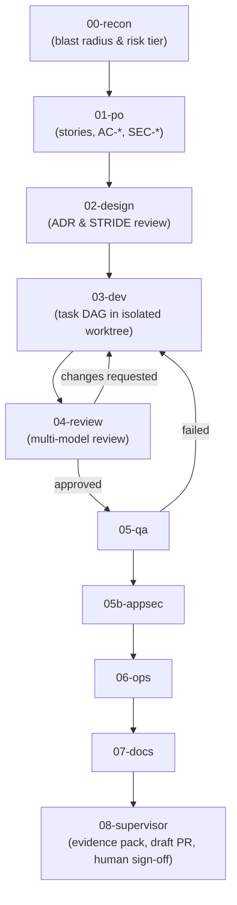

# SSDLC Orchestrator

An autonomous, project-isolated, **risk-tiered Secure Software Development Lifecycle (SSDLC)** orchestrator.

SSDLC coordinates teams of AI agents built on **Claude Code (`claude`)**, **OpenAI Codex (`codex`)**, **Antigravity (`agy`)** and **OpenRouter**. A ticket goes from reconnaissance and formal requirements through design, threat modelling, implementation, multi-model review, QA and AppSec, and ends with an evidence pack for a human supervisor. Global host configuration is never modified.

---

## Contents

- [Key principles](#key-principles)
- [How a run works](#how-a-run-works)
- [Requirements](#requirements)
- [Installation](#installation)
- [Your first project](#your-first-project)
- [Basic configuration](#basic-configuration)
- [Everyday commands](#everyday-commands)
- [Where things are stored](#where-things-are-stored)
- [Documentation](#documentation)
- [Project status and limitations](#project-status-and-limitations)
- [Developing SSDLC](#developing-ssdlc)
- [License](#license)

---

## Key principles

- **No global configuration pollution.** `~/.codex`, `~/.claude`, global `npm` and Python stay untouched. Each project has its own runtime (`<project>/.ssdlc/.runtime/`), and CLI binaries live in the toolkit's `.tools/` directory.
- **Cross-model verification.** A model never approves its own work. Design, review, QA and AppSec are assigned to different roles and, where available, to different engines.
- **Isolated execution.** Development happens in a project-local Git worktree. In Docker mode, role and verification containers have resource limits and no host credentials; verification mounts the source read-only.
- **Evidence by default.** Inputs, outputs, decisions and check logs are archived with SHA-256 hashes and compiled into `EVIDENCE_PACK.md`. The hashes are unkeyed integrity checks, not authentication (see [Architecture](docs/architecture.md#integrity-model-and-its-limits)).
- **Explicit authority.** Approvals, limit extensions, recovery transitions and merges need an explicit operator decision. Nothing is approved because a limit ran out.

---

## How a run works



`00-recon` assigns a **risk tier** that decides how much of the pipeline runs:

| Tier | Typical change | Pipeline |
| --- | --- | --- |
| **S** | small fix | recon → PO → dev → single review → QA → supervisor |
| **M** | standard feature | adds pair design, multi-model review and docs |
| **L** | high risk or architectural | full pipeline, including STRIDE threat model, AppSec and ops runbooks |

With **task mode** enabled (`SSDLC_ENABLE_TASK_BREAKDOWN=true`), design produces a reviewed **task plan**: a DAG of tasks with file manifests, owned requirements and automated checks. Development then runs one task at a time:

1. The host checks the baseline at a clean checkpoint, then dispatches the developer into a disposable workspace.
2. The candidate is **captured** and verified by the host. Only passing checks create a Git checkpoint.
3. Failed attempts are archived and repaired in place, within persistent attempt limits. Identical failing repairs stop as `REPAIR_STALLED`.
4. A developer that needs files outside its manifest stops with `SCOPE_REQUIRED`. The run then goes through a reviewed scope amendment, never through silent expansion of the manifest.
5. Global review, QA and AppSec run on the verified result. They use structured, nonce-bound gate reports.

Runs can also be **supervised** in the background, **resumed** from a phase, and **recovered** through explicit, hash-bound transitions under frozen cumulative limits. See [Documentation](#documentation).

Details: [Pipeline and architecture](docs/architecture.md) · [Task mode](docs/task-mode.md).

---

## Requirements

- Linux (supervision, flock-based locking and `/proc` checks are Linux-only). macOS can run foreground pipelines.
- Docker, recommended for isolation (`SSDLC_EXECUTION_MODE=docker`).
- Git 2.30 or later and Python 3.12.
- At least one AI provider: a Claude or ChatGPT subscription logged in on the host, an Antigravity login, or an `OPENROUTER_API_KEY`.

---

## Installation

```bash
git clone git@github.com:brushtyler/ssdlc.git
cd ssdlc
./setup-ssdlc.sh --bootstrap
```

`--bootstrap` installs the CLIs and Python requirements into `.tools/` and builds the shared runner image `ssdlc-runner:latest`. Later, `./setup-ssdlc.sh --update-tools` updates the CLIs for every project at once (see [Configuration › Maintenance](docs/configuration.md#maintenance)).

Log in to your subscriptions **once on the host**. Projects inherit the credentials automatically:

```bash
codex auth login        # ChatGPT Plus/Pro/Team → ~/.codex/auth.json
claude auth login       # Claude Pro/Max/Team   → ~/.claude/.credentials.json
```

For headless hosts and other options, see [Configuration › Authentication](docs/configuration.md#authentication).

---

## Your first project

**1. Initialize SSDLC in the target repository** (run from the toolkit directory):

```bash
./setup-ssdlc.sh --init-project /path/to/my-project --id my-project --mode docker --sync-remote auto
```

This creates, inside the project, `.ssdlc/project.env` (configuration, mode `600`), `.ssdlc/docker-compose.yml`, the isolated `.ssdlc/.runtime/`, an Antigravity skill in `.agents/skills/ssdlc/`, and the `./ssdlc` wrapper.

**2. Check the environment:**

```bash
cd /path/to/my-project
./ssdlc doctor
```

`doctor` verifies the CLIs, isolation, credential fingerprints and GitHub token visibility.

**3. Run a ticket** from a clean, committed baseline, with a narrowly scoped goal:

```bash
./ssdlc run --ticket TKT-001-auth \
  --goal "Implement OAuth2 PKCE authentication flow with unit tests" \
  --tier auto
```

A filename in the goal does not pass that file's content to API-based roles; describe what you need.

**4. Review the evidence and decide:**

```bash
cat .ssdlc/TKT-001-auth/EVIDENCE_PACK.md
./ssdlc approve TKT-001-auth                       # merge the verified result
./ssdlc reject  TKT-001-auth --reason "Persist refresh tokens in secure storage"
```

---

## Basic configuration

SSDLC reads, in order of precedence:

1. the **process environment**;
2. **`<project>/.ssdlc/project.env`**, per-project settings;
3. **`~/.ssdlc/global.env`**, host-wide defaults inherited by every project.

A minimal `~/.ssdlc/global.env`:

```bash
export SSDLC_INHERIT_HOST_CODEX_AUTH="true"    # copy ~/.codex/auth.json into each project runtime
export SSDLC_INHERIT_HOST_CLAUDE_AUTH="true"   # copy Claude credentials into each project runtime
export SSDLC_MAX_REASONING_EFFORT="medium"     # upper bound for every role
# export OPENROUTER_API_KEY="sk-or-v1-..."     # optional fallback provider
```

The settings used most often:

| Variable | Default | Purpose |
| --- | --- | --- |
| `SSDLC_EXECUTION_MODE` | `docker` | `docker` (isolated) or `local` (trusted code only) |
| `SSDLC_ENABLE_TASK_BREAKDOWN` | `false` | Enables task mode: task plan, scheduler and structured gates |
| `SSDLC_DEFAULT_TIER` | `auto` | Risk tier when `--tier` is not given |
| `SSDLC_<ROLE>_ENGINE` / `_MODEL` | `auto` | Per-role routing override |
| `SSDLC_BUDGET_CAP_USD` | S $3, M $6, L $20 | Reported-spend circuit breaker |
| `SSDLC_SYNC_REMOTE` | `auto` | GitHub/GitLab synchronization of branches, issues and draft PRs |
| `GITHUB_TOKEN` / `GH_TOKEN` | — | Needed to create issues and PRs (`export GITHUB_TOKEN="$(gh auth token)"`) |

The full reference covers routing tables, reasoning effort, budgets, container limits, standards profiles, remote sync and maintenance: [docs/configuration.md](docs/configuration.md).

---

## Everyday commands

| Command | Purpose |
| --- | --- |
| `./ssdlc doctor` | Check tools, isolation and credentials |
| `./ssdlc run --ticket T --goal "…" [--tier auto]` | Run the pipeline in the foreground |
| `./ssdlc run … --from-phase 03-dev` | Resume from a phase, preserving approved upstream work |
| `./ssdlc po` / `design` / `plan --ticket T` | Revalidate PO output, resume design, retry task planning (task mode) |
| `./ssdlc approve T` / `reject T --reason "…"` | Human sign-off |
| `python3 orchestrator.py start` / `status` / `cancel` / `resume` / `monitor` | Detached supervision ([docs](docs/supervision.md)) |
| `python3 orchestrator.py bounce-preview …` | Read-only targeted-bounce preview ([docs](docs/bounce-preview.md)) |
| `python3 orchestrator.py continuation-*` | Explicit recovery transitions for stopped runs ([docs](#recovery-and-continuation)) |
| `python3 orchestrator.py feedback-*` | Developer-feedback diagnosis and delegation ([docs](docs/developer-feedback.md)) |

---

## Where things are stored

```text
<ssdlc-toolkit>/
├── orchestrator.py, ssdlc_*.py      controller and modules
├── setup-ssdlc.sh                   bootstrap and project initializer
├── schemas/                         versioned JSON schemas
├── standards/                       default project standards
└── .tools/                          shared CLIs and Python environment

<project>/
├── ssdlc                            project-local CLI wrapper
└── .ssdlc/
    ├── project.env                  project configuration and keys
    ├── .runtime/                    isolated CODEX_HOME, CLAUDE_CONFIG_DIR, resource records
    ├── .supervisor/                 supervisor metadata, locks and audit (detached runs)
    └── <ticket>/
        ├── state.json               canonical run state
        ├── 00-recon/ … 07-docs/     phase artifacts and evidence
        ├── worktree/                isolated Git worktree
        └── EVIDENCE_PACK.md         evidence summary for sign-off
```

Recovered runs keep each generation under `<ticket>/execution-runtimes/<id>/`, selected by `<ticket>/execution/active.json`. See [Architecture](docs/architecture.md#run-layout).

---

## Documentation

### Using SSDLC

| Document | Content |
| --- | --- |
| [Configuration](docs/configuration.md) | Authentication, inheritance, model routing, reasoning effort, budgets, containers, remote sync, maintenance |
| [Architecture](docs/architecture.md) | Phases, tiers, isolation, run layout, controller contract, integrity model |
| [Task mode](docs/task-mode.md) | PO validation, design sessions, task planning, scheduler, repair, gate reports |
| [Supervision](docs/supervision.md) | Detached runs, resume, cancel, recovery matrix |
| [Troubleshooting](docs/troubleshooting.md) | Memory/OOM, resuming, deploy keys, common stops |

### Recovery and continuation

| Document | When to use it |
| --- | --- |
| [Candidate capture](docs/candidate-capture.md) | How developer output is captured and verified in disposable workspaces (I0) |
| [Bounded recovery](docs/bounded-recovery.md) | Frozen limits, timeout capture, semantic design progress, A5 replay gate (I2) |
| [Continuations](docs/continuations.md) | Importing a stopped pre-checkpoint run for fresh verification (I1) |
| [Historical reconciliation](docs/historical-reconciliation.md) | Admitting a stopped I1 generation to native development with cumulative limits |
| [Scope amendments](docs/scope-amendments.md) | Recovering a task stopped on `SCOPE_REQUIRED` after a checkpoint |
| [Developer feedback](docs/developer-feedback.md) | Scope diagnosis, reviewed feedback roles, delegated amendments, GitHub projections (#39) |
| [Native gate convergence](docs/native-gate-convergence.md) | Candidate checks collected before the reviews that need them (opt-in) |
| [Bounce preview](docs/bounce-preview.md) | Read-only preview of a targeted bounce from a gate |

### Plans

[PLAN_AUTONOMY_WORKSTREAMS.md](PLAN_AUTONOMY_WORKSTREAMS.md) describes the autonomy roadmap: workstreams for recovery, containment and oracle, and increments I0–I6. [PLAN_TASK_ROUTING_AND_SUBGOALS.md](PLAN_TASK_ROUTING_AND_SUBGOALS.md) covers task routing and subgoals.

---

## Project status and limitations

- **Task mode is opt-in** and remains under active development. Recovery transitions, scope amendments and the feedback workflow apply to task-mode runs.
- **No automatic merge.** Approval and every limit extension are explicit operator actions.
- **Integrity checks are not authentication.** SHA-256 hashes detect changes at checkpoints. They do not protect against a host user who rewrites both evidence and hashes, and there is no continuous containment (workstream B).
- **Cost accounting is partial.** Claude reports CLI estimates and OpenRouter reports metered usage. Subscription CLIs such as Codex do not report a cost; see [#43](https://github.com/brushtyler/ssdlc/issues/43) and [#14](https://github.com/brushtyler/ssdlc/issues/14).
- **Supervision is single-host Linux.** It is not a distributed scheduler.

Open work is tracked in the [GitHub issues](https://github.com/brushtyler/ssdlc/issues).

---

## Developing SSDLC

```bash
python3 -m venv .tools/python
.tools/python/bin/python3 -m pip install -r requirements.txt
.tools/python/bin/python3 -m unittest discover -s tests          # what CI runs
python3 -I ssdlc_replay_gate.py --output recovery-benchmark.json # isolated A5 recovery gate
```

- Running a single module needs `PYTHONPATH=tests`.
- Docker smoke tests: `python3 tests/docker_smoke.py --image <image> --suite` and `python3 tests/docker_pid_smoke.py --image <image>`.
- When SSDLC develops itself, run a pinned controller checkout against a **separate** target checkout.
- Agents contributing to this repository follow [AGENTS.md](AGENTS.md).

---

## License

Apache-2.0
