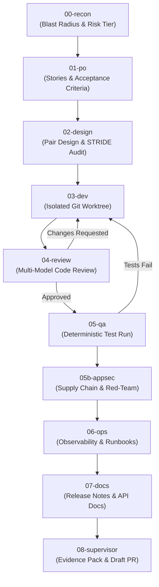

# SSDLC Orchestrator

An autonomous, project-isolated, **Risk-Tiered Secure Software Development Lifecycle (SSDLC)** orchestrator.

SSDLC coordinates multi-model AI agent teams—combining **Claude Code (`claude`)**, **OpenAI Codex (`codex`)**, **Antigravity (`agy`)**, and **OpenRouter**—to take software requirements from reconnaissance and formal specification to implementation, threat modeling, multi-model review, and verifiable delivery, **with zero pollution of global host configurations**.

---

## Table of Contents

- [Core Principles & Value Proposition](#core-principles--value-proposition)
- [The 10-Phase Pipeline](#the-10-phase-pipeline)
- [Risk-Tiered Autonomy (Tiers S, M, L)](#risk-tiered-autonomy-tiers-s-m-l)
- [Supported Engines, CLIs & Model Routing](#supported-engines-clis--model-routing)
- [Remote SCM & Issue Tracker Sync (`--sync-remote`)](#remote-scm--issue-tracker-sync---sync-remote)
- [Prerequisites & Installation](#prerequisites--installation)
- [First Project & First Run Walkthrough](#first-project--first-run-walkthrough)
- [Tool Updates & Maintenance](#tool-updates--maintenance)
- [Architecture & Isolation Guarantees](#architecture--isolation-guarantees)
- [Troubleshooting & Best Practices](#troubleshooting--best-practices)

---

## Core Principles & Value Proposition

1. **Zero Global Configuration Pollution**:
   - Host directories (`~/.codex`, `~/.claude`, global `npm`, global Python) remain untouched.
   - Each project maintains its own isolated runtime directories (`<project>/.ssdlc/.runtime/codex_home`, `claude_home`, cache).
   - Multiple projects can run concurrently on the same machine without SQLite file-lock conflicts or credential collisions.

2. **Heterogeneous Multi-Model Cross-Verification**:
   - *No single model is allowed to review or approve its own code.*
   - A model specialized in reasoning (e.g. DeepSeek-R1) critiques designs and reviews code written by another model (e.g. Claude Sonnet), enforcing architectural boundaries and STRIDE security audits.

3. **Cryptographic SHA-256 Audit Trail**:
   - Every intermediate artifact (PO specs, architecture decisions, threat models, review reports, diffs) is hashed with SHA-256.
   - Tamper-detection mechanisms block development if upstream requirements or security constraints are altered during code generation.
   - An `EVIDENCE_PACK.md` is compiled at the end of each run for human supervisor inspection.

4. **Isolated Git Worktrees**:
   - Development occurs strictly inside a project-local Git worktree (`<project>/.ssdlc/<ticket>/worktree`).
   - The primary working tree and active branch remain clean and uninterrupted during development iterations.

---

## The 10-Phase Pipeline



| Phase | Role | Focus & Artifacts |
| :--- | :--- | :--- |
| **`00-recon`** | Codebase Archaeologist | Maps blast radius, architectural impact, dependencies, and assigns Risk Tier (`S`, `M`, `L`) and Dev Profile (`FULLSTACK`, `ALGORITHMIC`, `REFACTOR`, etc.). |
| **`01-po`** | Product Owner | Generates testable User Stories, Given/When/Then Acceptance Criteria (`AC-*`), and Security Abuse Cases (`SEC-*`). |
| **`02-design`** | Architect & Security Threat Modeler | Pair design dialogue. Produces Architecture Decision Record (`adr.md`) and STRIDE threat mitigation analysis (`threat-model.md`). |
| **`03-dev`** | Developer Agent | Writes code and unit tests inside an isolated Git worktree branch (`ssdlc/<ticket-id>`). |
| **`04-review`** | Multi-Model Review Panel | Independent code review by distinct AI models. Blocks progress on security flaws, regressions, or spec violations. |
| **`05-qa`** | QA Engineer | Executes deterministic test suites (`--test-cmd`), asserts coverage, and validates acceptance criteria. |
| **`05b-appsec`** | AppSec Red-Teamer | Dependency vetting, secret leakage scanning, OWASP top-10 audit, and supply-chain risk checks. |
| **`06-ops`** | DevSecOps / SRE | Generates deployment checklists, monitoring rules, metrics, and rollback procedures. |
| **`07-docs`** | Technical Writer | Generates end-user documentation, migration guides, and developer release notes. |
| **`08-supervisor`** | Evidence Coordinator | Compiles the cryptographic `EVIDENCE_PACK.md`, synchronizes remote branches, opens Draft Pull Requests, and awaits human sign-off. |

---

## Risk-Tiered Autonomy (Tiers S, M, L)

When launched with `--tier auto`, Phase `00-recon` evaluates the blast radius and assigns one of three execution paths:

- **Tier S (Low Risk / Small Fixes)**:
  - Fast-track pipeline: `00-recon` ➔ `01-po` ➔ `03-dev` ➔ `04-review` (single reviewer) ➔ `05-qa` ➔ `08-supervisor`.
  - Skips full architectural pair design and DevSecOps overhead.
- **Tier M (Standard Feature / Moderate Impact)**:
  - Includes Pair Design, multi-model review, and documentation phases.
- **Tier L (High Risk / Architectural / Fullstack)**:
  - Full 10-phase pipeline, including STRIDE threat modeling, multi-model consensus review, AppSec red-teaming, and DevSecOps runbooks.

---

## Supported Engines, CLIs & Model Routing

### CLI Engines
- **Claude Code (`claude`)**: Anthropic's agentic CLI with bash and tool capabilities.
- **OpenAI Codex (`codex`)**: Codex CLI for code synthesis and test generation.
- **Antigravity (`agy`)**: Google's agentic assistant and skill ecosystem.

### Model Providers
- **OpenRouter (`openrouter`)**: Primary provider for multi-model routing. Every request is tagged with:
  - `HTTP-Referer`: `https://ssdlc.local/<project-id>`
  - `X-Title`: `SSDLC/<project-id>/<ticket-id>`
  - `user`: `<project-id>:<ticket-id>:<phase>`
  - Exact token usage and costs are recorded in the ticket ledger.
- **Anthropic Direct**: Native Anthropic API keys (`ANTHROPIC_API_KEY`).
- **OpenAI Direct**: Native OpenAI API keys (`OPENAI_API_KEY`).

### Customizable Routing (in `.ssdlc/project.env`)
You can assign different models and reasoning efforts to each role:

```bash
# Reconnaissance
export SSDLC_RECON_ENGINE="openrouter"
export SSDLC_RECON_MODEL="google/gemini-2.5-pro"

# Product Owner & Requirements
export SSDLC_PO_ENGINE="openrouter"
export SSDLC_PO_MODEL="anthropic/claude-sonnet-4.5"

# Pair Design & Security Threat Modeling
export SSDLC_DESIGN_ARCH_ENGINE="openrouter"
export SSDLC_DESIGN_ARCH_MODEL="anthropic/claude-sonnet-4.5"
export SSDLC_DESIGN_SEC_ENGINE="openrouter"
export SSDLC_DESIGN_SEC_MODEL="deepseek/deepseek-r1-0528"

# Developer Engine (auto selects claude or codex based on profile)
export SSDLC_DEV_ENGINE="auto"
export SSDLC_DEV_USE_OPENROUTER="true"

# Multi-Model Code Reviewers (comma-separated list for consensus)
export SSDLC_REVIEW_ENGINE="openrouter"
export SSDLC_REVIEW_MODELS="deepseek/deepseek-r1-0528,anthropic/claude-sonnet-4.5"

# QA, AppSec, Ops, Docs
export SSDLC_QA_MODEL="anthropic/claude-sonnet-4.5"
export SSDLC_APPSEC_MODEL="deepseek/deepseek-r1-0528"
export SSDLC_OPS_MODEL="anthropic/claude-sonnet-4.5"
export SSDLC_DOCS_MODEL="anthropic/claude-sonnet-4.5"
```

---

## Remote SCM & Issue Tracker Sync (`--sync-remote`)

SSDLC includes native remote synchronization with **GitHub** and **GitLab**:

1. **Issue Tracking (Phase 01 PO)**:
   - When `--sync-remote` is active, the PO specification (Acceptance Criteria and Abuse Cases) is posted to a remote Issue.
   - If `--issue <number>` is passed, it attaches the specification as a comment to that issue.
2. **Delivery & PR Creation (Phase 08 Supervisor)**:
   - Commits worktree changes to `ssdlc/<ticket-id>`.
   - Pushes the branch to `origin`.
   - Opens a **Draft Pull Request** (or GitLab Merge Request) referencing the issue (`Closes #...`) and embeds the entire `EVIDENCE_PACK.md` into the description.
3. **Approval & Merge Synchronization**:
   - Running `./ssdlc approve <ticket> --sync-remote` pushes the merged target branch to `origin`.

---

## Prerequisites & Installation

### Prerequisites
- **Linux** or **macOS** environment.
- **Docker** & **Docker Compose** (recommended for kernel-enforced sandbox isolation).
- **Git** (version 2.30+).

### Step 1: Clone the SSDLC Toolkit
```bash
git clone git@github.com:brushtyler/ssdlc.git
cd ssdlc
```

### Step 2: Bootstrap Shared Tools & Base Docker Image
Run the bootstrap command from the repository root:

```bash
chmod +x setup-ssdlc.sh
./setup-ssdlc.sh --bootstrap
```

This creates the isolated `.tools/` directory and builds the shared base image `ssdlc-runner:latest`.

---

## First Project & First Run Walkthrough

### Step 1: Initialize SSDLC in Your Repository
From the `ssdlc` directory, initialize your target project:

```bash
./setup-ssdlc.sh --init-project /path/to/my-project --id my-project --mode docker
```

This generates the following files **inside `/path/to/my-project/`**:
- `.ssdlc/project.env`: Project-specific credentials and model routing.
- `.ssdlc/docker-compose.yml`: Scoped container definition.
- `.ssdlc/.runtime/`: Project-isolated `CODEX_HOME` and `CLAUDE_CONFIG_DIR`.
- `.agents/skills/ssdlc/SKILL.md`: Local Antigravity skill definition.
- `./ssdlc`: Convenient local CLI wrapper.

### Step 2: Configure Project Credentials
Navigate to your project repository and edit `.ssdlc/project.env`:

```bash
cd /path/to/my-project
nano .ssdlc/project.env
```

Add your OpenRouter key:
```bash
export OPENROUTER_API_KEY="sk-or-v1-..."
```

*(Optional: Set `export SSDLC_SYNC_REMOTE="true"` and `export GITHUB_TOKEN="ghp_..."` for GitHub synchronization).*

### Step 3: Run the Environment Doctor
Verify that CLI tools, environment isolation, and API key fingerprints are ready:

```bash
./ssdlc doctor
```

### Step 4: Launch an Autonomous Pipeline Run
Execute a ticket with your feature or bugfix goal:

```bash
./ssdlc run \
  --ticket TKT-001-auth \
  --goal "Implement OAuth2 PKCE authentication flow with unit tests" \
  --tier auto
```

To enable remote GitHub/GitLab synchronization:
```bash
./ssdlc run \
  --ticket TKT-001-auth \
  --goal "Implement OAuth2 PKCE authentication flow with unit tests" \
  --tier auto \
  --sync-remote
```

### Step 5: Review & Human Supervisor Decision
When the pipeline finishes, inspect the compiled Evidence Pack:

```bash
cat .ssdlc/TKT-001-auth/EVIDENCE_PACK.md
```

- **To Approve and Merge**:
  ```bash
  ./ssdlc approve TKT-001-auth
  ```
  *(Merges the verified worktree into your active branch and prunes temporary worktree storage).*

- **To Reject and Bounce Back to Dev with Feedback**:
  ```bash
  ./ssdlc reject TKT-001-auth --reason "Ensure refresh tokens are persisted in secure storage"
  ```

---

## Tool Updates & Maintenance

SSDLC mounts shared CLI tools from its installation directory. You can update CLIs across **all initialized projects simultaneously without rebuilding individual containers**:

- **Update CLIs (`codex`, `claude`, `uv`)**:
  ```bash
  ./setup-ssdlc.sh --update-tools
  # or from within any initialized project:
  ./ssdlc update-tools
  ```
- **Rebuild the Shared Docker Image Layer**:
  ```bash
  ./setup-ssdlc.sh --rebuild-image
  ```
- **Inspect Installed CLI Versions**:
  ```bash
  ./setup-ssdlc.sh --versions
  ```

---

## Architecture & Isolation Guarantees

```text
Host System
├── /usr/local/bin, ~/.codex, ~/.claude   [UNTOUCHED]
│
├── <ssdlc-repository>/
│   ├── orchestrator.py                   [Core State Machine & RemoteSyncManager]
│   ├── setup-ssdlc.sh                    [Bootstrap & Project Initializer]
│   └── .tools/                           [Shared Tool Binaries (read-only mount)]
│
└── <project-a>/
    ├── .ssdlc/
    │   ├── project.env                   [Project-specific API keys & model routing]
    │   ├── docker-compose.yml            [Local container definition]
    │   ├── .runtime/                     [Isolated CODEX_HOME & CLAUDE_CONFIG_DIR]
    │   └── <ticket-id>/
    │       ├── 00-recon/ ... 07-docs/    [Step artifacts]
    │       ├── worktree/                 [Isolated Git Worktree for code generation]
    │       └── EVIDENCE_PACK.md          [Cryptographic SHA-256 evidence]
    └── ./ssdlc                           [Project-local CLI entrypoint]
```

---

## Troubleshooting & Best Practices

1. **Linux Memory & OOM (Out-of-Memory)**:
   - Large code generation passes across multiple files with unit test runners can consume substantial RAM.
   - Ensure your system has adequate swap space (recommended: 4 GB swap):
     ```bash
     sudo fallocate -l 4G /swapfile && sudo chmod 600 /swapfile && sudo mkswap /swapfile && sudo swapon /swapfile
     ```
   - Cap Node.js memory in `.ssdlc/project.env` by adding `export NODE_OPTIONS="--max-old-space-size=1536"`.

2. **Resuming Interrupted Runs**:
   - If an execution is interrupted (e.g. system restart or timeout), resume directly from the desired phase without re-running earlier steps:
     ```bash
     ./ssdlc run --ticket TKT-001 --goal "..." --from-phase 03-dev
     ```

3. **SSH Deploy Keys for Remote Sync**:
   - When using repository-specific deploy keys, configure Git to use the corresponding key via `core.sshCommand`:
     ```bash
     git config core.sshCommand "ssh -i ~/.ssh/id_ed25519_deploy -o IdentitiesOnly=yes"
     ```
   - Ensure the deploy key has **Write access** enabled in repository settings.

---

## License

Apache-2.0
