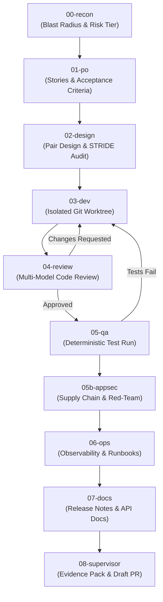

# SSDLC Orchestrator

An autonomous, project-isolated, **Risk-Tiered Secure Software Development Lifecycle (SSDLC)** orchestrator.

SSDLC coordinates multi-model AI agent teams—combining **Claude Code (`claude`)**, **OpenAI Codex (`codex`)**, **Antigravity (`agy`)**, and **OpenRouter**—to take software requirements from reconnaissance and formal specification to implementation, threat modeling, multi-model review, and verifiable delivery, **with zero pollution of global host configurations**.

---

## Table of Contents

- [Core Principles & Value Proposition](#core-principles--value-proposition)
- [The 10-Phase Pipeline](#the-10-phase-pipeline)
- [Risk-Tiered Autonomy (Tiers S, M, L)](#risk-tiered-autonomy-tiers-s-m-l)
- [Supported Engines, CLIs & Model Routing](#supported-engines-clis--model-routing)
- [Remote SCM & Issue Tracker Sync (`--sync-remote`)](#remote-scm--issue-tracker-sync---sync-remote)
- [Prerequisites & Installation](#prerequisites--installation)
- [First Project & First Run Walkthrough](#first-project--first-run-walkthrough)
- [Tool Updates & Maintenance](#tool-updates--maintenance)
- [Architecture & Isolation Guarantees](#architecture--isolation-guarantees)
- [Troubleshooting & Best Practices](#troubleshooting--best-practices)

---

## Core Principles & Value Proposition

1. **Zero Global Configuration Pollution**:
   - Host directories (`~/.codex`, `~/.claude`, global `npm`, global Python) remain untouched.
   - Each project maintains its own isolated runtime directories (`<project>/.ssdlc/.runtime/codex_home`, `claude_home`, cache).
   - Multiple projects can run concurrently on the same machine without SQLite file-lock conflicts or credential collisions.

2. **Heterogeneous Multi-Model Cross-Verification**:
   - *No single model is allowed to review or approve its own code.*
   - A model specialized in reasoning (e.g. DeepSeek-R1) critiques designs and reviews code written by another model (e.g. Claude Sonnet), enforcing architectural boundaries and STRIDE security audits.

3. **Cryptographic SHA-256 Audit Trail**:
   - Every intermediate artifact (PO specs, architecture decisions, threat models, review reports, diffs) is hashed with SHA-256.
   - Tamper-detection mechanisms block development if upstream requirements or security constraints are altered during code generation.
   - An `EVIDENCE_PACK.md` is compiled at the end of each run for human supervisor inspection.

4. **Isolated Git Worktrees**:
   - Development occurs strictly inside a project-local Git worktree (`<project>/.ssdlc/<ticket>/worktree`).
   - The primary working tree and active branch remain clean and uninterrupted during development iterations.

---

## The 10-Phase Pipeline



| Phase | Role | Focus & Artifacts |
| :--- | :--- | :--- |
| **`00-recon`** | Codebase Archaeologist | Maps blast radius, architectural impact, dependencies, and assigns Risk Tier (`S`, `M`, `L`) and Dev Profile (`FULLSTACK`, `ALGORITHMIC`, `REFACTOR`, etc.). |
| **`01-po`** | Product Owner | Generates testable User Stories, Given/When/Then Acceptance Criteria (`AC-*`), and Security Abuse Cases (`SEC-*`). |
| **`02-design`** | Architect & Security Threat Modeler | Pair design dialogue. Produces Architecture Decision Record (`adr.md`) and STRIDE threat mitigation analysis (`threat-model.md`). |
| **`03-dev`** | Developer Agent | Writes code and unit tests inside an isolated Git worktree branch (`ssdlc/<ticket-id>`). |
| **`04-review`** | Multi-Model Review Panel | Independent code review by distinct AI models. Blocks progress on security flaws, regressions, or spec violations. |
| **`05-qa`** | QA Engineer | Executes deterministic test suites (`--test-cmd`), asserts coverage, and validates acceptance criteria. |
| **`05b-appsec`** | AppSec Red-Teamer | Dependency vetting, secret leakage scanning, OWASP top-10 audit, and supply-chain risk checks. |
| **`06-ops`** | DevSecOps / SRE | Generates deployment checklists, monitoring rules, metrics, and rollback procedures. |
| **`07-docs`** | Technical Writer | Generates end-user documentation, migration guides, and developer release notes. |
| **`08-supervisor`** | Evidence Coordinator | Compiles the cryptographic `EVIDENCE_PACK.md`, synchronizes remote branches, opens Draft Pull Requests, and awaits human sign-off. |

---

## Risk-Tiered Autonomy (Tiers S, M, L)

When launched with `--tier auto`, Phase `00-recon` evaluates the blast radius and assigns one of three execution paths:

- **Tier S (Low Risk / Small Fixes)**:
  - Fast-track pipeline: `00-recon` ➔ `01-po` ➔ `03-dev` ➔ `04-review` (single reviewer) ➔ `05-qa` ➔ `08-supervisor`.
  - Skips full architectural pair design and DevSecOps overhead.
- **Tier M (Standard Feature / Moderate Impact)**:
  - Includes Pair Design, multi-model review, and documentation phases.
- **Tier L (High Risk / Architectural / Fullstack)**:
  - Full 10-phase pipeline, including STRIDE threat modeling, multi-model consensus review, AppSec red-teaming, and DevSecOps runbooks.

---

## Flat-Rate Subscriptions & Global Inheritance (ChatGPT Plus/Pro & Claude Pro/Max)

SSDLC is designed to eliminate pay-per-token API waste during heavy development loops by seamlessly utilizing your existing flat-rate AI subscriptions (**OpenAI ChatGPT Plus/Pro/Team** and **Anthropic Claude Pro/Max/Team**).

### 1. One-Time Host Setup (Login Once per VM)

You authenticate your subscriptions **only once** on the host VM. All projects automatically inherit these credentials.

#### A. OpenAI Codex (ChatGPT Plus / Pro / Team)
Log in via the Codex CLI on the VM host:
```bash
codex auth login
# or run 'codex' interactively
```
- Open the provided URL in your local browser, log in with your ChatGPT Plus/Pro account, and authorize.
- Codex writes your session credentials to: `~/.codex/auth.json` (`auth_mode: "chatgpt"`).

#### B. Anthropic Claude Code (Claude Pro / Max / Team)
You have two authentication options:

**Option 1: Native Persistent Login (Recommended for Shell & SSDLC)**
```bash
claude auth login
```
- Claude Code displays an authorization URL. Open it in your local browser, approve with your Claude subscription account, and copy the authorization code.
- Paste the code at the terminal prompt. Claude Code stores account metadata in `~/.claude.json` and OAuth credentials in `~/.claude/.credentials.json`. SSDLC copies the credentials into the project's isolated `CLAUDE_CONFIG_DIR`.

**Option 2: Headless 1-Year Setup Token (Ideal for Headless CI/CD)**
```bash
claude setup-token
```
- Complete the web flow to obtain a long-lived OAuth token (`sk-ant-...`).
- Export it in your environment: `export CLAUDE_CODE_OAUTH_TOKEN="sk-ant-..."`.

---

### 2. Automatic Project Inheritance (`~/.ssdlc/global.env`)

To prevent having to reconfigure environment variables or copy keys into every new project, SSDLC uses an **Host-Wide Defaults** architecture:

📁 **`~/.ssdlc/global.env`**

```bash
# /root/.ssdlc/global.env - Inherited automatically by every SSDLC project on this host
export OPENROUTER_API_KEY="sk-or-v1-..."             # Fallback provider for non-dev phases
export SSDLC_INHERIT_HOST_CODEX_AUTH="true"         # Automatically inherits ~/.codex/auth.json
export SSDLC_INHERIT_HOST_CLAUDE_AUTH="true"        # Inherits ~/.claude/.credentials.json and account metadata
export SSDLC_DEV_ENGINE="auto"                      # Routes to Codex/Claude automatically
export SSDLC_MAX_REASONING_EFFORT="medium"          # Strict cap to prevent token explosion
```

#### How Inheritance Works:
1. **Zero Configuration for New Projects**: When initializing or running any project (`./setup-ssdlc.sh --init-project` or `./ssdlc run`), SSDLC automatically loads `~/.ssdlc/global.env` and copies the host credentials into the project's isolated runtime (`.ssdlc/.runtime/codex_home/` and `.ssdlc/.runtime/claude_home/`). The CLI binaries live under the SSDLC repository's `.tools/` directory; they are not installed as global host commands.
2. **Project-Specific Overrides (Optional)**: If a specific project requires a dedicated API key (e.g. for client billing or independent auditing), set it in that project's `.ssdlc/project.env`. Local project variables strictly take precedence over host defaults.

---

### 3. Autonomous Context-Aware Model Routing & Quota Preservation

To protect your subscription rate limits from being drained by trivial edits, SSDLC's `DynamicRoutingPolicy` automatically calibrates models and reasoning effort based on the ticket's **Risk Tier** (`Tier S / M / L`) and **Dev Profile**:

| SSDLC Phase | Tier S (Micro-task / CSS / Refactor) | Tier M (Standard Feature) | Tier L (Epic / High-Risk Fullstack) |
| :--- | :--- | :--- | :--- |
| **01 PO** | `deepseek/deepseek-chat` (~$0.14/M) | `anthropic/claude-sonnet-4.5` | `anthropic/claude-sonnet-4.5` |
| **02 Pair Design & STRIDE** | *Bypassed (Fast Track)* | `claude-sonnet-4.5` + `deepseek-r1` | `claude-sonnet-4.5` + `deepseek-r1` |
| **03 Dev (Codex Subscription)** | **`gpt-6-luna`** *(Preserves Pro quota)* | **`gpt-6.1-terra`** *(Escalates to `sol` on retry)* | **`gpt-6.1-sol`** |
| **03 Dev (Claude Subscription)** | `claude-haiku-4.5` | `claude-sonnet-4.6` | `claude-sonnet-4.6` |
| **04 Review** | 1 reviewer (`deepseek-chat`) | Dual consensus (`r1` + `sonnet`) | Multi-model panel |
| **06 Ops & Runbook** | `deepseek/deepseek-chat` | `anthropic/claude-sonnet-4.5` | `anthropic/claude-sonnet-4.5` |
| **07 Docs & Changelog** | `deepseek/deepseek-chat` | `google/gemini-2.5-pro` | `google/gemini-2.5-pro` |

#### Built-In Safety Mechanisms:
- **Reasoning Effort Capping**: Automatically capped at `low` for Tier S and `medium` for Tier M/L (disables `high` and `xhigh` which otherwise cause 4x token inflation).
- **Tier-Calibrated Circuit Breakers**: Automatically halts execution if total spend across all phases hits calibrated thresholds:
  - **Tier S**: **$3.00**
  - **Tier M**: **$6.00**
  - **Tier L**: **$20.00**
  *(Configurable via `SSDLC_BUDGET_CAP_USD`).*

---

## Supported Engines, CLIs & Model Routing

### CLI Engines
- **Claude Code (`claude`)**: Anthropic's agentic CLI with bash and tool capabilities.
- **OpenAI Codex (`codex`)**: Codex CLI for code synthesis and test generation.
- **Antigravity (`agy`)**: Google's agentic assistant and skill ecosystem.

### Model Providers
- **OpenRouter (`openrouter`)**: Primary provider for multi-model routing. Every request is tagged with:
  - `HTTP-Referer`: `https://ssdlc.local/<project-id>`
  - `X-Title`: `SSDLC/<project-id>/<ticket-id>`
  - `user`: `<project-id>:<ticket-id>:<phase>`
  - Exact token usage and costs are recorded in the ticket ledger.
- **Anthropic Direct**: Native Anthropic API keys (`ANTHROPIC_API_KEY`).
- **OpenAI Direct**: Native OpenAI API keys (`OPENAI_API_KEY`).

### Customizable Routing (in `.ssdlc/project.env`)
You can assign different models and reasoning efforts to each role:

```bash
# Reconnaissance
export SSDLC_RECON_ENGINE="openrouter"
export SSDLC_RECON_MODEL="google/gemini-2.5-pro"

# Product Owner & Requirements
export SSDLC_PO_ENGINE="openrouter"
export SSDLC_PO_MODEL="anthropic/claude-sonnet-4.5"

# Pair Design & Security Threat Modeling
export SSDLC_DESIGN_ARCH_ENGINE="openrouter"
export SSDLC_DESIGN_ARCH_MODEL="anthropic/claude-sonnet-4.5"
export SSDLC_DESIGN_SEC_ENGINE="openrouter"
export SSDLC_DESIGN_SEC_MODEL="deepseek/deepseek-r1-0528"

# Developer Engine (auto selects claude or codex based on profile)
export SSDLC_DEV_ENGINE="auto"
export SSDLC_DEV_USE_OPENROUTER="true"

# Multi-Model Code Reviewers (comma-separated list for consensus)
export SSDLC_REVIEW_ENGINE="openrouter"
export SSDLC_REVIEW_MODELS="deepseek/deepseek-r1-0528,anthropic/claude-sonnet-4.5"

# QA, AppSec, Ops, Docs
export SSDLC_QA_MODEL="anthropic/claude-sonnet-4.5"
export SSDLC_APPSEC_MODEL="deepseek/deepseek-r1-0528"
export SSDLC_OPS_MODEL="anthropic/claude-sonnet-4.5"
export SSDLC_DOCS_MODEL="anthropic/claude-sonnet-4.5"
```

---

## Remote SCM & Issue Tracker Sync (`--sync-remote`)

SSDLC automatically enables remote synchronization when `origin` points to GitHub or GitLab. Set `SSDLC_SYNC_REMOTE=auto|true|false` in `.ssdlc/project.env`, or use `--sync-remote` / `--no-sync-remote` on `run`, `approve`, or `reject` to override it for one command. `auto` is the default for new and existing projects.

### GitHub API access

An SSH deploy key can push the branch, but creating Issues and Pull Requests requires a GitHub API token. SSDLC reads `GITHUB_TOKEN` or `GH_TOKEN` from its process environment; it does not read the `gh` CLI login automatically. If `gh` is authenticated, run these commands in the target repository before starting SSDLC:

```bash
gh auth status
export GITHUB_TOKEN="$(gh auth token)"
./ssdlc doctor
```

`doctor` reports whether SSDLC can see the token and suggests this command when `gh` is authenticated. A token being present does not prove it can write to this repository: the authenticated account and token must be allowed to create Issues and Pull Requests here. Check those permissions if GitHub returns 403 or 404. When a token is set, SSDLC also uses it for the branch push over HTTPS, so it needs repository write access for that operation; without a token, the push uses `origin` and can use the deploy key.

1. **Issue Tracking (Phase 01 PO)**:
   - On GitHub, with an API token, the PO specification (Acceptance Criteria and Abuse Cases) is posted to a remote Issue.
   - If `--issue <number>` is passed, it attaches the specification as a comment to that issue.
2. **Delivery & PR Creation (Phase 08 Supervisor)**:
   - Commits worktree changes to `ssdlc/<ticket-id>`.
   - Pushes the branch to `origin`.
   - On GitHub, with an API token, opens a **Draft Pull Request** referencing the issue (`Closes #...`) and embeds the entire `EVIDENCE_PACK.md` into the description. GitLab synchronization currently pushes branches only.
3. **Approval & Merge Synchronization**:
   - Running `./ssdlc approve <ticket>` pushes the merged target branch to `origin` when synchronization is enabled.

---

## Prerequisites & Installation

### Prerequisites
- **Linux** or **macOS** environment.
- **Docker** & **Docker Compose** (recommended for kernel-enforced sandbox isolation).
- **Git** (version 2.30+).

### Step 1: Clone the SSDLC Toolkit
```bash
git clone git@github.com:brushtyler/ssdlc.git
cd ssdlc
```

### Step 2: Bootstrap Shared Tools & Base Docker Image
Run the bootstrap command from the repository root:

```bash
chmod +x setup-ssdlc.sh
./setup-ssdlc.sh --bootstrap
```

This creates the isolated `.tools/` directory and builds the shared base image `ssdlc-runner:latest`.

---

## First Project & First Run Walkthrough

### Step 1: Initialize SSDLC in Your Repository
From the `ssdlc` directory, initialize your target project:

```bash
./setup-ssdlc.sh --init-project /path/to/my-project --id my-project --mode docker --sync-remote auto
```

This generates the following files **inside `/path/to/my-project/`**:
- `.ssdlc/project.env`: Project-specific credentials and model routing.
- `.ssdlc/docker-compose.yml`: Scoped container definition.
- `.ssdlc/.runtime/`: Project-isolated `CODEX_HOME` and `CLAUDE_CONFIG_DIR`.
- `.agents/skills/ssdlc/SKILL.md`: Local Antigravity skill definition.
- `./ssdlc`: Convenient local CLI wrapper.

### Step 2: Configure Project Credentials
Navigate to your project repository and edit `.ssdlc/project.env`:

```bash
cd /path/to/my-project
nano .ssdlc/project.env
```

Add your OpenRouter key:
```bash
export OPENROUTER_API_KEY="sk-or-v1-..."
```

*(`SSDLC_SYNC_REMOTE="auto"` is generated by default. Set `GITHUB_TOKEN` for GitHub Issue and Pull Request synchronization.)*

### Step 3: Run the Environment Doctor
Verify that CLI tools, environment isolation, and API key fingerprints are ready:

```bash
./ssdlc doctor
```

### Step 4: Launch an Autonomous Pipeline Run
Execute a ticket with your feature or bugfix goal:

```bash
./ssdlc run \
  --ticket TKT-001-auth \
  --goal "Implement OAuth2 PKCE authentication flow with unit tests" \
  --tier auto
```

To force remote synchronization even when the remote is not recognized:
```bash
./ssdlc run \
  --ticket TKT-001-auth \
  --goal "Implement OAuth2 PKCE authentication flow with unit tests" \
  --tier auto \
  --sync-remote
```

### Step 5: Review & Human Supervisor Decision
When the pipeline finishes, inspect the compiled Evidence Pack:

```bash
cat .ssdlc/TKT-001-auth/EVIDENCE_PACK.md
```

- **To Approve and Merge**:
  ```bash
  ./ssdlc approve TKT-001-auth
  ```
  *(Merges the verified worktree into your active branch and prunes temporary worktree storage).*

- **To Reject and Bounce Back to Dev with Feedback**:
  ```bash
  ./ssdlc reject TKT-001-auth --reason "Ensure refresh tokens are persisted in secure storage"
  ```

---

## Tool Updates & Maintenance

SSDLC mounts shared CLI tools from its installation directory. You can update CLIs across **all initialized projects simultaneously without rebuilding individual containers**:

- **Update CLIs (`codex`, `claude`, `uv`)**:
  ```bash
  ./setup-ssdlc.sh --update-tools
  # or from within any initialized project:
  ./ssdlc update-tools
  ```
- **Rebuild the Shared Docker Image Layer**:
  ```bash
  ./setup-ssdlc.sh --rebuild-image
  ```
- **Inspect Installed CLI Versions**:
  ```bash
  ./setup-ssdlc.sh --versions
  ```

---

## Architecture & Isolation Guarantees

```text
Host System
├── /usr/local/bin, ~/.codex, ~/.claude   [UNTOUCHED]
│
├── <ssdlc-repository>/
│   ├── orchestrator.py                   [Core State Machine & RemoteSyncManager]
│   ├── setup-ssdlc.sh                    [Bootstrap & Project Initializer]
│   └── .tools/                           [Shared Tool Binaries (read-only mount)]
│
└── <project-a>/
    ├── .ssdlc/
    │   ├── project.env                   [Project-specific API keys & model routing]
    │   ├── docker-compose.yml            [Local container definition]
    │   ├── .runtime/                     [Isolated CODEX_HOME & CLAUDE_CONFIG_DIR]
    │   └── <ticket-id>/
    │       ├── 00-recon/ ... 07-docs/    [Step artifacts]
    │       ├── worktree/                 [Isolated Git Worktree for code generation]
    │       └── EVIDENCE_PACK.md          [Cryptographic SHA-256 evidence]
    └── ./ssdlc                           [Project-local CLI entrypoint]
```

---

## Troubleshooting & Best Practices

1. **Linux Memory & OOM (Out-of-Memory)**:
   - Large code generation passes across multiple files with unit test runners can consume substantial RAM.
   - Ensure your system has adequate swap space (recommended: 4 GB swap):
     ```bash
     sudo fallocate -l 4G /swapfile && sudo chmod 600 /swapfile && sudo mkswap /swapfile && sudo swapon /swapfile
     ```
   - Cap Node.js memory in `.ssdlc/project.env` by adding `export NODE_OPTIONS="--max-old-space-size=1536"`.

2. **Resuming Interrupted Runs**:
   - If an execution is interrupted (e.g. system restart or timeout), resume directly from the desired phase without re-running earlier steps:
     ```bash
     ./ssdlc run --ticket TKT-001 --goal "..." --from-phase 03-dev
     ```

3. **SSH Deploy Keys for Remote Sync**:
   - When using repository-specific deploy keys, configure Git to use the corresponding key via `core.sshCommand`:
     ```bash
     git config core.sshCommand "ssh -i ~/.ssh/id_ed25519_deploy -o IdentitiesOnly=yes"
     ```
   - Ensure the deploy key has **Write access** enabled in repository settings.

---

## License

Apache-2.0

## Task breakdown bootstrap (opt-in)

The first implementation increment provides versioned JSON schemas in `schemas/`,
`TaskPlanValidator`, and a sequential DAG executor in `ssdlc_tasks.py`. The controller
captures a quality contract and baseline, requests a structured plan and independent
plan review, then executes one task at a time with the existing model routing.

The planner and validator share an explicit requirement catalogue. Define AC/SEC IDs
in Markdown headings, list entries, the first column of a table, or `AC-1: ...`
lines. Compact ID-only lists are also supported. IDs are case-sensitive, using
letters, digits and hyphens; malformed or duplicate definitions block planning.
Prose references and fenced examples do not create requirements. Every defined ID,
including parent headings and sub-cases, needs explicit task ownership and local
check coverage; hierarchy never implies coverage. Undefined prose mentions are
listed separately in the catalogue for review.

Task and check references use their respective AC/SEC fields. Checks can claim only
requirements owned by their task. Mapping diagnostics report all detected ownership,
coverage and contract defects together, with task/check IDs and exact offending
references. Contract references use actual design filenames and ATX heading anchors
relative to `02-design`, supplied to the planner (for example `adr.md#interfaces`);
titles are not filename aliases. Headings inside fenced code are excluded; repeated
anchors receive numeric suffixes. Duplicate JSON keys, non-finite constants and
multiple candidate objects are rejected. Structural coverage still requires an
independent semantic review of whether the checks exercise the claimed behavior.

Command argument arrays preserve order and repetition (for example multiple unittest
`-k` options); uniqueness applies to IDs and references, not CLI tokens. Only OPEN
BLOCKING findings require an obligation reference. Resolved schema notes may have
empty references and cannot block review; supplied references must still be valid.

After fixing a review validator, explicitly recover a captured rejected review with
`./ssdlc plan --ticket TKT-001 --recover-review`. Recovery revalidates the same candidate
and raw review, archives the previous session and new input fingerprint, retains all
attempt reservations/limits, and sends the remaining open findings back to the planner.
It can recover a REVISION_REQUIRED review only; it never grants approval. Old protocol
diagnostics remain archived, and the recovery evidence is hash-checked on resume.

New planning sessions use structured reviews (`schemas/task-plan-review.schema.json`).
Both planner and reviewer receive the cumulative diagnostic/review history. Findings
keep stable IDs and explicit OPEN/RESOLVED dispositions; each blocker needs a known
AC/SEC, standard or quality-check reference, concrete evidence and a requested change. Optional improvements
are advisory. New findings after the first review must identify an earlier omission
or a defect introduced by revision. The protocol checks attribution and consistency;
the independent reviewer still decides whether the evidence actually resolves a defect.

Pair design also persists its session and immutable drafts/reviews under
`02-design/design-session/`, with a sealed copy of inputs. Both architect and reviewer
receive cumulative reviews and the latest ADR; relevant tracked source files named
by recon are supplied with hashes and numbered excerpts (up to four files/80,000
characters, 50,000 per file). Truncation is explicit. The architect must verify actual
interfaces, journal state, evidence stores and exception boundaries against source.
The reviewer returns `schemas/design-review.schema.json`, including a STRIDE analysis,
stable finding IDs and explicit blocker dispositions. Optional advice cannot block;
new blockers require approved requirement or quality references and justification.

Fresh design sessions default to five total rounds; `SSDLC_MAX_DESIGN_ROUNDS` can
set the initial limit. The persisted limit and consumed reservations survive restart.
Interrupted architect calls consume their reserved round; a captured ADR is reused.
Reviews allow at most two reserved responses on the same ADR, including uncertain
calls and one correction for invalid output. An identical ADR with the same unresolved
blocking IDs stops as STAGNATION; environment prerequisites stop separately. Approval
requires a valid independent review, never exhaustion of the limit. Changed inputs
or altered evidence require explicit reconciliation/revision. Canonical `adr.md` and
`threat-model.md` are published after approval; partial work remains in round evidence.

Resume design only, with an explicit total limit up to eight if needed:

```bash
./ssdlc design --ticket TKT-001 --rounds 5
```

This command verifies upstream recon/PO approvals, input hashes and a clean unchanged
target. It refuses an existing plan/worktree and never starts development. A lower
limit is rejected; extensions are recorded. Repeating the command does not reset
rounds. Planning is blocked while a persistent design session lacks approval.

Legacy rounds require explicit import from a specific verified directory; they are
copied and counted, and their prose critiques remain context rather than an approval:

```bash
./ssdlc design --ticket TKT-001 --rounds 5 --import-legacy rounds/ROUND_DIRECTORY
```

For three exhausted legacy rounds this resumes at round four. Omit `--import-legacy`
on subsequent resumes. The old files remain intact; missing, ambiguous or modified
source evidence and interrupted imports block rather than starting from scratch.

Fresh structured sessions allow at most four semantic repairs, within the existing
cost circuit breaker. Three consecutive reviews retaining the same blocking IDs stop
as STAGNATION. Environment prerequisites stop as ENVIRONMENT_PREREQUISITE rather than
triggering speculative plan rewrites. Invalid reviewer output gets one correction
on the same candidate, then stops as REVIEW_PROTOCOL if still invalid. Both raw
responses and diagnostics are retained and hash-checked on resume.
Neither condition approves a plan. Existing session limits stay unchanged, and changed
protocols/inputs require an explicit planning revision that preserves old evidence.

Before new planning or first task execution, the host captures and registers
`00-recon/controller-contract.json`. It binds the actual executing controller path,
Git HEAD/status and hashes of tracked and nonignored files. The host checks this
baseline before/after developer invocations and verification checks. A committed
controller change is detected even when the checkout is clean. Tasks do not invent
controller environment variables or capture a late baseline. Missing/altered registered
contracts block execution; this unkeyed integrity check excludes ignored files and
does not provide authentication or continuous protection against external writers.

Keep the executing SSDLC installation pinned to a reviewed version and use a separate
checkout as the target when developing SSDLC itself. Start from a clean, committed
baseline and pass a narrowly scoped goal. A filename alone does not supply its content
to API-based roles.

`--bootstrap` and `--update-tools` install Python requirements into `.tools/python/`.
Generated wrappers use that interpreter when present. For an existing toolkit, an
isolated environment can also be prepared directly:

```bash
python3 -m venv .tools/python
.tools/python/bin/python3 -m pip install -r requirements.txt
.tools/python/bin/python3 -m unittest discover -s tests -v
```

Enable the path explicitly in the target project's `.ssdlc/project.env`:

```bash
export SSDLC_ENABLE_TASK_BREAKDOWN="true"
```

New projects default to generic standards. The existing yuna templates require
`SSDLC_STANDARDS_PROFILE=yuna` during initialization. Existing project standards are
preserved; review project-specific rules already installed before enabling the feature.

Quality discovery recognizes Python tests, Ruff/Mypy configured in `pyproject.toml`,
and npm `test`, `lint` and `typecheck` scripts. For other tools, supply
`.ssdlc/quality-contract.json` matching `schemas/quality-contract.schema.json`.
The controller captures a ticket snapshot with a fresh baseline; every required check
must pass and test suites must not be empty. Source paths and their SHA-256 values
must describe the actual project standards. The baseline array may be empty in the
input policy because it is populated during capture.

The host controller needs a usable runner image in Docker mode. Verification
containers mount source read-only, mask SSDLC runtime credentials, and use disposable
scratch/cache directories. Explicit `SSDLC_EXECUTION_MODE=local` also isolates caches
and removes AI authentication environment variables, but does not enforce filesystem
isolation. It is suitable only for trusted code and controlled tests.

Execution writes manifests, logs, diffs, `task-journal.jsonl` and `tasks-state.json`
under `.ssdlc/<ticket>/03-dev/tasks/`. The journal is authoritative. Completed tasks
are reused after input and evidence checks. Resume from development to preserve the
approved requirements and plan:

```bash
./ssdlc run --ticket TKT-001 --goal "The original scoped goal" --from-phase 03-dev
```

A crash around a verified Git checkpoint can be reconciled without generating or
committing the task twice. Interrupted dirty worktrees, unexpected HEAD changes,
modified inputs or missing evidence stop with a diagnostic and preserve the work;
there is no automatic reset of unexplained changes. Existing monolithic tickets need
an explicit migration; the feature does not adopt their changes silently.

Development runs the required quality checks at the clean checkpoint in the actual
task worktree before invoking a developer, including on resume with pending work.
This catches differences between the initial repository baseline and the worktree's
runner environment. Failing/empty checks stop as `BASELINE_MISMATCH` without consuming
developer attempts; mutations stop as `BASELINE_MUTATION` and preserve the unexpected
changes. Preflight logs and outcomes are journaled under `03-dev/tasks/preflight/`.

For an ordinary task-check failure, the scheduler archives the full patch, Git tree,
developer output and check logs, then restores a clean checkpoint. The next attempt
verifies the archived patch/log hashes, original base and declared file manifest,
then restores that candidate for repair in place, including new/deleted/binary files.
The prompt includes cumulative attempt summaries and head/tail excerpts of failed
logs (6,000 characters per log, 24,000 total); full evidence is retained. No failed
patch becomes a verified checkpoint until all required checks pass. Interrupted dirty
repairs and altered/missing evidence require reconciliation; arbitrary dirty state
is never silently adopted. Legacy failed attempts without repair metadata retain
their original restart behavior and are not automatically converted.

A developer can explicitly report `TASK_DEV_STATUS: SCOPE_REQUIRED` or
`TASK_DEV_STATUS: ENVIRONMENT_BLOCKED` as its final line. These signals archive any
in-scope partial work, roll back to the checkpoint and stop without speculative code
retries or automatic scope expansion. A nonzero developer exit stops separately as
`DEVELOPER_INVOCATION`. Repeating the identical failing tree with identical check
outcomes stops as `REPAIR_STALLED`. Attempt counters remain persistent; restarting
does not reset them. Console logs show the task/attempt, whether it restores a prior
candidate, and the failed checks with evidence paths. Failure packs preserve the
phase/category where execution actually stopped.

`TASK_DEV_STATUS: COMPLETE` (also COMPLETED/IMPLEMENTED/SUCCESS) requests independent
verification; it never bypasses checks. After a parser correction, an explicitly
selected unverified `DEVELOPER_PROTOCOL` candidate can be recovered with
`TaskScheduler.run(..., recover_protocol_task=task_id)`. Recovery checks the original
response against the journal, verifies its archived patch/base/scope, then runs all
task and required quality checks in a fresh evidence directory without another
developer call or a counter reset. The original protocol failure remains in history.
Only passing verification can create a checkpoint; failures return to ordinary
repair using the remaining developer allowance. Scope/environment blockers and
altered responses cannot use this recovery path.

Task-mode code review receives the complete cumulative diff and runs read-only in
the verified task worktree. It verifies the diff against the clean checkpoint before
calling reviewers and withholds approval if the checkpoint changes during review.
`SSDLC_REVIEW_MAX_DIFF_CHARS` controls the explicit input budget (default 200,000;
maximum 1,000,000). A larger diff stops before model invocation instead of silently
truncating input. Each invocation archives its full prompt/input and individual raw
reviews under `04-review/runs/`, retaining evidence even if a later reviewer fails.

This bootstrap requires strict file manifests and automated task checks. Runtime
scope expansion, targeted review bounce, granular model
routing, shared invocation/time budgets, subgoals and the advisory lifecycle remain
subsequent increments. Advisory schemas and provenance validation are available;
proposal collection, export and `--from-proposal` are not implemented yet. Global
review, QA and AppSec still run through the existing pipeline; the complete independent
review matrix is part of the next increments.

Transitive invalidation and verification-only revalidation are available through
`TaskScheduler` without changing the plan or invoking a developer:

```python
scheduler.invalidate(["T1"], reason="Recheck affected tasks and their dependants")
result = scheduler.revalidate()
if not result.complete:
    inspect(result.failed, result.blocked)
```

`revalidate()` accepts a journal with only COMPLETED/INVALIDATED tasks. It checks
fingerprints, clean HEAD/tree, protected/ignored-path baselines and retained evidence,
then verifies invalidated tasks in deterministic dependency order. Passing tasks
receive fresh evidence; failed tasks stay INVALIDATED and their dependants are blocked.
The result exposes passed, failed, blocked and unchanged tasks. Producer provenance,
commits and developer counters are preserved. Normal `run()` resumes only after all
invalidated work is successfully revalidated; its legacy refusal text is retained.

Each attempt uses a fresh directory, exclusive log creation, durable check-start and
completion events, and journal-authoritative recovery. Recorded original checks,
failed-attempt check logs/diffs, global preflight logs and retained revalidation logs
are hash-checked. Root identity and directory ancestry are checked before exclusive
writes, detecting evidence-root redirection during verifier execution. Source/HEAD
mutation or unsafe evidence paths stop without a false COMPLETED transition.

These are unkeyed integrity checks, not authentication or continuous filesystem
containment. The lock coordinates scheduler processes; arbitrary external writers
and ignored-file contents remain outside the guarantee. Unreferenced partial logs,
developer output, manifests and unrelated artifacts are outside this evidence inventory.
Discard a scheduler instance after an exception. Interrupted verification can be
repeated in a fresh directory, preserving earlier artifacts and audit history.

Verification supports a toolkit or target in a linked Git checkout: its shared Git
metadata is mounted read-only, preserving Git visibility without granting writes to
repository configuration or other worktrees.

The bootstrap stops on review feedback instead of skipping rejected completed tasks.
Approval requires passing global gates, a clean checkpoint and an unchanged clean
target, then fast-forwards to the verified SHA and preserves evidence. Advanced-target
integration and conditional remote delivery remain later work. This feature stays off
by default until the integration scenarios, including real Docker isolation and model
calls, have been validated for the chosen runner.

The real Docker smoke test uses only synthetic credentials and verifies source
read-only mounts, hidden runtime/authentication data and writable isolated scratch:

```bash
python3 tests/docker_smoke.py --image ssdlc-runner:bootstrap-test --suite
```

The selected image must contain `requirements.txt` dependencies to run the suite.
Validation passed with 41 tests in the separate `ssdlc-runner:bootstrap-test` image;
the existing `ssdlc-runner:latest` image was preserved. The Docker test also covers
initializing a project while the toolkit itself is mounted read-only.

Task planning supports an initial candidate and at most two repairs. Schema and
requirement/check mapping errors are returned to the planner as structured
feedback; semantic review can also reject a valid JSON candidate. Attempts,
outputs, diagnostics, reviews and hashes are kept in `02-design/task-planning/`.
Reservations survive crashes and do not reset the limit. Changed inputs or altered
planning evidence require explicit intervention. Repair never relaxes validation
or substitutes requirement labels for behavioral tests.

To retry planning without repeating approved PO/design work or executing code:

```bash
./ssdlc plan --ticket TKT-001
```

This checks the registered upstream hashes and design approval and requires that
execution has not started. Success records `PLAN_READY`; development can then be
resumed with `run --from-phase 03-dev`. Exhausted repair sessions are not silently
reset by the `plan` command. A single fenced JSON block may have a prose preamble;
multiple candidate blocks are rejected as ambiguous.

Planning now separates the original candidate plus two structural repair slots
from two semantic revision slots. A reviewer rejection can therefore be addressed
even after structural repairs were used. Both allowances and all reservations are
persistent and subject to the ticket's existing cost cap. Legacy sessions preserve
their old bound unless explicitly extended:

```bash
./ssdlc plan --ticket TKT-001 --review-repairs 2
```

The explicit extension is recorded in the planning session without resetting
history or input fingerprints. The supported semantic allowance is 0–4; exhaustion
still stops rather than approving an unresolved plan.

Role containers use `--init` and a finite PID/thread limit of 1024 by default
(`SSDLC_CONTAINER_PIDS_LIMIT`, minimum 16). Explicit existing overrides remain in
force. Configuration is read at controller startup; changing project.env does not
modify an already running controller or container.

Before normal container exit/removal, a shell wrapper collects cgroup-v2 PID and
memory counters using builtins, without requiring additional forks or mixing
metrics into CLI stdout. Per-invocation evidence is saved by the controller under
`.ssdlc/.runtime/resources/ssdlc-role-*.json`. Missing counters, including abrupt
termination before collection, are marked unavailable rather than reported as
measured zero. Controller timeouts remove only their own named container.

A measured PID/OOM resource event blocks AI output even if the CLI exited zero;
it raises `ENVIRONMENT_RESOURCE`, preserving the source for reconciliation instead
of asking the model to correct code. Read-only verification gets at most one retry
in a fresh container within the remaining timeout, retaining both resource records.
A repeated limit hit returns exit code 125. Developer invocations are not repeated
automatically, and attempt counters are not reset.

To exercise the failure path safely with a temporary limit of 32 tasks:

```bash
python3 tests/docker_pid_smoke.py --image ssdlc-runner:bootstrap-test
```

AGY authentication in Docker uses a dedicated profile instead of the verifier
profile. Only the existing host token at
`~/.gemini/antigravity-cli/antigravity-oauth-token` is inherited into a private
project copy under `.ssdlc/.runtime/agy_auth/` (token permissions 0600). The AGY
container can refresh that copy; the host store is unchanged. No Claude/Codex
credentials or AI API keys are granted to this profile, and untrusted verification
containers do not receive the AGY store. Missing credentials fail before starting
an interactive login. A newer host token can replace the project copy on a later
invocation after an explicit host reauthentication.

Design retries now save each architect draft and security critique immediately in
`02-design/rounds/<session-id>/`, registering both in the artifact manifest. When
approval is withheld, the controller prints a bounded excerpt of the actual
critique and its full report path, followed by either the next round number or an
explicit exhaustion message. Repeating design creates a new session directory;
previous round evidence is retained. Semantic task-plan rejections likewise print
the reviewer feedback and archived report path. These logs add no model calls and
do not change retry limits or approval criteria. Controllers already running from
a pinned checkout retain their original logging behavior.
