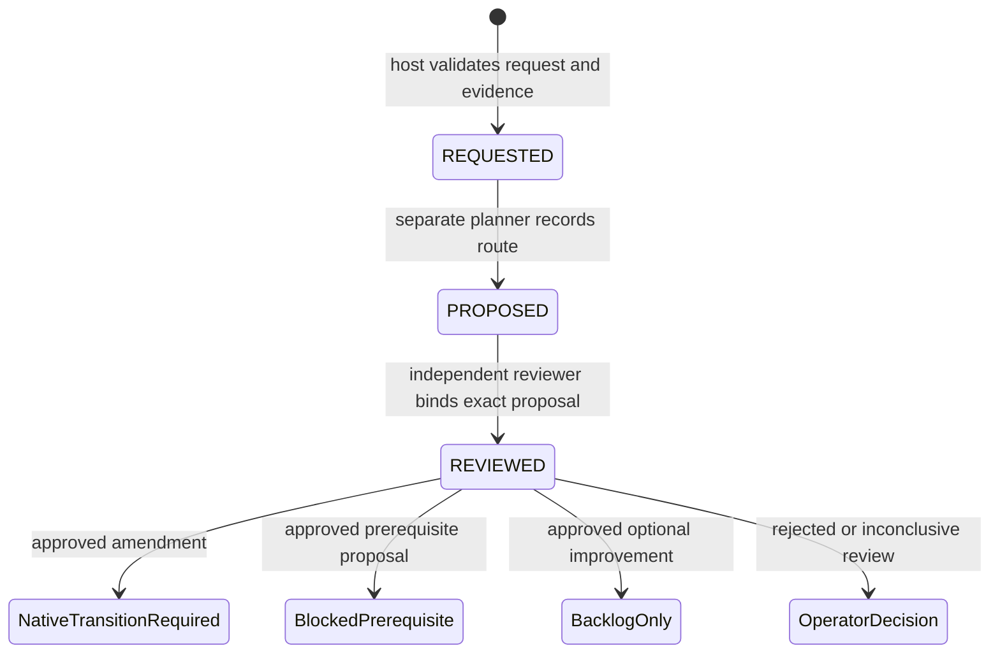

# Developer feedback and scope diagnosis

Issue #39 extends A6a. Its implementation is split into three increments. This
document distinguishes the implemented recording/diagnostic contract from the
future execution authority; a recorded approval never grants model dispatch.

## Implementation status

| Increment | Contract | Status |
| --- | --- | --- |
| F1 | Typed requests, conservative diagnosis, persistent routing/role receipts, ownership and independence metadata | Implemented offline; native inspection commands below |
| F2 | Funded role adapter, delegated native activation, technical fencing, lineage and cumulative amendment limits | Pending; no autonomous activation enabled |
| F3 | Supervisor recovery integration, sanitized idempotent GitHub projections, prerequisite proposals and supported return | Pending; no new DAG node or GitHub ticket starts implicitly |

This does not complete #39 or #38. It does not change a running controller or
authorize migration of the historical #22 run. The current #22 T08 case is a
baseline test change and deliberately requires operator coverage review under
the first proposed policy, even after automatic diagnosis is implemented.

## Decisions from the two issue reviews

The [implementation decisions](https://github.com/brushtyler/ssdlc/issues/39#issuecomment-6807639765)
resolve the Claude/Gemini review comments as follows:

- A failing test outside the manifest is an impact-analysis hint, not proof
  that the test must change. Failed code remains a possible cause.
- Deduplicate by ticket, task, parent plan and normalized requested-file and
  failed-check/test sets. Attempt/capture bindings are occurrence provenance,
  never the sole cause key. Changed evidence cannot reuse an old approval.
- Record role identity, engine, model and context separately. Equal role or
  context identities are refused. Equal engine/model pairs or unknown model
  metadata are disclosed as `reduced_independence`; the proposed initial
  delegation policy escalates them to the operator.
- Protected paths are never delegated. Baseline/checkpoint test changes require
  coverage analysis and initially the operator. Completed production ownership
  requires the native owner revalidation in #38, rather than treating old proof
  as fresh. Missing native recovery support requires explicit escalation.
- A rejected/inconclusive request does not redispatch the identical developer
  attempt. An alternative implementation needs a separately reviewed decision,
  bounded negative context and a normal charged development attempt.
- A local prerequisite is still a DAG change. Until a native transition supports
  it, record a blocking proposal without adding nodes or launching child runs.
- Diagnosis/planning/review are named roles, not new cost kinds. Their calls
  must share the frozen cumulative limits and cannot borrow `03-dev` attempts.
- Check useful remaining attempts and role capacity before consultation. Keep
  ticket/task amendment counts, cumulative file expansion, rounds and absence
  of progress persistent. No attempt or accounting refunds.
- Attribute predictable omissions to the registered historical impact report.
  Missing evidence means `UNKNOWN`; an unmatched report entry is not proof that
  the dependency was unpredictable.

## Native offline diagnosis

```sh
python3 orchestrator.py feedback-diagnose \
  --repo /absolute/target --ticket TICKET --request /private/request.json
python3 orchestrator.py feedback-status --repo /absolute/target --ticket TICKET
```

`feedback-diagnose` inspects a selected stopped native scope-recovery generation.
It validates registered request evidence and returns remaining development
attempts, source bindings, path ownership classes, historical impact hints,
failed-check localization and availability of named feedback role allowances.
It makes zero model calls, changes no candidate, journal, selector or limits,
and grants no execution authority. Existing ticket/scheduler locks serialize
inspection. Unsupported source generations are refused, not migrated.
An interrupted native accounting tail is preserved and refused; a diagnostic
never repairs the journal or treats its complete prefix as fresh authority.

The current locator recognizes complete Python unittest failure blocks whose
module resolves uniquely to a tracked Python file and whose summary matches
the number of failures/errors. Unsupported/truncated/ambiguous output is
`UNRESOLVED`. Mixed failures and protected paths stay distinct. A traceback
path alone is never enough. Candidate output is untrusted even when localized.
Additional check-format adapters need their own tests before activation.

`feedback-status` reads an existing canonical recording ledger. It refuses a
missing authority instead of initializing one. The CLI does not authorize a
policy, dispatch a role, apply a plan or publish to GitHub.

## Recording contract

`FeedbackStore` is a host API in the canonical ticket's `feedback/` directory,
outside disposable candidates and selected execution generations. Its policy
has `capability: record-only-v1`; neither this policy nor an approved recorded
review can later be reinterpreted as delegated execution authority.

The exact operator authorization binds the policy digest and explicit fencing
attestation for initialization. This is **not** the future in-run technical
fencing receipt. Replaying the same initialization is idempotent across intent
and journal publication. A changed policy, missing active journal, corrupt
chain, partial tail or symlink is refused. The snapshot is only a projection.
Hashes assume a protected host; they are not authentication against an owner
who can rewrite both history and authority.

Requests contain only cause enums, obligation IDs, literal requested paths and
registered evidence hashes. Unknown fields/prose are rejected. Obligation IDs
must belong to the task. Native source bindings include the parent selector,
plan, failed attempt, captured candidate, source files and counters. Stale
sources require reconciliation; a new generation needs a native admitted
lineage, not a caller-supplied parent. Exact duplicate submissions do not append
history or consume another allowance.

The recording state machine is:



Routes are `AMENDMENT`, `PREREQUISITE`, `ADVISORY`, `REJECTED` and
`INCONCLUSIVE`. A planner cannot add files beyond the request or delegated path
list, change obligations, or attach authorized files to a non-amendment route.
Only an `IMPROVEMENT` request can become an advisory. A missing-target blocker
cannot be downgraded to optional backlog. Equivalent file/obligation ordering
deduplicates; changed classification or registered evidence requires explicit
reconciliation and cannot silently inherit the previous decision.
Reviews bind the exact proposal and record a coverage assessment; this is a
reviewer's judgment, not a mechanical proof that assertions were preserved.
The native activation/candidate verification gates remain mandatory.

Role intents reserve only recording capacity. They are **not provider dispatch
tokens** and do not replace `LimitsStore` reservations. A restart encountering
an intent must reconcile; it cannot launch another model. Returned structured
responses are retained before interpretation, can be replayed exactly and
remain capturable after deadline. Conflicting responses stop reconciliation.
F2 must bind these receipts to real, funded invocations and validate native
accounting advances before enabling an execution handler.

Public projections contain enum status, opaque request IDs, task IDs, counts and
independence disclosure. They omit paths, raw responses, private logs, source
snapshots and credentials. They are data for a future GH adapter, not authority
or an implemented publication workflow.

## F2/F3 readiness requirements

F2 must introduce an explicit execution-delegation contract, not synthesize
`source_fenced: true` or reuse an unrelated exact operator approval. It must
prove current ownership/quiescence, resolved dispatches, source/candidate
freshness, remaining attempts, funded named roles, unchanged cumulative caps
and a supported compatibility rule. Parent selector, seals, journal prefixes,
captured patches and historical proofs remain bound as in #37. Role accounting
advances must not make unrelated source changes look authorized.

Crash/replay must preserve response receipts and match native invocation IDs;
lost or uncertain outcomes stop before another inference. Ticket/task amendment
and cumulative file counts are reserved before activation and reconciled with
the selected generation, never reset on resume. Baseline-test escalation and
completed-owner revalidation are enforced at actual candidate acceptance, not
only from the requested filename. Stage changes and alternatives need a bounded
progress rule, not unconstrained role ping-pong.

F3 must connect this handler to the persistent supervisor with the same native
scheduler, expose precise reasons/next actions, include decision provenance and
metrics in the Evidence Pack, and publish only sanitized host-owned projections.
Remote uncertainty requires reconciliation before retry; creating a prerequisite
never grants it budget or execution authority. Production activation continues
to depend on the applicable B/I6 containment and delivery controls.
