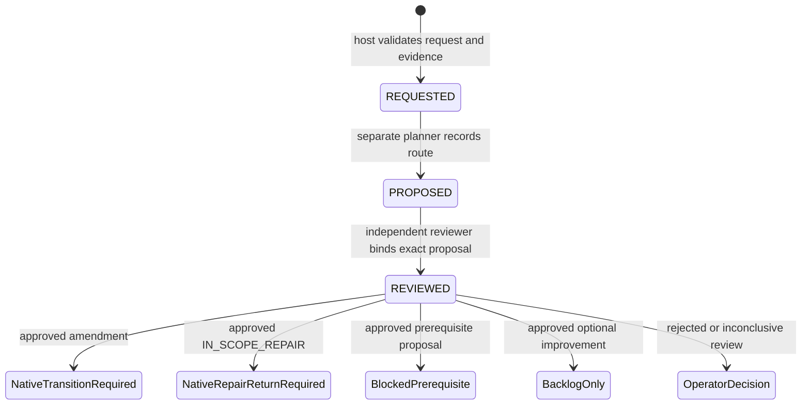

# Developer feedback and scope diagnosis

Issue #39 extends A6a. Its implementation is split into three increments. This
document distinguishes recording/diagnosis from separately granted native
execution authority; a recorded approval never grants model dispatch.

## Implementation status

| Increment | Contract | Status |
| --- | --- | --- |
| F1 | Typed requests, conservative diagnosis, persistent routing/role receipts, ownership and independence metadata | Implemented offline; native inspection commands below |
| F2 | Funded role adapter, delegated native activation, technical fencing, lineage and cumulative amendment limits | Implemented as an opt-in host API, validated offline; F3 wires the bounded production adapter |
| F3 | Supervisor recovery integration, sanitized idempotent GitHub projections, prerequisite proposals/return, consultative PO routing | Implemented opt-in, validated offline; prerequisite execution/return remains an explicit unsupported native transition |

Live rollout/measurement and broader #38 ownership recovery remain separate from offline acceptance. It does not change a running controller or
authorize migration of the historical #22 run. The current #22 T08 case is a
baseline test change and deliberately requires operator coverage review under
the first proposed policy, even after automatic diagnosis is implemented.

## Decisions from the two issue reviews

The [implementation decisions](https://github.com/brushtyler/ssdlc/issues/39#issuecomment-6807639765)
resolve the Claude/Gemini review comments as follows:

- A failing test outside the manifest is an impact-analysis hint, not proof
  that the test must change. Failed code remains a possible cause.
- Deduplicate by ticket, task, parent plan and normalized requested-file and
  failed-check/test sets. Attempt/capture bindings are occurrence provenance,
  never the sole cause key. Changed evidence cannot reuse an old approval.
- Record role identity, engine, model and context separately. Equal role or
  context identities are refused. Equal engine/model pairs or unknown model
  metadata are disclosed as `reduced_independence`; the proposed initial
  delegation policy escalates them to the operator.
- Protected paths are never delegated. Baseline/checkpoint test changes require
  coverage analysis and initially the operator. Completed production ownership
  requires the native owner revalidation in #38, rather than treating old proof
  as fresh. Missing native recovery support requires explicit escalation.
- A rejected/inconclusive request does not redispatch the identical developer
  attempt. An alternative implementation needs a separately reviewed decision,
  bounded negative context and a normal charged development attempt.
- A local prerequisite is still a DAG change. Until a native transition supports
  it, record a blocking proposal without adding nodes or launching child runs.
- Diagnosis/planning/review are named roles, not new cost kinds. Their calls
  must share the frozen cumulative limits and cannot borrow `03-dev` attempts.
- Check useful remaining attempts and role capacity before consultation. Keep
  ticket/task amendment counts, cumulative file expansion, rounds and absence
  of progress persistent. No attempt or accounting refunds.
- Attribute predictable omissions to the registered historical impact report.
  Missing evidence means `UNKNOWN`; an unmatched report entry is not proof that
  the dependency was unpredictable.

## Native offline diagnosis

```sh
python3 orchestrator.py feedback-diagnose \
  --repo /absolute/target --ticket TICKET --request /private/request.json
python3 orchestrator.py feedback-status --repo /absolute/target --ticket TICKET
```

`feedback-diagnose` inspects a selected stopped native scope-recovery generation.
It validates registered request evidence and returns remaining development
attempts, source bindings, path ownership classes, historical impact hints,
failed-check localization and availability of named feedback role allowances.
It makes zero model calls, changes no candidate, journal, selector or limits,
and grants no execution authority. Existing ticket/scheduler locks serialize
inspection. Unsupported source generations are refused, not migrated.
An interrupted native accounting tail is preserved and refused; a diagnostic
never repairs the journal or treats its complete prefix as fresh authority.

The current locator recognizes complete Python unittest failure blocks whose
module resolves uniquely to a tracked Python file and whose summary matches
the number of failures/errors. Unsupported/truncated/ambiguous output is
`UNRESOLVED`. Mixed failures and protected paths stay distinct. A traceback
path alone is never enough. Candidate output is untrusted even when localized.
Additional check-format adapters need their own tests before activation.

`feedback-status` reads an existing canonical recording ledger. It refuses a
missing authority instead of initializing one. The CLI does not authorize a
policy, dispatch a role, apply a plan or publish to GitHub.

## Recording contract

`FeedbackStore` is a host API in the canonical ticket's `feedback/` directory,
outside disposable candidates and selected execution generations. Its policy
has `capability: record-only-v1`; neither this policy nor an approved recorded
review can later be reinterpreted as delegated execution authority.

The F1 operator authorization binds the policy digest and explicit fencing
attestation for initialization. F3 additionally supports a distinct
`native-feedback-recording-v1` bootstrap from the frozen workflow grant and
live host fencing; it never manufactures that operator attestation. This is **not** the future in-run technical
fencing receipt. Replaying the same initialization is idempotent across intent
and journal publication. A changed policy, missing active journal, corrupt
chain, partial tail or symlink is refused. The snapshot is only a projection.
Hashes assume a protected host; they are not authentication against an owner
who can rewrite both history and authority.

Requests contain only cause enums, obligation IDs, literal requested paths and
registered evidence hashes. Unknown fields/prose are rejected. Obligation IDs
must belong to the task. Native source bindings include the parent selector,
plan, task-state digest, failed attempt, captured candidate, source files and counters. Stale
sources require reconciliation; a new generation needs a native admitted
lineage, not a caller-supplied parent. Exact duplicate submissions do not append
history or consume another allowance.

The early-F2 corrections from the
[F1 review](https://github.com/brushtyler/ssdlc/issues/39#issuecomment-6808458501)
enforce these additional recording invariants:

- The host derives requested-file classes and failed-test identities from the
  bound Git/journal/check evidence. Caller-provided test sets or impact
  attribution must match that evidence. The proposal binds the class digest;
  `coverage_preserved: true` never overrides the file policy.
- Baseline/completed tests route amendments to `OPERATOR_DECISION`.
  Completed production ownership yields `OWNER_REVALIDATION_REQUIRED`, not
  permission to proceed using old evidence. Unknown/legacy class metadata
  cannot grant a native amendment disposition.
- Approved eligible amendments reserve provisional quota in the canonical
  journal. Ticket and task ceilings and cumulative manifest-file additions are
  checked before `NATIVE_AMENDMENT_REQUIRED`. Replaying a review reserves no
  second slot. A file granted to another task counts as another expansion;
  reservation is not execution, and no automatic quota refund occurs. F2's
  native activation must reconcile the final outcome.
- Strong independence applies to diagnosis and planner as well as reviewer.
  The final assessment includes every role associated with the request, with
  exact duplicate metadata for the same role coalesced. Shared model/context
  or unknown model metadata cannot be hidden by a fresh reviewer alone.
- A captured `CHECK_FAILURE` whose verified checks localize entirely outside
  the manifest can create a `HOST_HINT`. This is an observation, not a claim
  that the failed test must change. Host and developer origins have distinct
  request IDs and can share a cause ID. A later source occurrence is recorded
  without inheriting the old approval and requires native source reconciliation
  before consultation; the recording policy itself cannot admit it to execution.
- `REQUIREMENT_CONFLICT` always needs the operator under the first policy and
  cannot become an amendment/advisory. Consultative PO routing is assigned to
  F3 with its own explicit allowance; it may recommend a product change but
  cannot approve changed requirements or start that work.

The existing manual scope transition continues to require an explicit captured
`SCOPE_REQUIRED`. Its read-only inspector accepts host hints only through an
explicit flag used by feedback diagnosis. Preparation/activation are not
silently extended by that flag. The normal scheduler preserves `CHECK_FAILURE`
and adds a bounded, non-authorizing scope hint to repair context; automatic
interception before a later developer dispatch remains F3. File localization
does not by itself suspend ordinary code repair or turn test paths into edit
permissions.

The recording state machine is:



Routes are `AMENDMENT`, `IN_SCOPE_REPAIR`, `PREREQUISITE`, `ADVISORY`, `REJECTED` and
`INCONCLUSIVE`. A planner cannot add files beyond the request or delegated path
list, change obligations, or attach authorized files to a non-amendment route.
Only an `IMPROVEMENT` request can become an advisory. A missing-target blocker
cannot be downgraded to optional backlog. Equivalent file/obligation ordering
deduplicates; changed classification or registered evidence requires explicit
reconciliation and cannot silently inherit the previous decision.
Reviews bind the exact proposal and record a coverage assessment; this is a
reviewer's judgment, not a mechanical proof that assertions were preserved.
The native activation/candidate verification gates remain mandatory.

### In-scope repair after a scope question

An outside failing test can reveal a regression in the current task's own
implementation. The planner may return this exact typed alternative:

```json
{
  "route": "IN_SCOPE_REPAIR",
  "requested_files": [],
  "repair_files": ["existing-task-target.py"],
  "reason_code": "fix_owned_code"
}
```

The host requires a captured `CHECK_FAILURE`, a nonempty literal subset of the
current task targets, no protected paths, and a strongly independent funded
review approving the exact proposal with preserved coverage. A failure alone
does not authorize changing its test. `REJECTED` remains terminal; neither
review prose nor an approved rejection is interpreted as permission to retry.

`feedback-in-scope-return-v1` uses the native preparation/selector protocol. It
preserves the plan, scope, requirements, checks, global profile, deadline,
historical captures and invocation facts. It records a reconciliation bound to
the exact failed candidate. No amendment/file allowance is spent; a subsequent
developer call consumes its ordinary next attempt and invocation. Exhausted
limits still stop. One failure cannot acquire multiple repair returns, and a
changed repeated cause still requires explicit reconciliation.

The selector is insufficient by itself: dispatch remains fenced until the
canonical feedback journal contains its matching return receipt. Cold resume
can reconcile a sealed delegated return without repeating either model. The
supervisor can observe its verified parent while this is pending. Historical
decisions and the original recording authority remain intact; receipts admit
the exact descendant under the same cumulative grant.

### Explicit recovery of an already rejected decision

An existing native F3 `REJECTED` decision is never rewritten to `IN_SCOPE_REPAIR`. After
operator review, `feedback-operator-repair-return-v1` can stage a distinct
unchanged-scope return. It binds the current stopped source, prior decision and
feedback head, exact repair files, controller/environment and preserved native
accounting. It permits an explicitly approved controller revision, while
refusing profile/grant changes or a different verification environment.

```bash
python3 orchestrator.py feedback-repair-prepare \
  --repo /path/to/project --ticket TICKET \
  --request-id REQUEST_SHA256 \
  --repair-files /private/repair-files.json \
  --reason 'Repair the existing implementation; preserve baseline tests'
```

`repair-files.json` is a JSON list containing only existing task targets. The
operator authorization has exactly `schema_version`, `transition_id`,
`proposal_sha256`, `old_controller_sha256`, `new_controller_sha256`,
`repair_return_sha256`, `authorized: true`, and `source_fenced: true`. These are
the operator's actual attestations for the concrete proposal; preparation does
not synthesize them or dispatch providers.

```bash
python3 orchestrator.py feedback-repair-activate \
  --repo /path/to/project --ticket TICKET \
  --preparation /canonical/ticket/execution/prepared-ID \
  --authorization /private/authorization.json
```

Activation adds a return receipt and descendant binding without refunding
calls or resetting attempts, including when recovering a crash after selector
publication. Only the ordinary bounded task engine executes the next attempt.
Public projections/metrics distinguish return receipts from amendments and
count operator return receipts separately; these counts are not measured human
intervention durations.

Role intents reserve only recording capacity. They are **not provider dispatch
tokens** and do not replace `LimitsStore` reservations. A restart encountering
an intent must reconcile; it cannot launch another model. Returned structured
responses are retained before interpretation, can be replayed exactly and
remain capturable after deadline. Conflicting responses stop reconciliation.
The F2 host API binds these receipts to native funded reservations and validates
the exact accounting advance before delegated activation. Offline tests inject
role responses; a production provider adapter belongs to F3.

For native sources the ledger retains an accounting anchor. A fresh source after
consultation can match the original request only when the captured native role
returns prove the exact accounting advance. The original binding and model
answer are not rewritten. A restart can finish recording the same reviewed
proposal against fresh counters using those receipts; a new candidate or an
unrelated invocation still requires explicit reconciliation.

Public projections contain enum status, opaque request IDs, task IDs, counts and
independence disclosure. They omit paths, raw responses, private logs, source
snapshots and credentials. They are data for a future GH adapter, not authority
or an implemented publication workflow.

## F2/F3 readiness requirements

The F2 support modules implement counted consultations through `LimitsStore`,
with explicit named `feedback-*` role caps and the `feedback` phase. They require
a host guard and an injected read-only runner; the F2 primitive has no default SDK runner. F3 supplies the explicit
read-only CLI adapter described below. A recording grant does not fund them. I2 admission includes the
feedback phase only when that phase and named feedback roles are explicitly
present in the exact authorized profile. Existing profiles remain unchanged. Consultations and response reconciliation
resolve the selected native generation before touching accounting; adapters
bound to an older generation or a pending transition cannot spend or mutate
its historical ledger.

`FundedFeedbackRoles` persists a recording intent, native reservation and binding
before invoking the supplied runner. It captures the structured response before
final native reconciliation. A captured response can finish the same reservation
after interruption without inference; a lost/uncertain result cannot. Unknown
costs remain null. Calls cannot consume/refund development attempts or replace
the frozen limits authority.

`ssdlc_feedback_bindings.py` separates a technical review subject from exactly
the recorded consultation accounting advance. Only the native limits journal
and snapshot may advance. Their prior journal prefix, all existing invocation
rows, deadline, policy and other counters remain identical; each added invocation
must match one captured funded response. A changed technical input, unrelated
call or altered historical cost is refused. The delegated activation contract binds this relation and both raw funded
decisions; an accounting advance alone is never activation authority.

Native locks remain nonreentrant. `LockLease` records a live process/thread-owned
file descriptor, and scope prepare/activate can explicitly borrow that exact
registered lease. Released, fabricated, other-thread and replaced-file leases
are refused. Borrowing additionally checks the actual exclusive Linux FLOCK in
`/proc/self/fdinfo`; an open descriptor whose lock was released or downgraded is
not ownership. Ordinary ticket locking retains its existing POSIX behavior.
Borrowing does not attest complete writer fencing and does not
replace the existing exact operator authorization. The separate delegated contract below additionally observes quiescence and
refuses unresolved dispatches.

## Explicit native delegation (F2 host API)

`ssdlc_feedback_delegation.py` reuses native scope preparation/activation and the
existing scheduler. It does not implement another development engine, a CLI
that implicitly grants delegation, or an automatic supervisor handler.
A frozen `recovery-limits` profile may explicitly contain:

```json
"feedback_delegation": {
  "schema_version": 1,
  "capability": "feedback-scope-delegation-v1",
  "allowed_files": ["src/helper.py"],
  "max_amendments": 2,
  "max_amendments_per_task": 1,
  "max_added_files": 2,
  "require_strong_independence": true
}
```

The profile must separately fund the `feedback` phase and the named
`feedback-planner` and `feedback-reviewer` roles within its existing total caps.
Without the explicit grant, funded recording/review still cannot execute an
amendment. Adding or changing the grant requires the normal exact native profile
admission; existing authorizations are unchanged. The recording policy remains
separate and grants recording only. Initial I1-to-I2 admission accepts the
explicit grant; upgrading an existing I2 profile is outside the scope-only API
and uses the separate exact operator profile admission described below. The recording ledger
currently uses its separate exact F1 operator initialization, or the separate F3 native bootstrap contract which
derives recording limits from the explicitly admitted run grant. Delegation never manufactures a human
`source_fenced` attestation or reinterprets a historical approval.

The host opens `fenced(...)` with the current frozen controller snapshot and
verification runtime, borrowing or acquiring the real canonical ticket and
source scheduler locks. Every guard checks process/thread ownership and kernel
exclusive flock, unchanged controller and Docker image/environment, and absence
of running Docker writers with overlapping writable mounts. Native inspection
requires all invocations resolved, a stopped captured failure, clean checkpoint,
registered evidence, valid completed receipts and exact task/plan bindings.
Controller/environment migration is deliberately outside this contract.
These are observations at guard boundaries under the existing trusted-host
model, not authentication or continuous containment against a hostile host.

`prepare(session, repo, plan, request_id)` requires an eligible independent
recorded approval, the exact captured funded planner and reviewer responses,
unchanged technical inputs, and an exact allowed accounting advance. Only target
additions to the failed task are supported; checks, obligations, DAG, order and
all other task manifests are unchanged. Only new files or unowned production paths can
proceed. Baseline/completed tests and completed ownership retain their operator
or #38 dispositions. Existing candidate confinement and verification remain
mandatory. Eligible requests exceeding delegation paths/quotas are refused
before another funded consultation.

The staged proof binds the frozen native grant, recording authority/state,
original proposal/review, technical subject, captured role accounting and host
fencing observations. Raw model decisions are not rewritten to accommodate
their own costs. Activation reobserves live ownership/quiescence, validates the
same source and prepared runtime, and atomically selects a native generation.
The semantic proof and distinct authorization contract are validated on replay;
no generic JSON flag grants dispatch authority.

A selected generation remains fenced at native runtime resolution until the
canonical ledger durably marks its reserved quota `APPLIED` and admits that
exact descendant. A crash after selector publication can finish reconciliation
without a second amendment or provider call, including after expiry; subsequent
execution still obeys the original deadline. Replays use `fenced(...,
preparation=...)` to own the original source locks and the sealed preparation.
Unchanged responses and allowances survive; modified or uncertain state needs
reconciliation rather than inference. Unselected failed preparations use the
existing native discard protocol, retaining their history and reserved quota.

A later failed task source can use the recording policy only through a natively
published, reconciled descendant with the exact admitted profile/envelope and
projection. Ticket/task amendment counts, file additions, role receipts and
request ceilings stay canonical across generations; no automatic refunds or
counter resets occur. Returned costs remain observed usage or null. An accepted
amendment consumes no developer attempt; a subsequent implementation consumes
the next normal native attempt and verification gates.

Offline acceptance covers funded activation and repair; six publication/quota
crash boundaries; lost prepare response; two native descendant generations;
missing execution grant or funded proof; controller/environment and writer/lock
guards; prepared candidate and historical-cost/response mutation. External
controller/Docker observations and model responses are simulated in contract
tests; journals, Git worktrees, locks, selectors and native scheduler are real.
The genuine-production-defect fixture separately proves rejection without
weakening the independent test or redispatching an identical developer attempt.

## Automatic feedback workflow (F3)

A profile enables automation only with `feedback_workflow` in addition to the
F2 delegation grant. The role models and optional GitHub destination are frozen
inputs, not an environment switch. The following is a fragment to include in an
explicitly admitted recovery profile (replace model placeholders with the
intended configured models):

```json
"feedback_workflow": {
  "schema_version": 1,
  "enabled": true,
  "roles": {
    "planner": {"engine": "claude", "model": "configured-planner-model", "effort": "medium"},
    "reviewer": {"engine": "agy", "model": "configured-reviewer-model", "effort": "medium"}
  },
  "github": {"repo": "owner/repository", "issue": 39}
}
```

`github` is optional; absence authorizes no publication. Planner/reviewer role
caps and the feedback phase cap must be explicit within the existing totals.
Automatic diagnosis uses deterministic host evidence; a paid diagnosis is not
an implicit workflow call. The F2 primitive still supports an explicitly funded
diagnosis consultation. An optional `po` role additionally requires `feedback-po`; it can recommend only
`OPERATOR_REQUIRED`, never approve a new requirement. Unknown/reduced role
independence still stops before an unusable consultation. Native preflight
includes engines from this frozen workflow, using the existing bounded
credential probes; credential presence is not proof of an authenticated session.

The normal task scheduler now intercepts captured `CHECK_FAILURE` whose verified
logs localize entirely outside the manifest before another developer dispatch
or repeated preflight. It retains `CHECK_FAILURE` as evidence, not as permission
to edit the test. Mixed, protected and unresolved hints retain their previous
handling. Explicit developer refusals include a bounded typed line:

```text
TASK_FEEDBACK_JSON: {"cause":"MISSING_TARGET","obligation_refs":["AC-1"],"requested_files":["src/helper.py"]}
TASK_DEV_STATUS: SCOPE_REQUIRED
```

Models cannot supply evidence hashes, actor identity, scope authority, GitHub
credentials or native counters. The host derives those from the stopped native
source. Duplicate/unknown fields, path aliases and ambiguous markers are refused.
For legacy refusals without the typed line, only a fully localized host hint can
supply a conservative request; other sources stop for explicit reconciliation.
A failed test outside scope remains a hypothesis, never proof its assertion is
wrong. A rejection is replayable without another developer or reviewer call.

On an enabled run the controller:

1. Stops the source, proves native ownership/quiescence and initializes the
   canonical recording ledger from the exact native grant. The recording grant
   remains record-only; it does not replace funding or activation authority.
2. Consults independent frozen roles through `FundedFeedbackRoles`. A one-use
   process-local prepaid token binds the existing reservation to the CLI
   dispatcher. Supervisor dispatch events remain active; there is no second
   reservation or second accounting finish hidden in a nested SDK call.
3. Runs each consultation in a fresh disposable Git clone mounted read-only.
   Full registered requirements, plan, checks and candidate diffs are available
   in a bounded read-only evidence bundle. Inline excerpts are marked truncated.
   No host GH token/configuration, toolkit private runtime/Git database, global
   Claude configuration or another role's conversation history is mounted.
   Only the selected provider's subscription credential is supplied, with fresh
   CLI context. Container/source mutation or context overflow stops recovery.
4. Preserves structured responses, observed usage and bounded raw output before
   semantic interpretation. Invalid JSON/nonzero CLI results become captured
   protocol failures with the known cost retained, not another inference.
   Raw excerpts include full-output hash and a truncation flag. Unknown usage
   remains null. Captured returns can reconcile after a crash/deadline without
   repeating the call; uncertain/lost returns and partial journals refuse retry.
5. Applies only a supported F2 amendment. After activation it rebinds all
   orchestrator paths, state and frozen accounting to the admitted generation
   before restarting the same native task engine. The old source is not rewritten
   by exception/evidence handlers after an interrupted selector change.

The supervisor follows only sealed, reconciled feedback descendants of its
pinned runtime; this does not waive controller/configuration/goal fingerprints.
During preparation or selector-to-quota reconciliation, observation can read
the verified parent without granting dispatch. Explicit supervisor resume and
foreground run can finish an already granted sealed F3 preparation under real
fencing before launch; no provider is called by this reconciliation. No general
retry or worker/controller launch allowance is reset by an amendment.

## Existing I2 profile admission

`ssdlc_feedback_admission.py` adds a separate operator-only
`feedback-profile-admission-v1` transition, reusing native staging and selectors.
It may add/change only feedback grant/workflow configuration and named feedback
role/phase allocations. Global cost/time/invocation limits, timeout, transport
policy, unknown-usage reserves, development attempts and existing role/phase
allocations remain exact. It cannot reconcile the existing scope refusal,
modify a plan, authorize a developer retry or replace an existing feedback ledger.
Controller changes remain explicit in the operator-bound proposal; verification
environment changes are refused. A new ledger reconciliation is required for
incompatible pre-existing recording authority.

```sh
python3 orchestrator.py feedback-profile-prepare \
  --repo /absolute/target --ticket TICKET \
  --profile /private/profile.json --reason 'Enable bounded feedback'
python3 orchestrator.py feedback-profile-activate \
  --repo /absolute/target --ticket TICKET \
  --preparation /private/canonical-preparation \
  --authorization /private/exact-authorization.json
```

Preparation dispatches nothing and returns the exact proposal digest. The
operator authorization binds `transition_id`, `proposal_sha256`,
`old_controller_sha256`, `new_controller_sha256`, `profile_sha256`,
`schema_version: 1`, `authorized: true` and `source_fenced: true`.
The last field is the operator's real offline attestation, not something the
feedback loop invents. Crash/replay preserves all original history and counters.

Historical #22 is untouched. Adoption requires the latest merged controller,
inspection of its actual source and remaining caps, native discard/archive of
any older unselected preparation, and a concrete profile proposal approved by
the operator. Existing authorizations never acquire this grant implicitly.
Baseline T08 still requires the operator under the first coverage policy.

## GitHub projections and prerequisite boundaries

The optional frozen GH destination permits only host-generated comments through
`gh api`. Models never invoke GitHub. `ssdlc_feedback_delivery.py` publishes an
allowlist of enum statuses, counts and opaque request IDs; no task names, paths,
AI text/reasons, private prompts, raw usage or credentials are copied. The
canonical recording ledger remains authority; comments cannot schedule work.

Comment history is read in explicit pages of 100, without requiring the newer
`gh api --slurp` flag. Observation stops with a refusal after 100 full pages;
an incomplete history never permits a POST. The adapter is compatible with the
installed gh 2.46 client as well as newer clients.

A separate host outbox durably records a publication intent and dispatch
reservation before POST. Reconciliation accepts only the exact body authored by
the recorded authenticated account. A lost acknowledgment can find that own
comment without another POST. Absence after the dispatch boundary, duplicates,
foreign markers or changed remote evidence require reconciliation. An earlier
uncertain operation blocks newer publications too. A known unlaunched intent
may be superseded. Partial outbox journals are preserved/refused. Publication
failure is reported and retained for delivery reconciliation, not converted into
new development authority. Publishing is optional and cannot add model budget.

A reviewed `PREREQUISITE` becomes a canonical blocking proposal with an opaque
host-generated child identity. Proposed dependency/wait edges are checked for
cycles. No child run, GH issue or local DAG task is implicitly created. Returning
from a proposed child is bound to that proposal and explicitly returns
`NATIVE_DAG_TRANSITION_REQUIRED`: the current task engine has no supported
DAG insertion/return transition. An external 'done' claim never marks the parent
complete. These unsupported cases go through the operator/intake contract.
`ADVISORY` remains optional backlog; it cannot replace a required blocker or
pretend that a refused developer completed its existing obligations.

## Evidence and rollout

`compile_evidence_pack` registers `feedback-summary.json`, with classifications,
decisions/coverage judgments, hashed provenance and plan subjects, amendment
counts, host timing/observed waits, impact-report attribution, consultation usage
and publication status. Raw role responses remain in the canonical private
ledger. Older timestamps/costs stay null when not observed. Reported required
operator decisions are not claimed as actual human interventions. Amendment
approval alone grants no signoff; the normal review/QA/security gates remain.

Offline acceptance uses real journals, Git worktrees, kernel locks and native
scheduler/selector transitions, with simulated providers and external host
observations. No paid calls or automatic #22 migration are part of this work.
Live rollout is opt-in after review: compare intervention/wait counts and latency
against the three historical manual amendments, while checking coverage and
end-to-end completion. Offline semantic fakes do not prove model quality or
live authentication. Production use retains the applicable B/I6 containment and
delivery requirements; broader owner revalidation stays #38.
